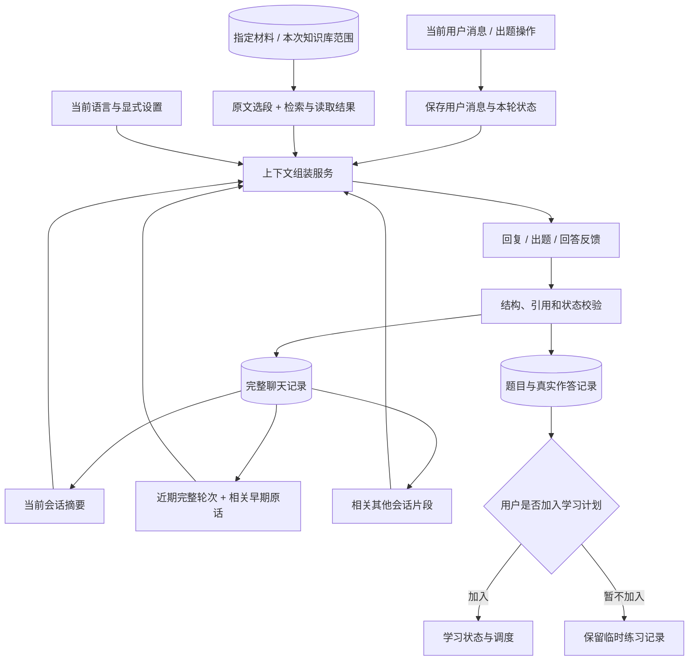

# 会话记忆与上下文组装技术方案

原设计日期：2026-10-02；最新实现核对：2026-10-10。第 0 节为当前已实现状态；后续章节为长期设计，未在第 0 节列出的能力不能视为已经实现。

## 0. 第一阶段已实现与后续边界

### 0.1 最新扩展：跨会话记忆与聊天管理

已实现按需 `search_conversations` / `read_conversation`，全部合格本地历史自动有资格，归档不排除、无年龄截止。英文/数字词与中文双字匹配结合本地 E5，按名次融合；只有真正搜索才加载 embedding，零调用不补历史或文档检索。最终回答共享检索背景，独立 MemoryReference 校验消息、版本、说话者与真正发送的字符范围，不提升文档依据。归档/恢复、标题筛选、删除已提供界面。

删除清理本聊天原话、摘要、向量和快照；依赖关系沿聊天传播，相关派生助手回复保留为可查看记录但不再用于记忆，并撤销相关摘要/自动标题。当前聊天来源版本、在途工具/结构化兼容请求和短事务发布共同拒绝迟到结果。其他聊天原始用户记录和学习/FSRS 不删除。初版传播较保守；检索全历史扫描与语义阈值为应用策略，尚未校准。

第二、三批已实现集合移动及保内容删除、正文替换/版本撤销、过期清单状态、讨论临时题与主动加入。讨论引用和文档依据分开；删除聊天在跨数据库短事务中撤销练习来源及在途任务，保留真实学习记录但不再送入模型。详细见 [资料与聊天出题](library-and-chat-practice.md)。历史编辑/纠正关系、全局画像、后台摘要、批量多题审核和物理文件清除仍未实现。

详细数据流、数据结构、预算和代码阅读见 [跨会话实际实现](conversation-memory-phase2.md)。下列第一阶段段落及第 8–13 节描述设计来源；具体是否完成以本节与实际实现说明为准。

### 0.2 保留的第一阶段基础

已实现持久聊天列表、新建、切换、重命名、分页读取完整原话、刷新/重启恢复，以及失败重试和同会话并发保护。数据库为 `.data/conversations.sqlite3`，包含 conversations、turns、messages、summaries。未删除聊天的完整原话与用户可见结构化回答保留在存档中，摘要不会覆盖它们；没有保存隐藏思维链。最新删除行为见 0.1。

`ContextBundle` 在 Agent 工具决策与最终回答之间传递，包含同一份近期原话/摘要/早期原话补回、当前语言和本轮资料版本/选段。最终阶段另接收实际工具原文。历史作为数据传递，不能扩大资料权限；严格模式仍用 SourceOnlyAnswer 和实际发送范围校验。没有重新加入每轮固定 RAG，只有实际搜索加载 embedding。

短聊天保留所有已完成原话；长聊天按实际预算压力增量摘要，至少保留两个近期完整轮次，摘要带事项类型、证据消息 ID、覆盖到的轮次 seq、版本与前缀指纹。发布检查旧摘要版本及原话指纹。摘要模型请求按完整轮次分批，网络期间不持有数据库写锁；失败保留有效旧摘要和所有原话。当前摘要在下一次提交的上下文准备阶段同步生成，没有后台队列。原话补回使用当前问题和最新用户主题的英文/数字词与中文双字重合度，相关性优先、时间只打破同分；仅限当前会话，尚未做跨会话检索或语义历史索引。

生成预算覆盖系统任务、历史、当前问题、偏好、目录、焦点、工具定义/调用/结果、SDK 实际展开的原生 Schema 和兼容结果工具，以及协议开销。配置容量优先；无配置时使用明确标记的应用保守上限。采用 UTF-8 字节保守估计和安全余量，不使用 embedding tokenizer、不声称精确计数或已探明服务容量。实际每次生成都复查；补充资料按完整原文行裁剪，同时缩小引用权限。详见 [第一阶段实现](conversation-memory-phase1.md) 和 [生成预算](document-rag-and-token-budget.md)。

第一阶段当时未包含聊天出题，现已按 0.1 实现讨论题及来源关联。当前尚未实现原话编辑、摘要更正界面、后台摘要调度及全局用户画像。跨会话召回/引用与归档删除见 0.1。学习计划、FSRS 和评分/档位修订由学习闭环实现；聊天疑问不会创建复习事件。

## 1. 目标与已经确认的决定

系统要围绕用户正在进行的学习对话回复和出题，能够接续当前聊天，并在相关时联系其他聊天中的问题、解释和作答。用户无需重新粘贴整段聊天，也无需每次指定从哪一句话开始考虑。

本方案将“完整记录”“供模型使用的上下文”“学习状态”分别管理。

- 完整聊天记录持久保存，作为恢复、检索与核对的原始记录。
- 当前会话默认整体参与上下文组织；较长时使用摘要、近期原话与相关早期原话共同表示。
- **跨会话默认自动检索全部可用的本地历史会话**，此项已由用户确认。每次只载入相关片段，不发送全部其他聊天。
- **历史召回以相关性为主、时间为辅**，用户已确认。不设置按年龄自动遗忘或固定期限淘汰；过期目标与已被替代判断通过内容和更正关系降低影响。
- **归档继续参与记忆，只从日常列表收起；删除后不再引用**，用户已确认。归档不降低召回资格或相关性排序，删除撤销原话及其派生记忆的使用资格。
- 用户指定的材料与本次选中的知识库范围参与取证；聊天历史不会自动扩大文档访问范围。
- 聊天与出题共用上下文组装服务，避免两套不同的记忆行为。
- 临时出题与加入学习计划是两个独立动作；只有用户选择加入，才建立后续复习安排。
- 评分、教学反馈和可选追问合并在同一次成功的模型生成中。评分依据展示给用户，后续支持当场更正。
- 回答语言来自已有中文/英语选项，作为当前偏好传递，系统和任务提示词不固定语言。
- 提示词表达任务意图；字段与格式通过接口 Schema 定义；状态、范围与数量约束由代码校验。

待确认的产品选项集中在第 18 节。本文中的数量、预算与实现顺序是初始建议，需要通过实际样例调整。

## 2. 当前代码与本方案的差距

以下表格保留原方案的模块差距，当前已完成部分以第 0 节为准。

| 当前模块 | 已有能力 | 本方案需要补齐的部分 |
| --- | --- | --- |
| `web_app.py`、`web/` | 资料阅读、选段问答、练习页面 | 聊天会话列表、连续消息、恢复与记忆设置 |
| `agent_loop.py` | 一次问题中的工具决策与上下文积累 | 跨用户轮次传递会话上下文 |
| `model_client.py` | 来源与问题组成的结构化问答 | 在最终生成阶段保留对话记忆 |
| `practice_service.py` | 从选段和有限检索材料出题，恢复已保存的练习 | 从聊天反馈生成问题，与聊天会话建立关联 |
| `practice_store.py` | 保存题目、评分要点、真实作答与材料快照 | 聊天事件关联及后续的评分修订记录 |
| `response_preferences.py` | 统一传递语言偏好 | 将明确偏好与历史讨论分开处理 |
| `structured_output.py` | 原生结构化输出与兼容工具结果通道 | 复用于摘要及带记忆引用的输出契约 |

原设计时网页没有持久聊天；第一阶段已补齐独立会话存储与共享上下文。`AgentRun.steps` 仍表示单轮实际步骤；`practice_sessions` 仍表示独立练习状态，不冒充会话记忆。

## 3. 总体数据流



与最初的流程相比，明确增加“近期完整轮次”。刚刚讨论的代码、公式、对照例子和“这个是什么意思”之类指代，需要原话接续；仅有摘要与相似检索容易遗漏即时语境。

“默认考虑整段对话”意味着整个当前会话都是可利用的记录范围。上下文足够时直接使用完整当前聊天；超过预算时采用上述组合，仍可检索早期原话。这种表示有信息损失，不能承诺每个历史细节都被模型同时准确记住。

## 4. 三类数据的职责

### 4.1 完整聊天记录：可核对的原始记录

保存用户实际输入、用户可见的 AI 回复及它们的先后关系；同时保存题目、答案、评分结果的关联和必要的运行元数据。摘要不会替换或删除这些消息。

“完整”指本产品可见的对话与结果记录，不指模型隐藏思考过程。内部凭据、认证请求头和密钥不进入聊天存档。保存必要的工具事件和原文版本引用，可另有调试信息，但不要求将每个巨大工具返回值重复写成聊天正文。

原始记录让系统能够恢复聊天、找回原话、重建索引、重新生成摘要，以及说明历史记忆来自哪里。

### 4.2 上下文视图：针对本轮问题组织的输入

每轮生成重新组装，包含摘要、近期聊天、命中的历史片段和本次材料。它有容量上限；其中的历史片段可能每轮不同。

存档范围可以很大，输入范围需要控制。缩小输入影响的是本轮可见内容，不改变保存下来的完整聊天。

### 4.3 学习状态：从真实作答形成的业务记录

题目、作答、评分修订、是否加入计划、复习记录单独保存。会话摘要中的“用户对 ACK 还有疑问”是学习线索，不能直接等同于掌握率或一次失败的复习。

`ConversationMemory` 回答“之前讨论过什么”；`LearnerState` 回答“哪些作答支持当前学习状态”。调度只使用已加入计划的学习项目及有效作答，不因一次聊天疑问自动创建复习任务。

## 5. 数据模型建议

先沿用本地 SQLite。建议新增 `.data/conversations.sqlite3`，已有 `.data/practice.sqlite3` 和 `.data/embeddings.sqlite3` 继续各负其责。数据库名称和表结构属于待实施方案。

### 5.1 `Conversation`：一个聊天窗口

| 字段 | 含义 |
| --- | --- |
| `id` | 稳定会话 ID，刷新或重启后不变 |
| `title` | 用户可修改的标题，不能只靠标题检索历史 |
| `created_at / updated_at` | UTC 时间，界面按本地时区显示 |
| `lifecycle` | `active / archived / deleting / deleted`；活跃与归档均可检索，删除中与已删除均不可用于模型上下文 |
| `history_revision` | 消息编辑、撤回或删除造成的历史版本变化 |
| `deleted_at` | 删除时间；删除标记仅保留必要 ID 与失效信息，不保留聊天正文作为记忆 |
| `next_seq` | 为消息分配本会话内递增的顺序号 |

默认所有未删除的本地会话参与检索，符合已确认的“自动考虑其他会话”。初版按归档/删除分工，不增加归档时自动退出记忆的行为。当前版本面向单用户；未来多用户时增加所有者字段，先按身份隔离再检索，不能只依赖相似度排除他人聊天。

### 5.2 `ConversationTurn` 与 `Message`

一个轮次从真实用户输入开始，包含本次生成的用户可见结果，以及有关联的练习动作；不把每个工具事件都算一次用户轮次。

| 对象 | 核心字段 | 用途 |
| --- | --- | --- |
| `ConversationTurn` | `id, conversation_id, request_id, status, started_at, completed_at` | 记录一次提交与生成的生命周期 |
| `Message` | `id, conversation_id, turn_id, seq, role, kind, content, created_at, content_revision` | 保存原始消息和明确说话者 |
| `MessageRevision`（编辑功能启用时） | `message_id, revision, content, replaced_at` | 保存编辑记录，确定哪一版参与当前上下文 |

轮次状态先采用 `pending / completed / failed / cancelled`。消息角色区分用户与助手；`kind` 可区分普通聊天、题目、作答、反馈。练习正文仍由练习服务保存，消息记录其用户可见文本与对应业务 ID。

`request_id` 设置唯一约束，重试同一次提交不会重复插入用户消息。`(conversation_id, seq)` 唯一，时间戳相同也不会破坏顺序。没有实际收到的模型回复不会创建成已完成消息。

### 5.3 `ConversationSummary`：可重新生成的摘要

| 字段 | 含义 |
| --- | --- |
| `id, conversation_id, version` | 摘要归属与版本 |
| `covers_through_seq` | 已覆盖到哪一条连续消息，之后的消息作为近期尾部 |
| `source_fingerprint` | 所覆盖消息 ID、内容版本和文本摘要的指纹 |
| `summary_payload` | 结构化的目标、讨论、决定、待解问题和作答线索 |
| `evidence_message_ids` | 摘要事项关联的原始消息 |
| `model / schema_version / created_at` | 用于定位生成差异与迁移 |

不只保存一段无法定位来源的自然语言。摘要里的决定、疑问、解释都带证据指针；指针是程序核对来源的依据，语义是否忠实仍需样例评估和用户修正。

### 5.4 `MemorySpan`：可检索的历史片段

| 字段 | 含义 |
| --- | --- |
| `id, conversation_id, turn_id` | 片段归属 |
| `message_id, message_revision` | 原始消息版本 |
| `start_offset / end_offset` | 原文 Unicode 字符位置，开始包含、结束不包含 |
| `role, created_at` | 保持说话者和时间背景 |
| `normalized_search_text` | 仅用于关键词召回的标准化文本 |
| `embedding_profile_id / vector` | 可选的语义向量与实际配置身份 |

检索命中后，根据保存的范围读取原文。标准化、分词或小型摘要仅用于搜索，不能显示为“历史原话”。长消息可分成段落或较小片段；扩展时优先补齐相邻问题和回复，避免只截到一句“对”的回答。

### 5.5 `ContextSnapshot`：这轮实际使用了什么

保存 `run_id`、当前会话与轮次、摘要版本、历史消息版本和片段范围、本次资料版本及范围、组装策略版本、预算估计和裁剪原因。不记录密钥。

历史片段和文档片段按类型分别登记；可以通过这些指针重建已保存的输入数据。模型随机性、服务变化等仍可能使重跑结果不同。

跨数据库的练习与聊天使用稳定业务 ID 关联，由业务服务校验和补偿恢复；不能把两个 SQLite 文件的写入称为一个天然原子事务。聊天反馈投影失败时，从已保存练习结果按事件 ID 补写，不能再次评分。

## 6. 当前会话的上下文如何组织

### 6.1 短聊天直接保留完整历史

若完整当前聊天、本次材料和输出预留空间都能放进预算，直接传递完整的已完成历史轮次，并加入当前用户消息。此时无需为了“有记忆模块”额外做摘要。

### 6.2 长聊天使用三部分共同表示

1. **当前会话摘要**：保留长期目标、已确认决定、术语背景和未解决问题。
2. **近期完整轮次**：保留最近对话的说话者、问题与回复，支持连续追问。
3. **相关早期原话**：从摘要覆盖的旧历史中检索与本轮有关的细节。

比如早期用户混淆 SEQ 与 ACK，后来讨论字节范围，现在说“考考我”。摘要帮助定位当前主题；近期对话保留刚刚澄清的规则；早期原话保留用户具体的错误表述，便于设计有针对性的题目。

### 6.3 不重复插入同一消息

以消息 ID、版本和原文范围合并候选片段。已经完整保留在近期窗口中的原话，不再以“历史召回”的名义重复加入。摘要可能简述同一主题，正文则保留具体细节。

近期窗口按完整轮次组织，原始工具请求与结果若需要继续作为协议历史，必须成对保留；一般历史工具步骤作为归属明确的辅助数据，不把旧工具调用重新执行。

## 7. 摘要怎样生成与更新

### 7.1 摘要内容

| 项目 | 示例 | 来源与用途 |
| --- | --- | --- |
| 当前学习目标 | 理解 TCP 确认号与数据范围 | 用户明确提出的目标 |
| 已讨论内容 | 已解释 SEQ、ACK、LEN 的关系 | 保留讨论进度 |
| 已确认决定 | 临时题目先不加入学习计划 | 需要用户消息作为依据 |
| 未解决问题 | 尚未解释乱序时的累计确认 | 帮助接续，不能自行标为已解决 |
| 作答线索 | 某题漏写了下一个期望字节的意义 | 关联题目、真实答案与评估 |
| 当前上下文 | 使用的是哪份笔记、哪一版资料 | 保留来源指针 |

摘要里的助手解释标为助手解释；用户疑问标为用户疑问。不会把“用户问 ACK 是否表示最后收到的字节”改写成“用户明确认定 ACK 表示最后收到的字节”，更不会把它当成正确知识。

摘要不建立永久个人画像。一句“我不会”只说明那一刻的作答；系统不据此自动保存“用户基础差”之类全局判断。

### 7.2 更新时机与调用成本

建议按输入预算和未摘要历史的增长量触发，不在每条消息后调用摘要模型。为下一次回复预留空间，避免上下文已经溢出才开始压缩。

初始行为：

- 短会话不生成摘要。
- 长会话在一轮回复成功后，由进程内任务尝试更新已完成的历史前缀，保留近期轮次。
- 用户继续提交时，优先使用已保存摘要加尚未覆盖的原话。
- 若已有上下文仍超预算，先去掉可选跨会话片段和低相关旧片段；需要保留的当前历史无法容纳时，再执行必要的摘要更新。
- 摘要失败不影响已经保存的聊天，也不伪装成空摘要覆盖旧版本。

摘要维护本身可能增加单独的模型调用，这是会话长度控制的成本。它不等于增加一个独立评分调用；评分、反馈和追问继续共用一次成功生成。进程退出可能中断摘要任务，任务应能根据持久化状态在下次恢复，不把进程内后台任务当成可靠调度服务。

### 7.3 避免反复压缩造成摘要失真

可在增量更新时使用“旧摘要＋新增历史”，但不能无限只读旧摘要。重要决定、未解决问题和更正记录保留原话指针；重新构建时按原始历史逐段核对，超过输入预算则分段摘要后合并。

重建触发包括：用户修正摘要、原话被编辑、摘要 Schema 变更，以及评估发现明显丢失上下文。重建频率由样例决定，不先指定一个未经验证的固定轮数。

### 7.4 并发发布

摘要生成期间不长时间持有数据库写锁。生成前记录历史前缀、指纹和旧摘要版本；完成后在短事务内核对这些数据，再发布。

若仅有新消息追加，已读取的历史前缀仍有效，摘要可以覆盖该前缀，新增消息继续留在尾部。若前缀被修改、删除或另一个更新已发布较新版本，旧结果不能覆盖当前摘要。使用版本比较和原文指纹处理这类竞态。

## 8. 跨会话检索：自动发现相关旧讨论

### 8.1 默认候选范围

当前会话之外，所有 `lifecycle` 为 `active` 或 `archived` 的本地聊天都可以成为候选。新会话不需要用户逐一勾选旧聊天；候选很大也不会把所有内容发给模型。归档与活跃聊天使用相同的召回和排序规则。

当前会话自己的早期原话使用独立检索路径；跨会话召回不替代当前历史的接续。`deleting / deleted` 会话及其摘要、片段和缓存均退出候选范围，不能通过展开邻近消息旁路载入。

旧聊天可能引用当前未勾选的材料。系统可以召回旧聊天原话并说明当时的出处，但不能因此自动读取那个文档，或给它本轮的资料引用权限。

### 8.2 检索问题从哪里来

使用当前用户输入、近期讨论的主题、当前目标和指定材料标题作为查询信号。用户只说“考考我”时，查询主要来自当前会话主题，而不是对这三个字做一次 embedding。

初版用确定性组织这些输入；已有 Agent 认为取回信息不足时，可以调用历史搜索工具改写查询。不在每轮之前强制额外调用模型生成搜索词。

### 8.3 召回与排序

先做范围过滤，再组合关键词与语义召回。

1. 精确会话/消息引用优先：用户明确提到某个聊天、上一道题或某条消息时直接定位。
2. 关键词召回保护 TCP、ACK、epoll、代码符号和具体数值等字面信息。
3. 语义召回覆盖不同说法，例如“下一期待的字节”与“确认号含义”。
4. 合并召回列表，可先试用按名次融合的 RRF，再做范围合并和会话多样性处理。
5. 载入少量相关轮次并补齐必要邻近消息，在总预算内交给上下文组装器。

SQLite FTS5 可作为关键词索引候选，但要先检查本机 SQLite 支持；其通用分词不能直接视为有效的中文分词。中文检索需要明确的分词或字符片段策略，并保留独立原文；英文术语也要避免被不恰当拆分。第一版可从可控的标准化术语匹配开始。

语义索引沿用本地 embedding 配置机制。聊天正文中的单条长消息同样可能超过模型 token 上限，先切成可定位片段，再编码。向量配置、输入前缀和指纹单独记录，不能把现有文档向量库中的向量当成聊天向量直接混用。

不预设“重要性 × 时间 × 相似度”之类未经验证的万能公式。相似度不代表可靠性，时间较新也不一定适用于当前问题。初版通过命中范围、相关例子和用户反馈调整候选数、分词方式及融合参数；不相关时允许返回零条其他会话。

### 8.4 时间与时效：已确认的排序规则

相关性决定候选是否值得带入，时间只作为相关性接近时的辅助排序或背景信息；不能用一条较新的无关聊天挤掉真正相关的旧讨论。不设置固定的时间衰减系数或“三个月后自动退出记忆”。

| 内容 | 随时间的处理 |
| --- | --- |
| 原始聊天及知识讨论 | 保留检索资格；很早的例子仍可在相关时找回 |
| 临时学习目标、当天安排 | 结合目标是否结束、当前要求和更正判断是否仍适用 |
| 明确的长期设置 | 以当前设置为准，直到用户修改；历史选择仅保留为背景 |
| 已被纠正的解释或评估 | 旧记录保留更正关系，使用当前有效判断，不因旧错误反复判错 |
| 归档会话 | 与活跃会话相同，不因归档降低资格或额外衰减 |
| 删除会话 | 撤销引用资格，与距离现在多久无关 |

日期本身不能证明信息失效。确定性代码提供顺序、状态和更正关系；自然语言目标是否过期、两种说法是否冲突，由模型在明确来源下判断，必要时请用户澄清。

### 8.5 历史片段的最小信息

每条带上会话 ID/标题、消息 ID/版本、时间、说话者、原话范围和必要邻近问题。历史助手的回答是“当时 AI 这样解释”，历史用户的答案是“用户当时这样回答”，均不能自动成为权威教材。

用户明确更正后，仍保存旧记录，但上下文同时展示更正关系，避免旧片段单独命中时再次传播已经纠正的错误。

## 9. 输入预算与裁剪

### 9.1 一个共享预算

当前会话、其他会话和材料共同占用模型输入窗口，不能分别给无限预算后直接相加。

```text
可用输入预算
  = 配置的上下文容量
  - 预留的输出空间
  - 系统任务与工具/输出 Schema 开销
  - 安全余量
```

这条式子只用于容量约束，不代表教学或记忆质量得分。参数需根据实际兼容服务、模型限制与实测设置；服务未明确容量时采用保守可配置上限，不能从模型名字猜测无限支持。

优先使用所选生成模型的 tokenizer 或服务提供的计数能力。若无法精确计数，字符/字节估算只能视为估算，并保留余量；本地 embedding tokenizer 不能冒充生成模型 tokenizer。

### 9.2 保留优先级

优先保护当前用户消息、当前题目/真实作答与必要评分要点、显式选择的原文范围、当前设置和接续必需的近期对话。随后容纳摘要、当前会话的相关旧原话、本次补充资料以及其他会话片段。

具体步骤：

1. 计算必需部分与预留开销。
2. 选取适量近期完整轮次；短聊天直接使用全文。
3. 长聊天添加覆盖旧前缀的有效摘要。
4. 将本轮需要的材料、早期原话与跨会话片段去重、补上下文、按预算装入。
5. 工具取得新资料后重新检查预算和实际可见范围。
6. 接近上限时先减少可选旧片段或补充上下文，保留精确的当前任务。

引用权限以最终实际发送的片段为准。裁剪掉一个片段后，需要同时撤销它的本轮引用资格，不能只缩短文本却继续允许引用未发送的内容。

若必要材料、作答或评分要点自身已经超过预算，提示用户缩小范围或采用专门的分段流程；不静默截断真实答案再声称评分完整。长公式、代码块和依赖前文的推导尽量按完整结构保留。

## 10. 记忆与材料怎样一起支撑回答

### 10.1 两类来源分别显示

| 来源 | 能支持的说法 | 展示与校验 |
| --- | --- | --- |
| 指定材料 / 文档原文 | “资料里这样定义/论述” | 资料版本、行号与可见范围 |
| 历史聊天原话 | “你之前问过/回答过/确认过” | 会话、消息版本、说话者、字符范围 |
| 会话摘要 | 当前讨论进展的压缩表示 | 摘要版本及原话指针，展开后核对 |
| 模型知识 | 额外解释、背景或类比 | 继续标为模型补充 |

历史聊天可辅助个性化、对比与出题，但不会替换原始资料的知识依据。严格资料模式下，聊天可以帮助理解用户想问什么，技术结论仍需当前允许的文档材料支撑；历史助手回复不能变成绕过严格模式的资料来源。

### 10.2 引用结构建议

现有 `Citation` 保留文档引用职责。新增独立的 `MemoryReference`，核心字段为 `conversation_id, message_id, message_revision, start_offset, end_offset`，与文档 `citations` 分开存储。

后端核对消息存在、版本有效、范围合法、原话与存档一致，以及是否在这轮实际可见且允许跨会话使用。界面显示“关联历史”，点击打开对应聊天和原话，不把它放进“资料依据”。

一个回答区块可以有资料引用、历史引用或二者共同存在，按实际用途展示。结构合法并不自动证明历史片段语义上支持模型结论。

### 10.3 历史与当前要求冲突

当前明确的用户选择、当前题目与资料范围具有直接效力；旧聊天用于解释背景。过去选过英语，本轮选择中文时仍采用本轮选项。过去讨论过某学习计划，不代表现在的新会话已经自动参加。

程序负责明确字段、版本和更正关系；“两个自然语言观点是否相互矛盾”属于语义判断，模型可以说明冲突或请求澄清。系统不会把任意新消息都机械视为推翻全部旧事实。

## 11. 问答、出题与评分怎样共用记忆

### 11.1 普通回复

先保存用户输入，再组装记忆与本次资料。Agent 的知识检索过程和最终 `answer_question()` 使用同一份历史上下文及其可见范围，最终生成额外接收成功工具返回的材料。

第一阶段已经将类型明确的 `ContextBundle` 传到最终生成阶段，避免仅在 Agent 阶段提供历史。两阶段背景保持一致，最终请求另加实际发送的资料，输出 Schema 与工具定义各自独立。

### 11.2 从聊天出题

用户说“根据刚才的聊天考考我”或执行出题操作时，默认结合整个当前会话的表示、本次材料和相关其他会话。

模型根据历史中的疑问、解释和真实作答选择合适的考察角度。例如此前混淆 ACK 和最后收到的字节，就可以问一个边界计算题；此前只有直接定义题，则可提出应用场景。历史理解线索是出题依据之一，不需要用户先逐条确认 AI 提取的候选知识点。

题目保存：目标、题干、预设评分要点、知识依据、关联历史、生成上下文快照与出题来源。来源可为聊天、指定材料或知识库；页面说明是哪一种。

当前 `QuestionDraft` 要求至少一个文档引用。若允许无指定材料的纯聊天出题，需扩展依据类型，支持历史引用与明确的模型补充；不能为满足旧 Schema 编造文档引用。在严格资料模式下缺少当前材料时，说明限制或让用户选择资料。

### 11.3 答案反馈

评分输入始终包含当前题目、出题时保存的评分要点、用户这一次的真实答案，以及题目所绑定的材料快照。可以添加相关教学历史，帮助选择解释方式。

之前答对过不能抵消这次漏答；以前答错过也不能成为这次判错的依据。逐项评估只看当前真实作答；历史主要用于选择补讲、澄清或追问。评分结果、评语、答案原话证据和可选追问由同一个结构化结果返回。

学习闭环现已实现评分修订和档位修订，保存 EvaluationRevision 并重放有效复习事件，避免重复累计；并非仅保存更正备注。聊天与评分业务仍独立，详见 learning-loop-implementation.md。

### 11.4 与学习计划、调度的连接

临时题目和作答记录可以长期保留，结束后可提示“是否加入学习计划”。同意后再将题目/知识项目关联到学习状态与调度；拒绝或关闭提示则继续聊天。

记忆功能以后可以帮助判断考什么、如何解释；当前复习日期已由独立的 FSRS 6.3.2 模块计算，参数与事件持久保存。这份记忆方案不另建调度公式，也不以聊天疑问代替真实复习证据。

## 12. 持久化、失败与一致性

### 12.1 每轮提交

1. 前端提交稳定的 `request_id`、会话 ID、用户输入与本次设置。
2. 短事务保存真实输入和 `pending` 轮次；重复请求定位已存在的轮次。
3. 读取截至本轮的历史与有效摘要，组装并记录上下文快照。
4. 在事务外调用模型和工具，避免等待网络时占用 SQLite 写锁。
5. 校验结构、引用与业务关系。
6. 短事务保存助手结果并标记 `completed`；页面显示保存后的结果。
7. 按需更新可重建的检索索引与摘要。

失败时保留用户输入及错误状态，重试同一轮次，不用自动补写“模型应该说什么”。索引或摘要失败不会导致原始聊天丢失。

### 12.2 同一个会话中的并发

初版同一会话同时只处理一个生成轮次；前端显示正在回复，后端也校验，避免两个窗口仅靠按钮禁用造成竞态。不同会话可以独立处理。

退出后留下的 `pending` 记录标记为中断或待重试，不默认在重启时再次消耗生成额度。已完成练习评分的重试只读取结果，不再改变学习状态。

### 12.3 编辑、归档与删除

编辑创建新的内容版本，旧上下文快照保留版本引用，下一轮重新组装。若增加编辑后重新生成，应明确新分支的有效消息范围；初版可以先只支持新消息更正，不急于实现聊天树。

归档只改变列表组织：默认列表收起，可在“归档聊天”中打开或取消归档；原话、摘要、索引及召回资格保持不变。归档不会额外降低排序，也不表示旧目标已经失效。

删除会话需要处理完整的依赖链，不能只移除列表项目：

1. 先在短事务中标记 `deleting`，撤销本轮及后续的上下文使用资格；候选过滤、原话读取和结果发布均核对这个状态。
2. 移除该会话的原始消息、修订正文、摘要、关键词/向量索引以及相关缓存。保留必要的删除 ID 信息以阻止旧后台任务重新发布内容。
3. 按上下文来源关系定位其他会话中引用或利用该聊天产生的派生内容。这些内容标为来源失效，退出后续历史召回、近期上下文与摘要输入；必要时以不含删除来源的原话重建受影响摘要。
4. 已保存结果中的相关引用显示“来源已删除”，不允许继续展开原话。初版可以保守排除整条受影响的助手消息，不要求模型逐句猜测哪句话受删除来源影响。
5. 正在进行的生成或摘要任务在发布前再次核对来源。如果所用历史已删除，丢弃旧结果并标记需要重新生成，不能在删除完成后发布引用旧历史的回复。
6. 与练习关联的聊天依据标为失效，不作为之后出题或评分的知识来源。独立保存的题目、真实作答及有效文档依据按各自记录管理，不能将它们的旧聊天引用重新包装成记忆。
7. 清理完成后标记 `deleted`。中途失败保持 `deleting`，持续禁止使用，重启后可以继续清理。

其他会话的用户原话属于独立输入；如果用户主动再次粘贴同一内容，这是新提供的信息。删除保证本系统不再从被删聊天及其派生记忆取用内容；它不会改变模型参数，也不阻止模型从独立教材讲解相同知识。

是否提供撤销删除、备份和长期存档，由产品明确说明；备份中的正文不参与在线检索。归档保留内容，删除撤销记忆，界面应清楚表达这两种操作。

## 13. 程序与模型的分工

| 确定性代码 | LLM / Agent |
| --- | --- |
| 保存完整原话、分配顺序、请求去重 | 理解当前主题与用户指代 |
| 候选范围、归档/删除状态、资料权限 | 生成可读的会话摘要 |
| 基础召回、合并片段、控制输入预算 | 在必要时改写历史/资料查询 |
| 校验引用 ID、版本和原文范围 | 对比旧讨论与当前材料，说明差异 |
| 保存题目与评分依据、维护合法状态 | 出题、理解答案、反馈与针对性追问 |
| 计划加入、评分修订版本、调度时间 | 建议小测或加入学习计划 |

`ContextBundle` 是程序内部数据对象，建议包含 `current_request, recent_turns, summary, same_session_spans, cross_session_spans, source_chunks, preferences, visibility_manifest`。序列化为模型输入时保持类别、说话者、时间和来源，不把历史消息复制成新的系统指令。

摘要模型和出题模型的输出格式由 Schema 决定。提示词只表达诸如“概括当前学习进展”“围绕讨论中的疑问设计练习”的任务意图；不附加 JSON 模板、字段清单或硬性次数要求。预算、范围、状态与格式由接口和代码落实。

历史对话、导入的笔记和旧助手建议都是待分析内容；它们不会自动改写当前资料权限、语言设置或执行规则。未来加入跨会话工具时，其参数边界与当前 `KnowledgeTools.execute()` 一样由代码检查。

## 14. 界面与接口草案

### 14.1 用户看到的变化

- 可以新建、重命名和切换聊天；刷新与重启后恢复完整可见消息。
- 同一聊天内直接连续追问，材料选段作为本轮附带上下文，不要求每个追问都重新选段。
- “基于这段聊天出题”默认使用当前会话历史；保留从选段和知识库出题的入口。
- 当实际引用其他聊天时，在回复或题目旁显示可展开的“关联历史”，可定位原话。
- 日常列表可归档聊天，归档区可打开或恢复；归档内容继续自动参与相关历史召回。
- 删除操作撤销聊天及其派生记忆的使用资格，历史引用明确显示来源已删除。
- 可查看当前摘要并提出更正，不要求用户每轮审核摘要或候选知识点。
- 小测后是否加入学习计划由用户选择，未加入的小测仍可恢复和查看。

初版不在每次回复前弹出记忆授权确认；已确认的自动检索作为设置生效。也不在用户阅读界面堆叠索引参数、相似度或预算公式；这些信息可放在开发诊断中。

### 14.2 接口建议

| 接口 | 作用 |
| --- | --- |
| `POST /api/conversations` | 创建持久会话 |
| `GET /api/conversations` | 列表与最近活动 |
| `GET /api/conversations/{id}/messages?cursor=...` | 按顺序分页恢复消息 |
| `POST /api/conversations/{id}/turns` | 保存用户消息并生成本轮回复，携带请求去重 ID |
| `PATCH /api/conversations/{id}` | 改标题和跨会话可用范围 |
| `GET /api/conversations/{id}/summary` | 查看摘要版本和来源 |
| `POST /api/conversations/{id}/summary-corrections` | 保存更正并触发后续摘要重建 |
| `POST /api/conversations/{id}/practice` | 根据聊天与可选材料生成临时题目 |

这是接口职责草案，实施前再确定请求 Schema。旧 `/api/ask` 可以保留独立的一次问答兼容路径；新聊天界面使用持久会话接口，不能将不存在的历史伪装成已经保存。

建议供 Agent 使用的只读工具为 `search_conversation_history` 和 `read_conversation_messages`。工具只接受合法会话/消息 ID及有限范围，返回原话和程序维护的可见范围，不接受任意文件路径或执行消息里的命令。

## 15. 模块落点与实施顺序

建议新增少量职责明确的模块，实施时逐个建立，不提前生成全部空框架。

| 建议模块 | 职责 |
| --- | --- |
| `conversation_models.py` | 会话、消息、摘要、历史引用与上下文契约 |
| `conversation_store.py` | SQLite 原始记录、轮次状态、去重与分页 |
| `conversation_index.py` | 历史片段构建、关键词/语义索引与范围过滤 |
| `conversation_summary.py` | 摘要生成、版本、水位与并发发布 |
| `conversation_context.py` | 所有任务共用的上下文组装与预算 |

### 第一批：可恢复的连续聊天

交付会话列表、完整消息保存、连续回复、分页恢复和失败重试；短会话传递完整历史。接入现有最终回答通道，保留资料引用与语言选择。该批让记忆有真实的数据基础。

### 第二批：长聊天与自动跨会话关联

交付近期轮次、摘要水位、早期原话召回、跨会话历史索引、归档继续召回与删除失效、历史引用及上下文诊断。将同一 `ContextBundle` 同时传入 Agent 取证和最终生成，验证上下文不会在模块交接时丢失。

### 第三批：从聊天反馈出题

交付聊天出题入口，结合当前目标、历史疑问、指定材料与相关其他会话生成题目；保存记忆依据与评分依据。反馈继续单次生成，支持评分版本修订；小测保留记录，加入学习计划通过独立用户选择完成。调度与 Learner Model 可在此后接入。

这一顺序提供三个可用结果，每批包含界面、业务与存储闭环，不按“先搭几个空模块”交付。

## 16. 验收与评估样例

### 16.1 程序自动检查

1. 刷新与重启后，原始消息、顺序、说话者和待重试轮次仍存在。
2. 同一请求重复提交不新增用户消息；模型失败不丢失输入，也不创建虚假的完成结果。
3. 摘要压缩后原文仍可读取，摘要水位之后的消息不遗漏、不重复计入。
4. 并发追加允许发布有效前缀摘要，编辑过的前缀拒绝旧结果覆盖，较新摘要不被较旧任务覆盖。
5. 归档仅改变列表展示，归档前后的召回资格和排序不变；删除状态过滤发生在召回之前，展开邻近消息也不能绕过过滤。
6. 命中长消息后返回保存的精确原话范围；标准化搜索文本不能冒充原话。
7. 历史引用只能指向本轮实际可见版本；资料引用不能跨越已裁剪行或未授权文档。
8. 摘要、索引失败不损坏原始聊天，重建不调用评分、不重复增加学习记录。
9. 当前语言和资料范围不被旧聊天覆盖；无材料出题不会伪造文档引用。
10. 未加入计划的小测不创建复习日期；评分修订不会重复累计作答。
11. 纯文档问答、命令行和现有练习恢复行为保持兼容；原有测试仍通过。
12. 删除后的原话、摘要、索引与缓存均无法再次取用；使用被删来源生成的其他会话派生记忆也被排除或重建，不从摘要回流。
13. 删除期间旧生成/摘要任务不能发布结果；清理失败或重启仍保持不可召回，能够继续清理。
14. 很早但相关的讨论仍可召回；较新而无关的片段不会仅因时间优势进入上下文。

### 16.2 语义评估

| 场景 | 期望表现 | 主要风险 |
| --- | --- | --- |
| 当前连续聊天 | “刚才那个例子”能定位近期例子 | 摘要过早压缩，原话丢失 |
| 长聊后回到早期话题 | 能找回早期代码、数值或疑问 | 摘要丢细节，搜索未召回 |
| 两个会话讨论 ACK 与文件偏移 | 在相关时类比并标出历史出处 | 因术语相似错误混用规则 |
| 用户只说“考考我” | 围绕当前讨论生成题目 | 查询只使用这几个字，题目偏离 |
| 用户曾答错，后来更正 | 解释包含更正，当前正确答案能被认可 | 旧错误被当成永久掌握状态 |
| 历史助手解释错误 | 将其作为待核对的旧观点 | 将历史回复当成权威资料 |
| 完全不同主题的新聊天 | 允许无跨会话命中 | 为展示记忆而强行关联 |
| 相关聊天已归档很久 | 仍能正常唤起原话 | 把列表状态或年龄误当作遗忘条件 |
| 删除聊天后询问旧讨论 | 不从该聊天或派生摘要找回原话 | 缓存、摘要或在途任务使删除内容回流 |
| 原材料已变更 | 旧题目仍按旧版依据评分 | 当前文档同一行冒充旧依据 |

记录命中是否相关、关键原话是否找回、当前目标是否保留、输出是否误用来源，以及总请求次数、输入量与延迟。先用人工标注的小型案例比较“全文”“仅摘要”“摘要＋近期＋召回”三种策略，再调整参数。

程序测试能证明保存和范围约束，不能证明摘要忠实、语义关联正确或评分准确。验收记录应将模拟接口测试和真实模型样例分开报告。

## 17. Codex 源码与官方资料参考

本次阅读 OpenAI Codex 公开源码，固定提交为 `ca466061d64f0b44f416135c7fd06aa7af850bbc`，访问日期 2026-10-02。固定提交链接用于后续核对；不据此声称所有 Codex 客户端、账号或 ChatGPT 采用相同机制。

| 实际阅读的来源 | 观察到的机制 | 本项目借鉴 |
| --- | --- | --- |
| [rollout recorder](https://github.com/openai/codex/blob/ca466061d64f0b44f416135c7fd06aa7af850bbc/codex-rs/rollout/src/recorder.rs#L77) | 规范会话条目写入 JSONL，支持记录、恢复读取及写入同步 | 原始记录独立保存；本项目使用 SQLite 维护消息与状态 |
| [context manager](https://github.com/openai/codex/blob/ca466061d64f0b44f416135c7fd06aa7af850bbc/codex-rs/core/src/context_manager/history.rs#L90) | 独立的模型历史视图，具有历史版本、替换与规范化机制 | 存档与本轮输入视图分离，记录版本，保证组装边界 |
| [local compaction](https://github.com/openai/codex/blob/ca466061d64f0b44f416135c7fd06aa7af850bbc/codex-rs/core/src/compact.rs#L351) | 构建摘要及替代模型历史，并记录压缩元数据 | 摘要具有覆盖范围和版本，不覆盖原始聊天 |
| [memory extraction](https://github.com/openai/codex/blob/ca466061d64f0b44f416135c7fd06aa7af850bbc/codex-rs/memories/write/src/phase1.rs#L53) 与 [consolidation](https://github.com/openai/codex/blob/ca466061d64f0b44f416135c7fd06aa7af850bbc/codex-rs/memories/write/src/phase2.rs#L47) | 记忆提取与后续整合分阶段执行 | 派生记忆与会话记录分工；首版暂不引入全局记忆整合 Agent |

官方 [Session Memory 示例](https://developers.openai.com/cookbook/examples/agents_sdk/session_memory) 展示保留近期完整用户轮次、压缩较早历史的组合，并讨论摘要漂移与对话回放评估。本文采用其完整轮次思路，但保持可检索原始存档；不会把示例的窗口裁剪当作永久存储策略。

官方 [Compaction 文档](https://developers.openai.com/api/docs/guides/compaction) 介绍 Responses API 的压缩状态，其中压缩条目可能是不透明的机器状态。该接口机制不能直接等同于本方案的可读摘要，也不是当前 Gemini/OpenAI Chat Completions 兼容服务已支持的功能。本项目继续在业务侧管理可读摘要与原话索引，不为记忆功能切换现有模型服务。

**本文的“跨会话自动检索相关原话”是本项目自己的学习产品设计。**以上源码足以说明记录、上下文压缩与记忆整合存在不同职责，不能证明 Codex 或 ChatGPT 每轮都会读取所有其他聊天，更不能直接复制出其完整用户体验。

## 18. 需要继续讨论的产品选项

| 选项 | 当前状态 | 建议 |
| --- | --- | --- |
| 跨会话默认范围 | 已确认：全部可用的本地历史 | 自动检索活跃和归档历史，删除后退出 |
| 当前聊天参与范围 | 已明确：默认整体考虑 | 短聊全文，长聊摘要＋近期＋早期召回 |
| 从聊天出题的触发方式 | 待确认 | 用户主动要求或点击；AI可轻量建议小测，不自动连续发题 |
| 历史是否按年龄淡化 | 已确认：相关性为主、时间为辅 | 不按固定期限自动遗忘，失效目标与更正另行处理 |
| 归档是否退出记忆 | 已确认：归档继续参与，只从列表收起 | 与活跃聊天使用相同召回规则 |
| 删除对记忆的影响 | 已确认：删除后不再引用 | 撤销原话与派生摘要/索引，处理在途任务与依赖关系 |
| 摘要查看与修改 | 方案建议 | 平时自动维护，需要时可查看、提出更正 |
| 是否建立独立的全局用户画像 | 首版不纳入 | 先使用原话召回和明确设置，避免错误画像反复传播 |
| 评分更正如何影响学习状态 | 用户已要求允许当场修改，细节待实施 | 保存修订和当前采纳版本，更新学习状态时去重 |
| 加入学习计划与调度算法 | 已明确需要用户选择加入，算法另议 | 与会话记忆独立，后续借鉴 Anki/FSRS 并验证 |

历史时效、归档和删除规则已确认。尚可讨论小测建议的主动程度；后续按第 15 节落实可恢复聊天、长会话记忆与聊天出题。
