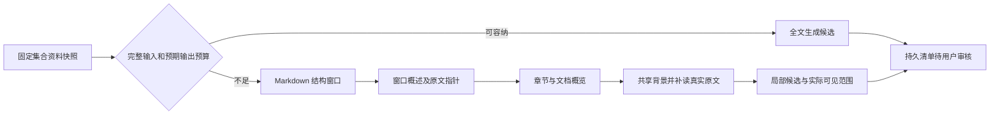

# 从业务链路理解核心代码

正式融合查找最新入口见 [代码与数据流](production-hybrid-search.md)：网页selection→AskRequest.retrieval_mode→KnowledgeTools同一search_notes→实际调用时才E5/BM25/RRF→两次预算/引用范围→上下文及回复持久Trace。重点读旧提交mode默认的幂等比较、失败诊断的attempt条件、最终模型completed_actions程序记录，以及为何内部50候选只返回最多10，不让未发送原文获得引用资格。

检索扩样（2026-10-13）阅读路线：先看 `evals/retrieval/expanded-v1/build_fixture.py` 的原文/问题/证据定义，再看 `retrieval_fixture_audit.bind_section_audit` 如何校验完整语义台账并映射实际片段，最后跟踪 `quality_retrieval --suite` 的版本选择。模型检索不读这些标签；`retrieval_comparison.compare_runs` 只在固定冻结标签下调用BEIR，再由 `retrieval_failure_report.failure_inventory` 定位候选、前三证据和局部退化。这样把“标注语义”“原文身份”“被测排名”“自动指标”四件事分开，避免被测结果自行定义正确答案。详细操作与限制见 [100条审核说明](../evals/retrieval/expanded-v1/audit.md)。

2026-10-11 学习入口：先读 [项目学习手册](project-learning-handbook.md) 的功能/架构/技术栈地图，再按 [第一课：一次网页提问](learning-01-question-flow.md) 跟踪变量与实验。本文保留各阶段详细导读；当前路线见第 8 节，讨论题与资料管理见第 9–10 节。

2026-10-10 补充：前置关系与路线见第 8 节；跨会话记忆与聊天管理已实现，阅读 `conversation_store.delete → ConversationMemory.execute → run_agent → answer_question → ConversationStore.finish`。详细依赖撤销、两阶段背景和预算见 [第二阶段记忆](conversation-memory-phase2.md)。下面 2026-10-08 的未实现描述是旧快照。

核对日期：2026-10-08。这是实际代码的阅读路线；不把设计中的跨会话召回、自主复查或学习顺序当成已实现功能。建议一次只追踪一条请求，记录它读写了什么、模型拿到了什么、失败后留下什么，再看对应测试。

## 1. 先建立项目的三层视角

| 层 | 主要代码 | 负责什么 |
| --- | --- | --- |
| 界面和入口 | `web_app.py`、`web/static/` | 接收文档身份、当前语言与用户选择，调用业务服务，展示可恢复状态 |
| 业务编排与模型边界 | `agent_loop.py`、`conversation_context.py`、`outline_context.py`、`outline_grouping.py`、`practice_service.py` | 组装真实上下文、检查预算、请求模型、校验结果、决定是否允许发布 |
| 事实存储与调度 | `conversation_store.py`、`practice_store.py`、`outline_store.py`、`outline_group_store.py`、`learning_store.py`、`learning_state.py`、`review_scheduler.py` | 持久原话/证据、身份与版本、短事务、幂等、有效评分与日期回放 |

模型适合判断语义和产生建议。程序负责来源权限、状态、身份、预算及事务。通过 Schema/行号校验，只能说明结果符合程序边界，不能证明“这个引用在语义上支持这个结论”。

## 2. 连续问答：原话怎样走到最终回复

按顺序读：`web_app.py` 中 `execute_turn()` → `conversation_store.py` 的 `generation_lock()` / `begin()` → `conversation_context.py` 的 `build_context()` → `web_app.py` 的 `generate_answer()` → `agent_loop.py` 的 `run_agent()` → `model_client.py` 的最终回答请求 → `ConversationStore.finish()` / `fail()`。

`begin()` 在生成前保存用户原话和轮次身份。同一提交标识恢复原轮次，已完成则返回原回复；会话操作锁避免并发生成打乱顺序。材料由浏览器的文档 ID 在后端解析，版本不同就拒绝，不能让请求指定任意本地文件路径。

`build_context()` 产生共同的 ContextBundle：当前问题、当前语言、已完成原话或摘要、近期完整轮次、补回的早期原话。`execute_turn()` 也把资料目录、必要选段、工具定义及最终 Schema 的预算压力纳入组装。Agent 决策和最终生成共用这份背景，最终生成另加入工具真正返回的原文。历史中的助手解释是讨论记录，不能变成文档证据。

`KnowledgeTools` 初始化不加载 embedding；实际执行 `search_notes()` 才准备向量。默认整篇文档是允许查阅的范围，不是自动把全文发给模型。零工具调用后不会补检索。`finish()` 将可见回复、引用摘录和上下文记录原子保存；异常时 `fail()` 保留原话，重试同一轮。成功回复保存后独立后台标题任务命名，失败不影响聊天。

长聊天看 `update_summary()` / `publish_summary()`：预算压力触发前缀摘要，旧摘要、近期原话和早期补回共同参与；网络期间不占写锁，发布比较版本与前缀指纹。摘要不替换原始消息。

对应测试：`test_conversations.py` 的 `test_both_model_phases_receive_same_chat_background_without_search`、`test_failure_duplicate_retry_and_completed_replay_save_once_without_learning`、`test_long_chat_summary_recent_turns_coverage_evidence_and_originals`。受控 ACK=130 验证的是数据传递，不是模型理解。

## 3. 集合清单：局部阅读怎样获得整体背景

按顺序读：`web_app.py` 的 `create_outline()` → 集合及后代文件快照 → `outline_context.py` 的 `plan_outline()` → `OutlineStore.create()` → 后台 `run_outline()` / `run_adaptive()` → `public_outline()`。

`section_manifest()` 用 Markdown 解析器建立不重叠正文范围，代码和引用块里的“标题”不会被当成文档章节。路由同时考虑完整请求的输入、预期目标数量和输出预留；当前目标数量估计是启发式，不是知识完整性判定。

分层流程看 `execute_step()`、`reduce_steps()`、`background_messages()`：概述带原文指针和未解决事项，逐层归并后给局部提取共享背景。指针本身不授权引用；只有按预算实际补回并发送的原文才可引用。背景挤占窗口时保存完整尾段，不能无声丢弃。每个概述和提取请求都检查 Schema 与兼容协议预算。

清单保存快照、阅读计划、概述步骤、批次、候选和实际可见行范围。`claim_batch()` / `finish_batch()` 用 attempt 识别在途任务；概述的依赖身份让重试复用已完成结果，旧任务不得覆盖新状态。模型请求在事务外，发布在短事务内。`scope_fingerprint()` 用集合文件身份及来源版本判断当前清单是否过期。

覆盖中的已分析行数是成功处理的原文范围；仅标题/空白可由程序直接标为完成。它不代表知识召回率，更不代表用户掌握程度。失败保留已有候选和概述，正式网页可继续未完成部分。

对应测试：`test_outline_context.py` 的 `test_shared_background_and_original_early_evidence_reach_later_extraction`、`test_actual_background_pressure_splits_batch_without_losing_tail`、`test_summary_failure_keeps_valid_steps_and_resumes_without_regeneration`。

## 4. 归组和加入：建议为什么不会立即变成计划

按顺序读：`group_outline()` → `outline_grouping.start_grouping()` / `run_grouping()` → `outline_integration.execute_integration()` → `outline_group_plan.make_plan()` / `work_scopes()` → `claim_step()` / `finish_step()` → `publish()` → `outline_group_store.review_group()` → `outline_service.enroll_candidate()` → `OutlineStore.begin_enrollment()` / `commit_enrollment()`。旧 plan=NULL 任务继续走原 group_messages / GroupDraft 分支。

归组模型看到固定候选的知识、能力目标、范围、标准和实际引用原文。返回三种可审核建议：同知识、重复目标、待核对。程序检查成员身份、重复、能力维度和预算；不能用标题相同直接推断目标重复，也不能让不同能力目标自动当作重复。

2026-10-09 的分层整合看 `page_fits()`：完整输入、估计输出和单次契约容量都适合才直接比较。否则稳定章节树安排所有候选对；上层卡片保留完整条件/标准，只去原文正文。`validate_page()` 核对已处理/待处理身份；`progress()` 找出待核验关联，再以原文页核验。候选条件不被再摘要，导航假设不能直接发布。`proposals_from_proofs()` 要求每对组员同类型原文支持，不用关系链合并。输出估计是启发式，平方级比较及模型漏判是当前代价。

`outline_group_runs` 保存任务输入版本、路由、额度及失败；`outline_group_steps` 保存每次请求身份、回执、预算、证据范围和 attempt；`outline_groups` 保留原模型建议、支持步骤、用户修改和成员 revision。默认 24 请求后暂停，继续复用有效步骤；网络不占写锁，暂停和版本变化阻止迟到结果。候选修改使旧建议失效。用户接受建议仍不创建学习记录；勾选加入后才生成固定目标的首题。

加入分两段：先取得 candidate attempt 和归组 token，事务外生成首题，再在 `commit_enrollment()` 中复核候选/归组版本。`resolve_unit()` 延迟创建或绑定共同知识点；同一个数据库事务内完成首题、目标、ReviewItem 和候选状态。失败整体回滚，重复加入返回已有身份。重复目标仅允许代表加入，原候选保留；不同目标各自保留 FSRS。

这解释了为什么集合、清单与学习数据共用 `practice.sqlite3`：加入过程需要原子性。`document_id` 管理文件归属，内容版本的 `source_id` 管理证据；二者不能互换。目标归属与文件归属独立，移动文件不应重建复习项。

对应测试：`test_outline_groups.py` 的 `test_distinct_dimensions_share_one_unit_and_keep_independent_targets_fsrs`、`test_approval_changed_during_initial_question_rolls_back_every_record`、`test_duplicate_different_dimensions_and_unknown_ids_are_rejected`。

## 5. 作答与修订：为什么不按评分点数计算等级

按顺序读：`submit_practice_answer()` → `PracticeStore.submit_answer()` → `practice_service.grade_pending_answer()` → `practice_model.grade_answer()` / `validate_grade()` → `PracticeStore.save_grade()` → `learning_state.record_evaluation()` / `reschedule()`。

答案先保存再请求评分。评分模型拿到固定题目、rubric、完整真实作答、固定资料快照及必要的学习背景；`SemanticGradeDraft` 返回逐标准分类、原答案子串、整体判断、范围判断和建议档位。`validate_grade()` 检查索引、原话引文等契约，不按覆盖点数量重算等级，允许等价表达和语义判断。

评分失败保留 `grading` 状态及原答案；成功保存有效评价。临时题目不会凭一次评分自动加入计划。已加入目标的主要作答才可能产生一个 ReviewEvent；不确定、超范围、已获得帮助不计入调度，教学追问不变成第二次主要复习。

修订路径：`learning_service.correct_grade()` → `PracticeStore.revise_grade()` → `record_evaluation()` → `reschedule()` → `review_scheduler.replay()`。新修订保留原答案及历史评价版本，更新同一作答对应的事件；用户明确选过的难度保留。用原始作答时间、原始调度参数从初始卡片回放后续有效事件，不能仅修改当前 due 日期，也不能重复累计同一次复习。

对应测试：`test_learning.py` 的 `test_semantic_grade_is_not_computed_from_point_counts_and_one_call_returns_feedback`、`test_user_revision_preserves_answer_original_grade_and_explicit_rating`、`test_correction_replays_later_reviews_using_original_times_and_parameters`。

## 6. 用一个具体样例读懂，而不是背模块名

先读 [评测操作说明](quality-evaluation.md)，运行离线校验和受控小样例。打开报告，挑一个候选或评分 session，沿上述函数查它的输入、状态变化和原文证据。再运行一组明确选择的真实样例，比较模型结果与草案参考；失败也是需要解释的结果。

建议每条链路写下四件事：一次用户操作的入口；模型实际收到的数据；程序能保证的边界；一次异常之后保留下来的记录。再尝试只修改合成样例里的条件，例如从纯数据改为存在缺口，核对参考标注、版本和模型变化。这比一次读完所有文件更适合建立独立理解。

面试介绍可以围绕三个可举证的选择展开：按需 RAG 与实际可见引用；有界分层阅读与审核后的原子加入；真实作答先落库及评分修订后 FSRS 回放。不要把受控测试、少数真实样例或可用功能说成已完成质量校准；[开发记录](development-log.md) 给出本次实际遇到的问题和理由。

## 7. 定向复查：如何让模型补证据而不直接改变计划

读 `web_app.source_review()` / `run_grouping_with_reviews()` → `start_source_review()` → `run_source_review()` → `prepare_review_request()` / `execute_lookup()` → `finish_review_step()` / `finish_review()` → 用户 `apply_source_review()` → 原 `enroll_candidate()`。

先找三份内容：原候选（含固定引用）、原 needs_review 建议、独立复查结果。它们不会互相覆盖。模型最初只看到已有引用，可以在目录中的许可快照定位或补读。定位只给行号；实际读取的块才加入下一轮 prompt 和引用范围。预算同时计算 Schema、数据、偏好、输出预留及协议，不能只数新补读正文。

两轮以后换 `ReviewConclusion` 契约，禁止第三轮读取。逻辑调用先占父整合额度，再发网络请求；已完成步骤复用，失败步骤重试。attempt 阻止暂停后的迟到发布，candidate/group revision 阻止在旧候选上继续采用。短事务让用户在模型运行期间仍能暂停或编辑。

练习读法：运行 `quality_source_review.py --mode smoke`，打开独立 results.json，核对初始候选引用与步骤 actual_range。改变补读引用为未发送行，观察测试拒绝发布；暂停后继续，观察完成步骤 id 保持。最后找到 `apply_source_review()`，说明为什么采用只保存审核分组，直到加入计划才延迟绑定 unit 并产生独立目标。受控结论不是模型语义能力；live 报告也要检查失败、原始候选未变和未创建学习记录，而不只看最后文字。

## 8. 前置关系与下一目标：分清规划意见和学习证据（2026-10-10）

从 `web_app.py` 的 `/api/outlines/{id}/routes` 跟到 `outline_routes.start_route`：检查资料指纹、候选原文和归组状态，固定完整目标及版本，保存独立路线任务。`run_route` 按全部目标对推进；`outline_route_model.prepare_page` 用完整双协议请求与输出估计分批，`validate_page` 核对逐对回执和实际原文引用。`outline_route_store` 在网络前领取 attempt/扣额度，返回后短事务保存判断及游标；暂停、候选修改、服务中断不会覆盖原结果。

然后看 `edit_edge` 和 `save_order`：关系接受检查 DAG，用户意见分存，方向/理由修改撤销当前原文授权；手动顺序只作冲突提示，跳过目标不更新复习项。`ordered_nodes` 是稳定拓扑排序，不是评分或关卡算法。

最后看 `route_recommendation.recommend_next`：一个 SQLite 读取快照中，沿候选 item_id → 固定 target_id → 最近首题 → effective_evaluation_id 获取当前有效反馈。只用该目标的首题，追问不会变成新达标证明，也不能因会话变为追问而丢掉首题。相关能力的成功不迁移；提示/范围不匹配/不确定保持证据不足。根据待答题、真实复习事件和日期、定性缺口、路线探索提出可解释建议，没有概率公式，不修改学习记录。

可以跟踪合成样例：字节加法 → ACK 含义 → 连续数据段 ACK 计算。接受只是路线意见；明确选择加入第二个目标才产生首题，前一个目标未作答也能直接学习。提交真实输入后，主要作答和当前有效评分成为推荐依据；修改评分版本后重读即可改变推荐。`quality_route.py` 固定候选用于检验关系生成，不测试提取质量；`test_outline_routes.py` 控制响应验证工程行为，不验证真实教学语义。

新增独立任务/批次/关系三表是为了恢复、预算、保留审核历史；没有重写原 practice/FSRS，也没有引入框架或概率门槛。最坏目标对平方级、缺失外部话题待核实和人工审核仍是当前限制。

## 9. 讨论出题和来源撤销：用户选择之前不产生计划

从 `web_app.py` 的 `/api/conversations/{id}/practice` → `chat_practice.start` → `build_context` → `ConversationMemory.search` → 完整协议预算 → `_request_structured` → 原话/原文/目标标准校验 → `PracticeStore.create`。先保存唯一请求任务，再发网络；同聊天锁防止同时领取，attempt 阻止迟到发布。题目和 practice_basis 与任务完成在同一事务保存，失败重试不会重复创建 session。普通问答仍走自己的按需工具路径。

重点看 DiscussionProposal / DocumentProposal：同一个题目层级附带 reason 与 history_references，默认讨论契约禁止文档引用，严格文档契约保持原限制。接口扁平化解决真实模型把依据塞入题目内部的问题，没有去掉引用或标准校验。输入数据中的旧回复只是讨论，不提高知识权威。ContextBundle 同时提供语言、摘要/近期原话/补回和依赖；只有实际原话具有字符引用权限。

随后跟 `learning_service.enroll`、`grade_pending_answer` 和 `chat_practice.grade_discussion`：目标预览不暴露隐藏参考标准，用户可以主动查看参考并记录支持情况；选择加入才创建目标及复习项，真实答案先保存。评分基于实际答案证据，变式保留稳定目标，追问不创建第二个复习事件。

最后看 `ConversationStore.delete` → `practice_provenance.revoke`，以及 PracticeStore 的 `check_session`：两个既有磁盘数据库 ATTACH 短事务撤销所有依赖该来源的练习资格，清理引用摘录和诊断，保留答案/评分/日期。调用前检查防止继续发送，落库时再次检查防止删除竞态。复习、评分、更正、参考、加入、新维度及相关历史都须守住这个边界；不能只在页面禁用按钮。

## 10. 文件身份、正文版本和集合范围为何分开

`LibraryStore.move` 沿父链检查循环；`remove_collection` 同事务迁移直接子集合及关联，不重建题目。文件的 document_id 管归属，source_id 管路径与实际正文版本，document_states.revision 管并发资格；三者职责不同。`change_document` 原子存旧版本和当前正文覆盖，避免磁盘替换与数据库资格更新半成功。DocumentCatalog / `_source_for` 让问答、出题、清单读取一致。

把合成资料的 LEN=20 换成 LEN=30 后，当前阅读改变，旧题快照不变；清单指纹改变只能查看，旧引用显示旧摘录。移出文档保留明确旧版本学习依据，删除聊天则撤销讨论派生内容资格，两种操作语义不同。`test_management_chat_practice.py` 与隔离 smoke 可验证这两个例子；真实模型报告不能代替工程竞态测试。
## 11. 文档检索评测补充入口（2026-10-11）

本次没有替换生产检索算法。阅读顺序：`quality_retrieval.main` → `load_suite`/`make_manifest` → `ReviewStore.create/review/save/freeze` → 审核页 → `run_baseline` → `KnowledgeTools.search_notes`/`rank_chunks` → `score_run`。结合 [评测设计与实现](retrieval-benchmark-design.md) 查看命令、指标、数据版本和逐模块“为什么修改/改变了什么”。这一链与问答 Agent 的自主决定分开：评测直接调用检索器，生产问答仍可零工具调用。

标注不是模型检索得分。必要证据组表达独立事实；组内完整片段组合才能满足该事实。当前冻结qrels同时允许Agent完整初审自动采用与用户处理争议后的等级，分别保存来源，不是全部人工gold；BEIR按实际排名自动计算。manifest保存embedding实际预处理后的片段，不能用较粗分块或纯行号重叠代替这些检索单位。

2026-10-12 B混合检索阅读路线：`quality_retrieval.main(hybrid)` → `run_hybrid` → 原工具初始化/实际片段校验 → `BM25Index`（许可范围内词项tf/df/长度） → `rank_chunks`与`BM25Index.search` → `reciprocal_rank_fusion` → 分支Trace → `compare_runs`/同冻结`score_run`。先读 [B实现与取舍](retrieval-benchmark-design.md#hybrid-b)，再用 `test_bm25_known_term_frequency_math_and_no_zero_fill` 的数字例理解BM25，`test_rrf_uses_ranks_deduplicates_and_records_both_contributions` 理解为什么融合排名而非直接相加原始分。最后看CLI受控测试和真实报告；mock只验证工程，当前未冻结的排名变化不代表质量提升。正式问答未接入B，C仍后续。

2026-10-13 C收尾阅读路线：`quality_retrieval.main(rerank)` → `validate_hybrid_pool` → `LocalReranker`离线固定模型/实际tokenizer → `run_rerank` → `document_windows`完整问题与原文全覆盖 → `rerank_pool`批推理/max窗口分/稳定B序 → `validate_same_pool` → 冻结标签`score_run` → 三组`compare_runs`。C输入是保存的B结果，不运行新的E5检索；这是公平比较排序的关键。原文分窗只影响模型逐对读取，最终候选身份/原文不变，超窗口或pair上限失败保留。完整数据流、核心代码取舍和命令见 [C实现](retrieval-benchmark-design.md#rerank-c)。

先运行/阅读 `test_windows_cover_all_original_chars_and_repeat_whole_query` 和 `test_C_candidate20_remains_B_pool20_when_gold_promoted_from_last`：前者证明不偷偷截断原文，后者说明排序上升不等于召回池扩大。再看 `test_candidates_before_rerank_and_true_BEIR_rescue_denominators` 的受控数字，最后读真实三组报告。用户已冻结20条，当前正式评分基于同一版本；上文“C仍后续/未冻结”是B交付时状态。生产问答仍原检索，约100扩样和生产接入后续。
