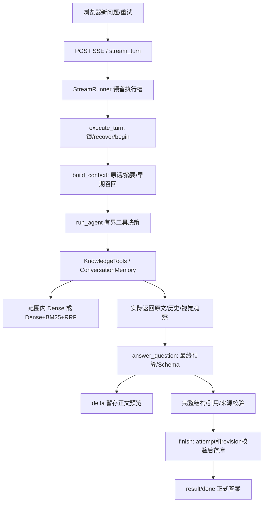

# Knowledge Review 源码学习地图

基线：2026-10-23当前工作区；不是旧架构文档的干净HEAD。具体决策与证据等级先读 [技术决策审计](TECHNICAL_DECISION_AUDIT.md)。本地图中的“练习”是建议，不代表你已经完成；关联测试的本轮执行状态见 [验证记录](VALIDATION.md)。符号和行号绑定 [源码快照](evidence/source-snapshot.json)，代码变更后应重新定位。

## 1. 先走一条真实路径

用项目公开示例，打开文档，问一个需要原文的问题。不要先遍历全部 `.py` 文件。沿下图观察：用户输入何时保存、哪些原文发给模型、哪些结果经校验后发布。

图中本地检索只有实际调用搜索才发生；允许零工具调用。公开示例也可能触发真实云端调用，正式练习前先用受控测试理解流程。不能把“代码允许这条路径”误说成“本轮已测真实模型这条路径”。

主干阅读入口：[web_app.py:L1022 — execute_turn](<E:/agentic project/knowledge-review/web_app.py:1022>) → [conversation_store.py:L238 — ConversationStore.begin](<E:/agentic project/knowledge-review/conversation_store.py:238>) → [conversation_context.py:L193 — build_context](<E:/agentic project/knowledge-review/conversation_context.py:193>) → [web_app.py:L866 — generate_answer](<E:/agentic project/knowledge-review/web_app.py:866>) → [agent_loop.py:L84 — run_agent](<E:/agentic project/knowledge-review/agent_loop.py:84>) → [model_client.py:L44 — answer_question](<E:/agentic project/knowledge-review/model_client.py:44>) → [conversation_store.py:L289 — ConversationStore.finish](<E:/agentic project/knowledge-review/conversation_store.py:289>)。浏览器流式入口为 [web_app.py:L1080 — stream_turn](<E:/agentic project/knowledge-review/web_app.py:1080>)；一次JSON接口与CLI保留，持久会话不是所有入口都有。

## 2. 专题一：RAG 的数据、向量和检索链（Q11–Q58）

### 位置与职责

解析层负责把原文变成可定位快照；chunk/embedding负责检索单元；KnowledgeTools负责范围内获取证据；最终答案层负责可见证据消费。不要把这些统称为一个“向量数据库”。

### 推荐阅读顺序与入口

1. [sources.py:L10 — Source](<E:/agentic project/knowledge-review/sources.py:10>)、[sources.py:L36 — load_sources](<E:/agentic project/knowledge-review/sources.py:36>)、[document_model.py:L47 — Document](<E:/agentic project/knowledge-review/document_model.py:47>)：先理解版本化原文。
2. [chunking.py:L14 — Chunk](<E:/agentic project/knowledge-review/chunking.py:14>)、[chunking.py:L37 — chunk_source](<E:/agentic project/knowledge-review/chunking.py:37>)、[chunking.py:L146 — document_chunks](<E:/agentic project/knowledge-review/chunking.py:146>)：结构分块、真实行范围、表格依赖。
3. [embedding_config.py:L28 — select_embedding_config](<E:/agentic project/knowledge-review/embedding_config.py:28>)、[embeddings.py:L98 — LocalEmbedder.prepare_chunks](<E:/agentic project/knowledge-review/embeddings.py:98>)、[embeddings.py:L156 — LocalEmbedder._encode_complete](<E:/agentic project/knowledge-review/embeddings.py:156>)：前缀、容量、二次分块与池化。
4. [vector_index.py:L36 — get_document_vectors](<E:/agentic project/knowledge-review/vector_index.py:36>)：profile、input hash、miss、计算、事务写入。
5. [retrieval.py:L25 — rank_chunks](<E:/agentic project/knowledge-review/retrieval.py:25>) → [hybrid_retrieval.py:L20 — lexical_tokens](<E:/agentic project/knowledge-review/hybrid_retrieval.py:20>) → [hybrid_retrieval.py:L88 — BM25Index.search](<E:/agentic project/knowledge-review/hybrid_retrieval.py:88>) → [hybrid_retrieval.py:L110 — reciprocal_rank_fusion](<E:/agentic project/knowledge-review/hybrid_retrieval.py:110>)。
6. 回到 [knowledge_tools.py:L150 — KnowledgeTools._search_notes](<E:/agentic project/knowledge-review/knowledge_tools.py:150>) 看它们如何串联，再读 [knowledge_tools.py:L239 — KnowledgeTools.execute](<E:/agentic project/knowledge-review/knowledge_tools.py:239>) 的权限出口。
7. 最后读 [rerank_retrieval.py:L77 — rerank_pool](<E:/agentic project/knowledge-review/rerank_retrieval.py:77>)，牢记是离线C，不能接在生产调用链上冒充已上线。

### 输入输出与关键数据结构

| 对象 | 主要字段 | 学习重点 |
| --- | --- | --- |
| Source | source_id/path/text/document | 内容快照，不是可任意读取文件的工具参数 |
| Document/ContentBlock | 解析身份、正文、类型、真实范围、页/bbox、assets | PDF抽取行号不是物理页行号 |
| Chunk | chunk_id/source_id/line_start/end/text/context_ranges | 连续正文＋独立依赖区间，不含“模型推断的正文” |
| SearchHit | chunk/score | dense是cosine，hybrid是RRF，不可统一解释为概率 |
| IndexResult | vectors/reused/computed | 缓存命中与检索命中是两件事 |
| ToolExecution | output/visible_chunks/visual_observation | 模型收到的载荷与运行层维护的证据资格分别表达 |
| BM25Index | postings/lengths/average_length | term→(chunk序号,TF)，只统计当前许可范围 |

### 跨模块执行与状态

`search_notes(query, top_k)` → 每次算query向量 → 首搜prepare/cache，后续复用实例_vectors → dense排序 → hybrid时惰性建BM25/查词/RRF → SearchResult → execute补表头原文 → ToolExecution。缓存不存在不是业务失败；损坏行重算，数据库不能用则显式错误，可由用户明确选择no-cache，不静默伪装成功。

算法细节：dense O(Nd+NlogN)；BM25累计命中posting后排序；RRF最多处理两路50并合并，不能纠正候选外缺证据。正文归一化只用于检索特征，不改引用原文。长行窗口覆盖不等于保留全部跨窗语义。

### 异常/边界

`top_k=True` 必须拒绝，因为Python的bool是int子类；前缀过长连一个字符也放不下时报错；零向量/NaN/维度不符拒绝；同路重复、陌生chunk、同ID原文冲突拒绝；BM25无词命中返回空，RRF保持dense顺序但分数单位仍是RRF。旧缓存不能扩scope。

关联测试：[test_chunking.py:L1 — 证据](<E:/agentic project/knowledge-review/test_chunking.py:1>)、[test_embeddings.py:L1 — 证据](<E:/agentic project/knowledge-review/test_embeddings.py:1>)、[test_vector_index.py:L1 — 证据](<E:/agentic project/knowledge-review/test_vector_index.py:1>)、[test_hybrid_retrieval.py:L1 — 证据](<E:/agentic project/knowledge-review/test_hybrid_retrieval.py:1>)、[test_production_retrieval.py:L1 — 证据](<E:/agentic project/knowledge-review/test_production_retrieval.py:1>)、[test_rerank_retrieval.py:L1 — 证据](<E:/agentic project/knowledge-review/test_rerank_retrieval.py:1>)。重点先看手算BM25与RRF测试，不要一开始下载模型。

### 岗位知识与可观察练习

Python：dataclass frozen、Counter/defaultdict、稳定排序、生成器、`zip(strict=True)`；C++：vector/unordered_map、浮点归一化、`stable_sort`与堆Top-K、对象身份和不可变快照；数据库：复合主键/事务/cache失效；OS：CPU计算、内存占用、文件缓存。这里只是知识迁移，项目核心并非C++实现。

**完成标准**：用3个Chunk手算BM25和RRF；画出不同scope的postings；证明same chunk双路只返回一次；能解释query embedding每次算、文档embedding为何不每次算。具体小练习见首批答案。

## 3. 专题二：Agent Loop 与 Tool Calling（Q59–Q72）

**位置**：模型决策和程序执行之间的边界。先读 [agent_loop.py:L35 — AgentRun](<E:/agentic project/knowledge-review/agent_loop.py:35>)、[agent_loop.py:L28 — AgentStep](<E:/agentic project/knowledge-review/agent_loop.py:28>)，再读 [agent_loop.py:L84 — run_agent](<E:/agentic project/knowledge-review/agent_loop.py:84>) 全函数；工具Schema在 [knowledge_tools.py:L303 — knowledge_tool_definitions](<E:/agentic project/knowledge-review/knowledge_tools.py:303>)，业务校验在 [knowledge_tools.py:L239 — KnowledgeTools.execute](<E:/agentic project/knowledge-review/knowledge_tools.py:239>)。最终输出契约在 [answers.py:L32 — NoteAnswer](<E:/agentic project/knowledge-review/answers.py:32>)。

**调用链**：构造catalog/focus/background/schema → 模型create → 处理tool_calls → JSON解码/白名单分发 → tool结果匹配call.id → 累积可见范围 → 下一轮或终止 → 独立answer_question。`completed_actions`是程序根据步骤生成的执行事实，不从模型自然语言提取。

**输入/输出**：sources、question、tools必须属于同一Source快照；可带focus、ContextBundle、memory_tools、before_request、event_sink。输出AgentRun包含最终NoteAnswer、steps、stop_reason、visible_chunks/context_snapshot/history_references；不自动创建练习或FSRS事件。

**状态与失败**：stop_reason区分model_finished/tool_budget；模型可不调用工具；参数/业务ValueError/TypeError变工具错误并耗预算；API失败、生成截断、非恢复错误可终止；GenerationCancelled走明确外层取消处理。多call超过额度不执行，多出的调用也要响应协议错误信息，实际steps不超过上限。

**阅读顺序**：先零工具测试 → 一次search → search后read → 工具错误 → 超预算 → 最终引用。关联 [test_agent_loop.py:L1 — 证据](<E:/agentic project/knowledge-review/test_agent_loop.py:1>)、[test_knowledge_tools.py:L1 — 证据](<E:/agentic project/knowledge-review/test_knowledge_tools.py:1>)、[test_production_retrieval.py:L1 — 证据](<E:/agentic project/knowledge-review/test_production_retrieval.py:1>)。本轮没有运行全部test_knowledge_tools，不能借地图暗示全通过。

**深入知识**：Python闭包、回调、`**kwargs`条件展开、异常分类；后端策略与执行器分离、有限状态机、循环不变量。C++可对应variant结果类型、函数对象、异常边界，但不能把内部Function Calling称为MCP协议。

**完成标准**：画出一次响应含2个tool_calls的消息序列；解释tool_call_id对应；把工具名改成未知名，看哪层拒绝；用无工具模型替身证明E5未加载。若不能指出真正执行函数的位置，就还没掌握工具调用。

## 4. 专题三：证据权限、预算、结构化生成（Q73–Q84）

**位置**：Agent证据获取出口到最终发布入口。阅读 [context.py:L8 — validate_chunks](<E:/agentic project/knowledge-review/context.py:8>) → [context.py:L55 — citation_is_visible](<E:/agentic project/knowledge-review/context.py:55>) → [answers.py:L50 — validate_answer](<E:/agentic project/knowledge-review/answers.py:50>) → [generation_budget.py:L16 — GenerationBudget](<E:/agentic project/knowledge-review/generation_budget.py:16>) / [generation_budget.py:L73 — fit_chunks](<E:/agentic project/knowledge-review/generation_budget.py:73>) → [model_client.py:L44 — answer_question](<E:/agentic project/knowledge-review/model_client.py:44>) → [structured_output.py:L42 — request_structured](<E:/agentic project/knowledge-review/structured_output.py:42>)。

**输入输出**：`chunks=None`表示全文；`[]`表示没有检索原文。必需focus和可选检索块分开；普通NoteAnswer可有supplement，SourceOnlyAnswer schema只允许grounded/inference且每块有引用。coverage_note说明缺口，不是LearnerState或掌握度。

**调用链与算法**：校验chunk逐字等于快照 → 构造完整请求 → 分别估算原生/工具结果Schema → 必需内容不能容纳则失败 → 可选块裁剪并同步引用范围 → 请求/协议受限回退 → Pydantic → 文档/视觉/历史引用校验 → 上层事务发布。范围并集用cursor扫描，拒绝未发送gap。

**重要边界**：内部候选50≠工具返回10≠Agent实际可见≠最终实际可见；表头依赖不能被裁掉后留下正文；只见第1/4列或部分行不能声称全表结论。材料中的“忽略要求”是数据；提示词提醒与工具范围限制不构成完整prompt-injection防御证明。

**关联测试**：[test_context.py:L1 — 证据](<E:/agentic project/knowledge-review/test_context.py:1>)、[test_answers.py:L1 — 证据](<E:/agentic project/knowledge-review/test_answers.py:1>)、[test_model_client.py:L1 — 证据](<E:/agentic project/knowledge-review/test_model_client.py:1>)、[test_structured_output.py:L1 — 证据](<E:/agentic project/knowledge-review/test_structured_output.py:1>)、[test_conversations.py:L293 — RequestBudgetTests](<E:/agentic project/knowledge-review/test_conversations.py:293>)。看一个引用在完整source存在却因不在visible chunks而失败的用例。

**深入知识**：Python `Literal`/Pydantic严格类型、列表切片赋值别名效应、二分搜索前提；算法区间覆盖；安全上的allowlist、最小权限和TOCTOU；JSON Schema是语法约束，语义蕴含需要另测。

**完成标准**：为`[1,3]`和`[5,7]`手算引用`[2,6]`被拒；相邻`[1,3]`/`[4,7]`可覆盖。裁剪后三种范围分别打印公开例子的行号，解释为何最终不能引用被裁的尾部。不能用真实私人文本做公开实验日志。

## 5. 专题四：会话上下文、摘要、跨聊天记忆（Q99–Q105）

**位置**：ContextBundle为两个模型阶段提供连续讨论；ConversationStore拥有原话/轮次/摘要；ConversationMemory拥有历史工具。它们不直接更新学习掌握状态。

**阅读顺序**：[conversation_store.py:L336 — ConversationStore.history](<E:/agentic project/knowledge-review/conversation_store.py:336>) → [conversation_context.py:L31 — ContextBundle](<E:/agentic project/knowledge-review/conversation_context.py:31>) → [conversation_context.py:L193 — build_context](<E:/agentic project/knowledge-review/conversation_context.py:193>) → [conversation_context.py:L90 — update_summary](<E:/agentic project/knowledge-review/conversation_context.py:90>) / [conversation_context.py:L144 — recall_originals](<E:/agentic project/knowledge-review/conversation_context.py:144>) → [conversation_memory.py:L175 — ConversationMemory.search](<E:/agentic project/knowledge-review/conversation_memory.py:175>) / [conversation_memory.py:L257 — ConversationMemory.validate_references](<E:/agentic project/knowledge-review/conversation_memory.py:257>) → [conversation_store.py:L154 — ConversationStore.delete](<E:/agentic project/knowledge-review/conversation_store.py:154>)。

**数据结构**：Turn含request_id/status/attempt；Message含role/content及所属turn；Summary含version/covers_through_seq/source_fingerprint/payload；MemoryReference含消息身份/revision/字符半开范围；memory_dependencies是派生关系，不是“历史助手内容已验证为真”的标志。

**主链**：完成历史在预算内直接放原话；有压力才按完整轮次摘要、近期至少两轮；当前早期原话靠字面召回。跨聊天工具另用字面+E5 RRF，结果经过fit_memory、remember、最终再fit和validate_references。历史助手解释不提升文档coverage。

**失败与状态**：摘要身份/说话者/前缀指纹或CAS失败不能发布；有有效旧摘要且预算能容纳剩余历史时可继续，否则失败保留原话；删除来源即时撤销资格，不能等外部生成结束；归档继续可检索。语义搜索失败明确关键词降级，与文档search错误策略不同。

**关联测试**：[test_conversations.py:L1 — 证据](<E:/agentic project/knowledge-review/test_conversations.py:1>)、[test_conversation_memory.py:L1 — 证据](<E:/agentic project/knowledge-review/test_conversation_memory.py:1>)、[test_management_chat_practice.py:L1 — 证据](<E:/agentic project/knowledge-review/test_management_chat_practice.py:1>)。前两者本轮执行，management模块本轮仅查契约及调用关系，运行范围见验证记录。

**深入知识**：Python dataclass/元组浅不可变、哈希序列化、集合去重；数据库依赖图、外键/唯一索引、CAS；C++ const对象与引用生命周期；OS文件锁/进程异常释放。摘要压缩不是无损编码，需承认语义损失。

**完成标准**：用A聊天被B引用、B被C引用的图，解释删A后哪些原话/向量/摘要/练习资格改变；区分“文字仍展示”和“可作为记忆召回”。能解释召回的800字符窗与读取上限1400字符的区别。

## 6. 专题五：事务、版本、幂等与恢复（Q103–Q108、Q115）

**位置与入口**：[conversation_store.py:L89 — ConversationStore.generation_lock](<E:/agentic project/knowledge-review/conversation_store.py:89>) / begin / finish控制聊天；[library_store.py:L150 — LibraryStore.change_document](<E:/agentic project/knowledge-review/library_store.py:150>)控制资料替换；[practice_provenance.py:L30 — check_session](<E:/agentic project/knowledge-review/practice_provenance.py:30>)与revoke控制讨论练习来源；[web_app.py:L1154 — guard_documents](<E:/agentic project/knowledge-review/web_app.py:1154>)做当前资料守卫。

**主链**：OS锁 → recover遗弃状态 → 短事务begin保存用户输入＋attempt → 事务外调用模型 → 短事务finish校验revision/attempt、写助手结果。超时后HTTP客户端必须读状态，不能据响应丢失断言数据库没提交。

| 身份/状态 | 作用 | 反例 |
| --- | --- | --- |
| request_id | 同一次逻辑提交防重放 | 相同问题用新ID仍是新提交 |
| attempt | 当前运行的发布权 | 旧attempt晚到不能覆盖重试结果 |
| revision/source_id | 内容/资格版本 | 同document_id替换正文不能沿用旧内容身份 |
| OS文件锁 | 同聊天活跃执行互斥 | 不能替代版本检查或跨机器租约 |
| running→failed | 失败保留输入，允许同轮重试 | 不等于已跳过 |
| failed→cancelled | 用户跳过后可开新轮次 | 未完成原话不进入完成历史 |

**异常边界**：同ID不同请求拒绝；failed阻塞新输入直到重试/skip；finish条件更新0行拒绝；数据库事务不能覆盖PDF文件写入/远程模型调用；ATTACH跨文件保证取决于日志模式等条件。向量缓存“旧行保留”不等于原文历史归档。

**推荐测试**：[test_conversations.py:L118 — test_failure_duplicate_retry_and_completed_replay_save_once_without_learning](<E:/agentic project/knowledge-review/test_conversations.py:118>)、[test_conversations.py:L138 — test_interrupt_recovery_and_skip_keep_input](<E:/agentic project/knowledge-review/test_conversations.py:138>)、[test_vector_index.py:L113 — test_database_write_failure_rolls_back_partial_rebuild](<E:/agentic project/knowledge-review/test_vector_index.py:113>)；再读management来源替换测试。

**深入知识**：ACID、隔离/写串行、BEGIN IMMEDIATE、部分唯一索引、幂等与exactly-once差异、乐观并发控制；Python contextmanager/finally与C++ RAII、lock_guard。面试不要把网络操作“已经执行一次”与结果“只发布一次”混为一谈。

**完成标准**：手画两个attempt交错的时序图；指出哪条SQL拒旧结果，说明失败时rollback保护哪些表、保护不了哪些外部动作。

## 7. 专题六：有界执行、SSE、取消与背压（Q109–Q116）

**阅读顺序**：[agent_stream.py:L176 — StreamRunner.__init__](<E:/agentic project/knowledge-review/agent_stream.py:176>) → _reserve → _submit → bounded/response/detached/title → [agent_stream.py:L47 — EventBridge](<E:/agentic project/knowledge-review/agent_stream.py:47>) → [agent_cancel.py:L21 — Cancellation](<E:/agentic project/knowledge-review/agent_cancel.py:21>) / CancellableBody / model_http_options → [agent_work.py:L58 — job_boundary](<E:/agentic project/knowledge-review/agent_work.py:58>) → [answer_stream.py:L116 — collect_answer](<E:/agentic project/knowledge-review/answer_stream.py:116>) → 浏览器 [web/static/chat-stream.js:L1 — 证据](<E:/agentic project/knowledge-review/web/static/chat-stream.js:1>)。

**数据结构/位置**：WorkLease含kind/token/key/state；信号量表示实际工作名额；Future表示同步worker生命周期；EventBridge有有界Queue、单独terminal、detached/finished标志；Cancellation区分requested和observed。它们都是进程内状态，业务可恢复记录另存Store。

**前台链**：准入→线程池→绑定ContextVar→业务执行/模型HTTP→delta/progress桥→完整结果保存→result/done→真实Future退出还槽。**后台链**：先预留槽再创建业务记录→202→后台仍占槽；提交者断连不撤销已接受后台工作；pause先撤attempt再请求取消。标题最多1个且不挤满多worker容量。

**状态/异常**：满槽503而非无限排队；普通progress满队列失败、delta满队列等待消费者形成背压；终态有保留位置；断连请求取消但不能提前还槽；请求已保存后传输失败不回滚结果。没有事件ID持久重放，恢复靠业务状态读取。

**当前覆盖限制**：装饰器明确接入的路由受治理，不是全应用模型调用一律有界。检查 [web_app.py:L416 — create_app](<E:/agentic project/knowledge-review/web_app.py:416>) 的每个`@streams.bounded`/后台装饰；CLI、评测、部分导入/其他业务直接路径不可概括成受相同治理。C++ Gateway属于独立项目，本地图不证明其源码和部署现状。

**关联测试**：[test_agent_admission.py:L1 — 证据](<E:/agentic project/knowledge-review/test_agent_admission.py:1>)、[test_agent_sse.py:L1 — 证据](<E:/agentic project/knowledge-review/test_agent_sse.py:1>)、[test_agent_cancellation.py:L1 — 证据](<E:/agentic project/knowledge-review/test_agent_cancellation.py:1>)、[test_agent_governance.py:L1 — 证据](<E:/agentic project/knowledge-review/test_agent_governance.py:1>)、[test_answer_stream.py:L1 — 证据](<E:/agentic project/knowledge-review/test_answer_stream.py:1>)。初跑和本地直连复测分开记录，不能删失败。

**深入知识**：线程与协程、I/O和CPU工作、GIL与原生库线程、ContextVar作用域、Future取消、生产者消费者、背压、尾延迟、资源清理。C++面试可以对应线程池/条件变量/RAII/协作stop token，但当前Python不是epoll C++网关实现。

**完成标准**：2槽条件下挂起2个worker，第三个503；取消一个HTTP等待者后确认槽直到真实worker退出才释放。分别解释request.cancel_requested与实际observed差异，以及为何远端可能继续计费。

## 8. 专题七：评测、实验和故障定位（Q85–Q98、Q117–Q120）

**阅读顺序**：[evals/retrieval/expanded-v1/suite.json:L1 — 证据](<E:/agentic project/knowledge-review/evals/retrieval/expanded-v1/suite.json:1>) 看问题族/scope → [retrieval_benchmark_data.py:L60 — make_manifest](<E:/agentic project/knowledge-review/retrieval_benchmark_data.py:60>) / ReviewStore.freeze → [quality_retrieval.py:L62 — run_baseline](<E:/agentic project/knowledge-review/quality_retrieval.py:62>) / run_hybrid → [rerank_retrieval.py:L105 — run_rerank](<E:/agentic project/knowledge-review/rerank_retrieval.py:105>) → [retrieval_benchmark_metrics.py:L22 — score_run](<E:/agentic project/knowledge-review/retrieval_benchmark_metrics.py:22>) → [retrieval_comparison.py:L10 — compare_runs](<E:/agentic project/knowledge-review/retrieval_comparison.py:10>) → 历史 [结果表](../../evals/retrieval/expanded-v1/results-20261013.md)。

**输入输出**：manifest绑定资料/实际prepared chunks/模型profile；review revisions记录判定来源与理由；freeze固定一版标签；run保存排名/范围/分数/失败/耗时；comparison只消费已有产物，不能偷偷重新召回。标签和标准答案不应泄漏给被测生成任务。

**算法与口径**：BEIR负责基本排序指标；完整证据使用group/bundle集合包含；C救回/退化按原B是否命中划分不同分母；失败留分母，负例另测拒答；nDCG本项目线性gain；C输入候选指标不随重排后次序作弊提升。

**诊断顺序**：

| 检查层 | 观察对象 | 不能直接归咎的对象 |
| --- | --- | --- |
| 原始资料→抽取 | 是否抽到、页/表头/条件是否完整 | embedding |
| 抽取→prepared chunks | 是否跨块、实际输入是否含条件 | reranker |
| 许可范围→候选池 | scope、dense/BM25分路、候选完整组 | 最终生成 |
| 候选池→前K | RRF贡献/C分数、冗余、缺组 | 解析 |
| 前K→最终请求 | Agent/最终预算裁剪、表头依赖 | 召回模型 |
| 最终可见→答案 | 主张/引文语义、错误推导、拒答 | SQL存储 |
| 答案→发布 | attempt/revision/取消/传输状态 | 答案语义 |

**测试**：[test_hybrid_retrieval.py:L232 — test_compare_command_does_not_load_model](<E:/agentic project/knowledge-review/test_hybrid_retrieval.py:232>)、[test_rerank_retrieval.py:L1 — 证据](<E:/agentic project/knowledge-review/test_rerank_retrieval.py:1>)、[test_evaluation.py:L1 — 证据](<E:/agentic project/knowledge-review/test_evaluation.py:1>)、[test_retrieval_benchmark.py:L1 — 证据](<E:/agentic project/knowledge-review/test_retrieval_benchmark.py:1>)；后两模块本轮未整模块执行，部分helper在已运行模块被调用。

**深入知识**：统计分母、配对实验、问题族相关性、数据泄漏、bootstrap；Python序列化/不可变实验输入；指标实现与论文定义对齐。不要把样本重复3次的时延观察变成3倍独立语义样本。

**完成标准**：解释B Hit@3低于C但完整证据高于C为何不矛盾；重算一个group含两个可替代bundle的例子；给一条失败定位到上述具体层。不能仅展示平均Recall然后宣称整个系统有效。

## 9. 架构旁支：练习、FSRS、清单与路线（Q1–Q10、Q120）

这部分用于解释项目为何超出PDF聊天，不替代16项主审计。

- 练习：[practice_store.py:L207 — PracticeStore.submit_answer](<E:/agentic project/knowledge-review/practice_store.py:207>) → grade_pending_answer → [practice_store.py:L256 — PracticeStore.save_grade](<E:/agentic project/knowledge-review/practice_store.py:256>)；真实答案先保存，评分失败保留grading以便重试。出题、作答、评价是不同实体。
- 学习：[learning_state.py:L86 — record_evaluation](<E:/agentic project/knowledge-review/learning_state.py:86>) → reschedule → [review_scheduler.py:L15 — replay](<E:/agentic project/knowledge-review/review_scheduler.py:15>)；固定target、首题/辅助条件、唯一事件决定是否计复习。变式共目标，评分修订回放原时间/参数；FSRS6.3.2、fuzz关闭不等于掌握度已校准。
- 清单：[outline_context.py:L81 — plan_outline](<E:/agentic project/knowledge-review/outline_context.py:81>) / run_adaptive进行预算路由与分层背景；[outline_grouping.py:L122 — run_grouping](<E:/agentic project/knowledge-review/outline_grouping.py:122>)、[outline_review.py:L96 — run_source_review](<E:/agentic project/knowledge-review/outline_review.py:96>)负责持久建议与有限原文复查。背景卡不能授原文引用权；接受归组与加入学习计划不同。
- 路线：[outline_route_store.py:L1 — 证据](<E:/agentic project/knowledge-review/outline_route_store.py:1>)、[route_recommendation.py:L1 — 证据](<E:/agentic project/knowledge-review/route_recommendation.py:1>)；建议/审核/真实学习状态分离。跨模块不是独立微服务，web_app依然承担较多协调。

关联测试：test_practice、test_learning、test_outline_context、test_outline_groups、test_outline_review、test_outline_routes。本轮未运行这些整模块；请按学习专题再做定向验证，不引用历史全量数字冒充本轮。

## 10. 较难的 Python 语法：按真实代码理解

### 10.1 `@dataclass(frozen=True)` 与 `replace`

在 [chunking.py:L14 — Chunk](<E:/agentic project/knowledge-review/chunking.py:14>)、[embeddings.py:L98 — LocalEmbedder.prepare_chunks](<E:/agentic project/knowledge-review/embeddings.py:98>) 中，frozen阻止普通字段赋值，`replace(chunk, line_end=..., text=...)` 创建新实例。这样裁剪/拆块不会直接改写原快照对象；改变的是派生块的范围与身份。它是浅层约束，嵌套可变对象仍需约束，不应说“绝对不可变”。

### 10.2 `@property` 与惰性加载

[knowledge_tools.py:L123 — KnowledgeTools.embedder](<E:/agentic project/knowledge-review/knowledge_tools.py:123>) 看似字段访问，实际执行getter；第一次构造LocalEmbedder，再保存实例。这样read_source和零搜索不承担模型加载成本；改变的是加载时机，不是自动拥有跨请求全局模型池。

### 10.3 `zip(..., strict=True)` 与 `type(x) is int`

[retrieval.py:L25 — rank_chunks](<E:/agentic project/knowledge-review/retrieval.py:25>) 用strict zip使长度不一致直接失败，避免默认zip悄悄截掉尾部；向量维度另做检查。[knowledge_tools.py:L128 — KnowledgeTools.search_notes](<E:/agentic project/knowledge-review/knowledge_tools.py:128>) 使用精确int类型检查，排除`True`作为1。不是所有isinstance都错，而是工具参数不能把布尔值误当数值。

### 10.4 `with`、`@contextmanager`、`yield`、`finally`

[conversation_store.py:L76 — ConversationStore.connection](<E:/agentic project/knowledge-review/conversation_store.py:76>) 在yield前取得资源，调用者执行块后回到生成器退出段；with db负责提交/异常回滚，finally db.close负责连接释放。两者职责不同。[vector_index.py:L36 — get_document_vectors](<E:/agentic project/knowledge-review/vector_index.py:36>) 的`closing`明确补上关闭，不应误以为事务上下文会自动关闭SQLite连接。

### 10.5 闭包、`nonlocal` 和回调

[structured_output.py:L68 — request_streamed](<E:/agentic project/knowledge-review/structured_output.py:68>) 的emit通过`nonlocal emitted`修改外层状态，含义是“正文已交付后禁止协议回退导致重复内容”。[agent_stream.py:L276 — StreamRunner._submit](<E:/agentic project/knowledge-review/agent_stream.py:276>) 注册完成回调，在真实Future结束时归还槽；不是在提交或HTTP等待结束时还槽。

### 10.6 `chunks[:] = ...` 的别名影响

[model_client.py:L44 — answer_question](<E:/agentic project/knowledge-review/model_client.py:44>) 用切片赋值修改调用者传入的同一列表对象。这样Agent持有的chunks会同步反映最终裁剪；若改成`chunks = fitted`只重绑局部变量，调用方仍可能保存旧权限范围。原文Chunk本体仍以派生替换处理。读代码时画出变量→对象指向，理解赋值与就地修改。

### 10.7 ContextVar、异步与 BaseException

[agent_cancel.py:L39 — cancellation_scope](<E:/agentic project/knowledge-review/agent_cancel.py:39>) set返回旧Token，finally reset恢复，避免后续任务误用前任务取消状态；线程入口显式绑定，不应假设任意线程自动继承。[agent_cancel.py:L15 — GenerationCancelled](<E:/agentic project/knowledge-review/agent_cancel.py:15>) 继承BaseException是为了越过普通except Exception，外层必须专门清理/保存失败状态；它不等于可以跳过finally。

### 10.8 `dict.fromkeys`、`setdefault`、排序键

[hybrid_retrieval.py:L88 — BM25Index.search](<E:/agentic project/knowledge-review/hybrid_retrieval.py:88>) 用dict.fromkeys去重查询词并保持第一次出现顺序，避免重复query词加权；RRF的setdefault创建某chunk的分路贡献字典；`key=(-score, original_index)`同时规定高分优先和稳定同分次序。两路命中加两份贡献，同一路重复则拒绝，不能用简单set去重掩盖上游错误。

## 11. 建议的七次学习安排

| 次序 | 主题与题号 | 必须交出的可观察成果 |
| --- | --- | --- |
| 1 | Q35–Q46混合检索 | 手算BM25/RRF、画scope倒排、复述完整链 |
| 2 | Q11–Q34解析/分块/embedding | 原文→Chunk→实际编码输入对应表，说明尾部和表头 |
| 3 | Q49–Q58、Q85–Q98实验 | 解释一条多证据退化，核对冻结/分母/时延口径 |
| 4 | Q59–Q84工具/证据 | 一次tool_calls协议时序图、两次裁剪范围表 |
| 5 | Q99–Q108记忆/一致性 | 删除依赖图、两attempt竞争的发布时序 |
| 6 | Q109–Q116执行治理 | 满槽/断连/清理/结果已保存的故障表 |
| 7 | Q1–Q10、Q117–Q120综合 | 90秒项目介绍、一次分层诊断、明确个人实际完成事项 |

能独立推导一个失败案例并指出源码位置，比记住十条组件名称更能证明掌握。口述时允许说“最初实现大量由Agent辅助；我目前能从代码说明这个机制；我亲自完成的验证是……”，最后一项只填自己实际做过且能复现的工作。
