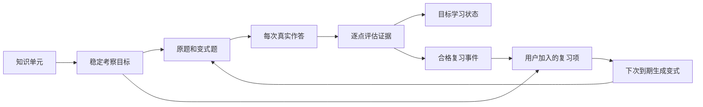

# 知识、考察目标与题目：数据模型讨论稿

创建：2026-10-02；更新：2026-10-03。状态：用户确认后已实现首个计划与复习闭环；本文保留设计分析。实际表结构、代码与边界见 [学习闭环实现](learning-loop-implementation.md)。

讨论输入：[用户提供的 GPT 分享页](https://chatgpt.com/s/t_6abfd1571d548191b08b435825c73222)、[持续学习路径方案](mastery-path-design.md)及当前 `practice_model.py`、`practice_service.py`、`practice_store.py` 的实际实现。已读取分享页正文；本文不把其中的示例数字、论文引用或生成的技术例题视为已验证的产品规则。

## 1. 已确认的决定

- 路线只提供建议；用户可以点名目标、跳过、换题、看解析、暂停或结束，不因“掌握不足”被锁关。
- 复习档位默认建议并采纳，允许当场修改；修改不必再调用模型。
- 优先实现现有练习加入计划并可复习。本版已落地。
- 到期复习默认生成同目标变式，同时保留重做原题入口。
- 只有用户选择加入计划，才建立后续复习安排。
- 评分、语义诊断、反馈和可选追问由一次成功模型生成完成；格式走 Schema，状态与引用约束走程序。
- 用户已确认：同一知识点的“能解释”“能应用”等表现分别安排复习，界面按知识点归组。这些是同一知识的掌握维度，观察证据可以互相参考。
- 用户已确认：评分由大模型结合资料、考察目标和真实回答作语义判断；约束用于保障依据和状态，不用写死的计分公式替代判断。

时间算法已接入 FSRS 6.3.2，默认库参数，禁用随机扰动并存档参数。整体评价与建议档位由模型语义判断，用户可改；不存在评分点计数到档位的固定映射。能力首版为回忆、解释、应用、辨析，标签可为空。

## 2. 对分享方案的判断

它最有价值的方向是把知识内容、考察能力、作答证据和选题策略分开，并让题目中的评分点连接到持续保存的知识。这样才可能区分“会背定义”与“会应用”，也便于从错误中生成更有针对性的变式。

需要修正的地方：

| 讨论中的思路 | 本项目建议 | 原因 |
| --- | --- | --- |
| 知识使用多标签 | 支持可选标签，首版不要求填齐八类 | 分类有助检索和生成，但每个标签不需要各自一套状态机 |
| 明确题目考察能力 | 采用，并绑定稳定考察目标 | 题型名称不足以定义两题是否可比较 |
| 多维度小数掌握分 | 先记录稀疏证据与状态 | 未测试不等于能力为零；少量样例不能支撑精确概率 |
| 固定加减分、阈值和乘法选题公式 | 暂不采用 | 数字尚无校准依据，重复追问可能快速刷高状态 |
| 教学、测试、复习协同 | 作为可接受/可忽略的推荐动作 | 符合用户自主选择；不要自动把“不会”变成强制学习流程 |
| rubric 直接变成知识单元 | 建立显式映射，不机械转换 | rubric 可能是题目特有步骤，也可能同时依赖多个知识点 |

分类还有三个边界要讲清楚：

1. 分享页里的内容类型、能力字段和后续示例状态有交叉，例如“概念/程序”与“理解/应用”被交替使用；实现需要统一字段含义，避免同一证据进入不同坐标。
2. `retention` 是随时间变化的记忆表现/预测，不能作为与“解释能力”可直接相加的一项分数。`confidence` 也要区分用户自述信心与系统证据是否充足。
3. 设计、解释、迁移并非固定难度阶梯；设计一个很小的例子可能比解释一个复杂机制容易。问题的条件、支持程度和任务复杂度需要单独描述。

对 BKT/DKT、知识图谱和复杂信息增益公式，本阶段不依赖它们。先保存真实问题、作答、评分依据、提示使用及后续复习表现，之后才有比较不同模型的基础。

## 3. 默认变式带来的关键设计：稳定考察目标

知识单元说明材料中的内容；考察目标说明用户需要展示什么能力；题目是一次具体考察的表达。三者需要不同身份。

以 TCP 为例，以下例子仅用于说明模型边界：

```text
KnowledgeUnit K1
    ACK 表示下一个期望收到的字节序号。

LearningTarget T1
    能解释 ACK 的含义。

LearningTarget T2
    在收到连续、无缺口的数据字节后计算 ACK。
    范围：不涉及 SYN/FIN、乱序、丢包和序号回绕。

Question Q1 → T2
    接收方正期待序号 100，收到从 100 开始的 20 个连续数据字节。
    下一个 ACK 是多少？为什么？

Question Q2 → T2
    接收方正期待序号 1000，收到从 1000 开始的 60 个连续数据字节。
    下一个 ACK 是多少？为什么？
```

Q1 和 Q2 可以作为同一目标的变式。询问有缺口的乱序数据应如何确认，会引入额外能力，不能因为都提到 ACK 就无条件归入 T2 的复习历史。

对应关系：



一个目标可以涉及多个知识单元，例如区分流量控制与拥塞控制；一道题也可能包含辅助知识。但首版每道计划复习题有一个主要考察目标，只有这个目标的对应复习项获得一次调度更新。

## 4. 拟议数据结构及其责任

这些是逻辑对象，不意味着独立服务、Agent 或模型调用。建议仍放在现有 SQLite 中，以便作答、评估和调度在同一事务提交。具体建表方式待讨论后确定。

### KnowledgeUnit：资料中的知识

```text
id, revision
statement
source_refs[]          # 资料快照身份、原文范围
content_tags[]         # 可选多标签
```

用可独立引用、可解释的陈述表示知识。首先确保资料依据，标签只是辅助。暂不要求难度、重要性、抽象级别、例子、反例和先修关系全部具备，也不按每个句子或 rubric 条目强行拆知识点。

稳定 ID 与资料版本不同；修改措辞和改变知识含义也不同。语义改变时保存新修订，不能把旧作答的成功自动迁移成新知识的证据。

### LearningTarget：复习中保持稳定的测量目标

```text
id, revision
unit_refs[]            # 指向具体知识版本
capability             # 回忆、解释、应用、辨析等
description
scope                  # 场景假设、范围和允许考察的内容
criteria[]             # 稳定 criterion_id、要求、是否核心
assessment_conditions  # 提示/工具条件和任务复杂度范围
```

这是同目标变式的共同依据。`unit_id + capability` 还不够：同属“应用 ACK”的连续收包题和乱序题并不天然可比，因此需要具体目标和范围。

首版能力建议先覆盖回忆、解释、应用、辨析；其余能力按实际场景扩展。预测、补全、纠错等问法可以服务于多种能力，不急于把每一种问法变成一列掌握分数。迁移描述相对先前任务的新颖程度，不能只给一道题贴上 transfer 就断言测试了迁移能力。

### Question：具体题目及当时的依据

```text
id                     # 每份已发布题目不可变，修改另建记录
primary_target_ref
prompt
rubric_points[]        # 本题 point_id、目标 criterion_id、具体要求
source_snapshot_refs[]
variation_of           # 可选原题/上一变式身份
task_features          # 本题问法、场景条件等
```

目标标准是可复用的，本题 rubric 则可以包含具体数值和推理步骤。两者通过 ID 映射，避免靠自然语言相似度事后猜测。计算某个具体 ACK 值是本题判分要求，不应为每个数值建立新知识单元。

生成后保存题干、标准、来源和版本；原题重做复用题目身份，创建新的作答身份，不能覆盖上次答案。界面默认变式，同时提供原题入口，原题何时展示答案由当前作答状态决定。

### Attempt 与 EvaluationRevision：事实和可修订判断

```text
Attempt
    id, question_id
    answer_text, submitted_at
    assistance_events  # 实际发生的提示、展示解析等
    effective_evaluation_id

EvaluationRevision
    id, attempt_id, revision, origin
    observations[]     # criterion_id、结果、答案原话、依据
    feedback
    suggested_rating
```

Attempt 保存真实发生的事，EvaluationRevision 保存对这件事的判断。用户修改评分产生新评估版本，不产生第二次作答。

观察结果建议区分“满足、部分满足、明确错误、尚未展示、无法评估”。遗漏不能直接推断为误解，题目不清楚或依据不足也不能默认按用户不会处理。误解仅记录有证据的候选解释和引用，不从一次失误推断用户稳定能力或态度。

系统记录实际使用的提示；“未记录提示”不保证用户完全独立作答，更不能靠模型猜测耗时和信心。显示证据时要保留这个区别。

#### 评分依据与整体判断

rubric 作为预存的参考要求，帮助模型明确问题的目标；模型理解用户实际表达，可识别同义表述、不同但合理的解法、部分正确、思路正确但局部计算错误、遗漏与明确误解的差别。题目假设不明确、资料不足或 rubric 本身有问题时，可以返回不确定或无法评估，并解释原因。

结构化结果应同时保存模型的整体判断与逐维度观察。不能把“缺一条评分点”“包含某个词”“答对三次”写成决定所有题目评价的固定规则；逐项编号完整也不意味着整体语义评价正确。程序校验引用真实、目标身份合法、输出结构可读和采纳版本有效，不能靠这些结构检查声称已验证用户理解。

一次应用题的解题解释也可能提供解释能力的证据，允许模型记录这种关联；复习事件仍只更新本次安排的主要目标，不凭一次回答给所有维度各增加一次复习。展示时合并为同一知识点下的证据与复习安排。

现已移除 `validate_grade()` 的覆盖组合等级推导和强制追问。整体评价与建议档位交给模型及用户修订，保留结构、原话与来源校验。档位建议、依据与可选追问在同一次成功生成中返回，日期由调度代码计算。

### ReviewItem 与 ReviewEvent：加入计划与复习时间

```text
ReviewItem
    id, learner_id, target_ref
    original_question_id
    status              # active / paused
    scheduler_state
    next_review_at

ReviewEvent
    id, review_item_id, attempt_id, evaluation_revision_id
    reviewed_at
    suggested_rating, effective_rating, rating_origin
    scheduler_version, parameter_snapshot
```

ReviewItem 由用户选择加入才创建；Question 的生成不会自动建立一个新复习项。换一道同目标变式，沿用同一个 ReviewItem；重做原题也走同一入口。

同一真实作答最多给对应复习项产生一个事件。多个评分点、网络重试、模型重试和评分修订都不能额外增加复习次数。辅助目标可以留下观察，但不会因一道综合题被批量当作独立复习。

建议档位默认采纳，用户可改；建议值与生效值都保留。档位调整只改变调度判断，评分内容更正则改变评估证据。前者不需要改写模型反馈，后者可能连带重算调度。

### LearnerState：从证据形成的可重建视图

按 `learner × target` 聚合证据。知识单元视图显示相关目标的表现，例如“能解释定义；连续场景应用有一次正确记录；乱序场景未测试”。不必为所有知识单元预填六个小数。

首版可以显示最近一次结果、已采纳作答数、是否有提示后正确、是否有延迟后正确、尚未覆盖的目标点和证据出处。未测试明确标记 unknown，不能等于 0 或错误。

复习是否到期由 ReviewItem 判断；内容能力没有因为日期变化自动归零。聚合缓存可以保存以提高读取速度，但原始作答和生效评估始终能重建它。

## 5. 变式如何生成，什么情况下进入同一调度记录

生成输入包含目标版本、核心标准、场景范围、资料依据、原题、近期变式和已出现的缺口。等价不要求字面相似；它要求考察范围和成功标准可比较。

程序可以检查目标 ID、来源范围、rubric 映射、必需字段和重复提交；无法仅靠 Schema 证明题目语义等价。目标遵循和题目质量仍需要真实样例评估，并提供“题目有误/超出目标”反馈。不能将模型自己填写的“等价”标志当作数学证明。

让可比较变式共用 FSRS 状态是本项目的适配假设，目标稳定不代表调度准确性已被验证。初期应从范围窄、评分标准明确的任务开始，保留原题/变式标记以比较后续表现；复杂设计任务不能直接承诺同样的记忆预测质量。若某类变式持续表现不同，应拆分目标或调整可比范围，而不是一概归因于用户遗忘。

满足以下条件才作为该复习项的一次有效事件：有真实作答、有可评分题目、评估有效、覆盖本次约定核心标准、支持条件符合约定、来源和目标版本可用。含糊题目或不可评分结果不按遗忘处理。

即时补充提示、讲解后的重述和辅助追问可以保留教学证据，但首版不自动当作新的独立复习事件。用户主动重做或提前复习可以更新记录，只计实际发生的一次，并保存时间和支持条件。

若变式超出目标，用户可继续把它当练习，不据此降低原复习目标的状态；目标本身有实质改变时使用新修订并重新审视旧证据。生成失败后提供重试或重做原题入口，不伪造已完成的复习。

## 6. 选题与教学推荐如何保持用户自主

程序先尊重当前请求：用户要看解析就给解析，要换题就生成变式，要复习指定目标就使用该目标。只有用户没有指定时才推荐到期项或其他目标，并简短说明原因。

低于某个评分不构成禁止操作的理由。初次使用没有证据时也不强制从定义题开始；可以根据用户选定的目标或材料提出一道适度探测题。

程序管理数据、时间、范围和请求预算；模型可以在选定目标内建议问法、解释缺口。无需把每一种教学选择都写成大量阈值分支，也不允许模型通过自然语言建议直接更改加入状态或复习日期。

当前契约允许只有评分与解释/建议。追问作为候选保存，用户点击继续才进入待答；三题技术上限与长期路径自由分别管理。

## 7. 实施前的代码对照（历史）

| 现有位置 | 实施前行为 | 已实施的方向 |
| --- | --- | --- |
| `QuestionDraft` | 自然语言 objective、题目、字符串 rubric、引用 | 增加稳定目标关联和 rubric 映射；旧记录保留原义 |
| `GradeDraft` / `validate_grade` | 覆盖/缺失、原话、反馈，按覆盖组合推导等级，弱回答强制追问 | 模型综合评价、逐目标证据与建议档位；追问可选，程序保留依据及状态校验 |
| `practice_questions` | 一行同时保存题目、一次答案和一次评分 | 分离可重复使用的题目与多次 Attempt，保存评估修订 |
| `practice_service` | 选段出题、保存快照、评分并创建追问 | 增加加入计划、按目标生成变式、合格事件调度与更正重算 |
| 页面 | 当前练习和历史记录 | 加入/暂停计划、到期变式、原题入口、建议档位和依据修改 |

旧记录迁移时，可以为原有每份作答建立一个 Attempt，并将现有评分作为首个评估版本，保存旧 ID 对应关系。当前 `missing_indices` 无法可靠区分错误和没展示，迁移不能编造更细的判断；旧的更正备注也不能自动视作有效改分。

已有题目缺少稳定知识和目标，加入计划时可以结合原题、预存 rubric 与资料快照生成目标草案，展示为可编辑内容。这个语义整理若需要模型，可使用一次独立的加入任务；它不是重复评分。新生成的题目以后可以在原出题请求中一并返回目标信息。

旧题目的 rubric 不自动永久固化为知识事实，不根据标签或相似度静默合并知识点。首版优先保持身份与证据可追溯，再逐步支持用户确认的合并/拆分。

正常评分仍用一次成功模型生成返回观察、反馈与可选建议。模型返回后，程序校验并在事务内写入生效评估、派生状态及合格复习事件；生成期间不占用长事务，提交时检查版本以拒绝过期结果。

评分更正重算受影响的目标状态和调度，使用原始复习时间、算法版本与参数，并处理随机扰动以确保回放可重现。修改不追加新复习次数，也不替换已经发出的待答题。

## 8. 实施范围及后续细化

同知识点归组、各目标独立复习、模型整体判断、可选追问、原题/变式、评分修订与事件回放已实现。首版以已保存的题目为起点，不自动提取整库覆盖路线。

其次讨论初始目标如何从已有题目产生，以及何种支持条件和变式范围可以共用调度。能力标签枚举、完整先修图、数值掌握模型可以后置，不需要阻塞首个可用闭环。

知识点粒度、目标修订/合并、细粒度语义诊断、变式可比性和参数校准仍需真实数据检验。运行契约以 [学习闭环实现](learning-loop-implementation.md) 和代码为准；本文更丰富的拟议字段不表示已经全部实现。
