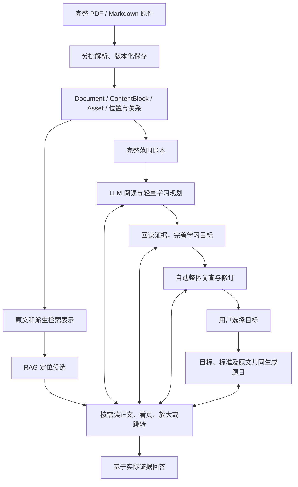

# 大文件与多模态学习清单改造方案

日期：2026-10-29。状态：讨论形成的设计方案，未开始本方案的业务实现或真实模型实验。

2026-10-30进度：已开始实施，第一批交付PDF自主视觉导航基础，详见[实现及验证范围](pdf-visual-navigation.md)。本文其余章节仍是设计，不代表整套方案已完成；本轮没有真实模型实验。

## 1. 目标与已确认的原则

支持从较大的 PDF / Markdown 中整理学习能力、生成有原文依据的知识清单，并据此生成题目；图片、表格、公式同时服务于 RAG 检索和整份资料的学习整理。

核心原则：**代码约束执行，LLM 判断语义。**

- 保持 PyMuPDF＋VLM 的原有选型，Docling 为可选解析器。选型不意味着本轮修改现有 VLM 开关，也不意味着每次导入都必须调用 VLM。
- 保留完整原件、版本化解析结果、结构与原文定位。轻量规划、检索描述和模型观察都是派生产物，不能替代原件。
- 不按文件长度推算应生成几个学习目标，不把 proposals 或 criteria 的建议数量作为语义正确性的硬门槛。
- 整页查看、局部放大、翻页、跨章跳转都是模型可选择的动作，不固定为每次必走的流程。
- 资源、完整请求预算、访问范围、身份、结构校验和持久化一致性由代码严格控制。
- 清单生成完成后自动整体复查；用户选择加入学习计划的流程仍保留，不自动创建正式学习记录。
- 不引入新的 Agent 框架、图数据库或必选视觉检索模型。复用现有文档模型、工具调用、SQLite、预算和恢复能力。
- 保留 V1/V2 和历史实验作为基线；新方案单独标识版本，不自动替换默认算法或改写冻结资料、Gold。

## 2. 代码与 LLM 的职责边界

| 事项 | 代码的硬约束 | LLM 的决策空间 |
| --- | --- | --- |
| 资料范围 | 只访问本次授权的文档版本、页面和资源 | 选择先读哪里、补读哪些允许访问的内容 |
| 分批 | 完整请求不得超预算；拆分不丢原文；记录主范围与辅助范围 | 请求关联内容、调整处理粒度、继续处理尚未完成的能力 |
| 页面与区域 | 校验页码、区域、坐标变换、分辨率和资源归属 | 看整页、放大、翻页、跳转关联位置或停止阅读 |
| 学习目标 | 校验字段、ID、证据、版本以及任务回执 | 判断学习价值、目标数量、粒度、条件、依赖与重要性 |
| 合并与拆分 | 保留旧版本和输入输出映射；引用不越权 | 判断是否等价、是否独立、是否遗漏必要能力 |
| 题目 | 校验目标身份、标准映射、引用和保存条件 | 决定问法、情景、难度及可判分的考核方式 |
| 完成状态 | 未处理、失败或预算中断必须如实记录 | 判断已有材料是否足以完成当前语义任务，说明剩余缺口 |

不再把以下规则视作设计前提：固定 80 行、10 MB 一个语义块、每次最多两张图片、每页固定产生目标、必须先看整页再裁剪、固定阅读前后各一页、目标超过某个数量就必须拆分。

模型可以建议合并相关内容，代码仍须检查合并后请求是否放得下；模型可以认为需要继续查阅，代码仍可因任务预算耗尽而暂停。模型不能自行扩大资源或权限。

代码校验只证明可验证的结构和执行事实，不把 Schema 通过、引用合法、处理范围完整解释为知识准确或语义无遗漏。

## 3. 总体结构：共享资料，两条使用链路

这是数据流和职责图，不规定每个框必须对应一次 API 调用。小任务可以合并相容阶段，大任务可以分批；阶段的输入、产物、证据和状态仍需分清。

RAG 为问题寻找相关证据；清单整理需要记录整个选定范围的处理去向，不能仅用 top-k 搜索代替遍历。跨章节理解可以借助检索，但检索命中不等于完成该章节的学习整理。

## 4. 大文件：三种粒度分别管理

### 4.1 解析任务分片

目的是控制内存、耗时、渲染资源与失败恢复，不定义学习目标边界。

- PDF 有可用书签时，先提取章节导航及页范围；书签只是初始结构依据，可能缺失或不准确。
- 没有可靠目录时，先做轻量扫描或按页范围解析，再根据标题、阅读顺序和必要的模型判断补充章节结构。
- 保留一个完整原件，优先向解析器传递页范围；只有接口确有需要时才生成临时子 PDF，并保留到原页码、原区域的映射。
- 一页可以包含多个章节；段落、图注或表格也可以跨页。页范围任务不应直接成为语义切分结果。
- Markdown 按结构识别标题、段落、列表、代码、表格和图片资源，保存原行号及引用式链接定义，不按字节硬切结构。
- 每个任务完成后持久化产物、实际解析器及问题；失败任务单独恢复，不重新解析所有成功部分。

10 MB 暂不作为默认分片标准。它最多是资源管理的一个参考量：压缩文件字节数不能代表解码内存、页面复杂度、OCR 开销或 Token 数。分片默认值应由少量代表性文件的资源测量确定。

### 4.2 文档结构单元

解析产物统一映射为现有 Document / ContentBlock / Asset。分片属于同一逻辑文档，不创建互不关联的独立资料。

保留：

| 数据 | 用途 |
| --- | --- |
| document_id、原文件哈希、解析版本 | 区分长期身份、原件版本和解析快照 |
| 章节树、章节来源与不确定性 | 提供父子、顺序和导航关系，不虚构可靠目录 |
| block_id、前后块、类型、章节归属 | 组织内容、扩展上下文 |
| 页码、区域、原文行或块内位置 | 从派生结果回到确切原件 |
| 图片/表格/公式资源及关联说明 | 找回图注、表头、单位、脚注和符号定义 |
| 明确交叉引用及模型提出的依赖 | 支持跳转；将结构事实与语义推断分开 |
| 解析问题及处理状态 | 保留无法读取、结构可疑、失败和未处理范围 |

先保存分片本地位置与原始页码，不在尚未完成的并发结果上反复重编号全局引用。发布解析快照时形成确定的索引；重新解析产生新版本，不把旧证据 ID 悄悄映射到新内容。

### 4.3 LLM 请求窗口

从结构单元组装实际请求，包含目标任务、导航、正文、图片、工具定义、Schema、已有结果和输出预留。

代码可以在超预算时沿结构边界分批，并明确保留剩余内容；模型可以要求补读或联合查看相关单元。不得静默截断必要证据，也不因为输入放得下就强制填满上下文。

表头、单位、脚注作为独立的真实依赖加入。辅助内容不重复计入主范围，不伪造跨空隙的连续原文。

## 5. PDF、图片、表格和公式的基础处理

PyMuPDF 提供原件访问、正文提取、页面渲染、图像区域和表格候选；VLM 负责需要视觉理解或补读的工作；Docling 保持显式可选。是否需要视觉理解不只由解析器是否报错决定，一张正常解析的架构图也可能包含重要内容。

必须区分：检测到对象、提取出内容、理解正确。这三项都不能由“解析器支持该格式”直接保证。

- 图片保留原图、页面位置、图注与邻近正文。补足 Markdown 嵌套图片及 HTML 等已知盲点；未支持的内容显式记录。
- 表格保留原图和结构化候选，关联真实表头、单位、脚注。模型决定需要查看哪些部分，代码准确报告实际读取的行列和已提取总范围。
- 跨页表格保存各页片段。是否同表、是否延续由结构证据和模型判断共同提出，合并保留依据及原片段；不能靠页码相邻直接认定。
- 公式保留原图、转写候选及符号说明。不能因为返回了 LaTeX 或非空文字就认定修复成功；不可靠部分继续带问题标记。
- VLM 观察、忠实转写和原始正文分开保存。观察文字是派生理解，不是 PDF 原文。
- 解析器未识别出对象时，整页图像仍可访问。实际看过页面也不保证每个细节被正确理解。

## 6. 多模态 RAG：先可检索，再回读

### 6.1 首选：文字检索表示关联原始对象

复用现有 BM25、Dense 与融合能力，在原文索引之外增加派生检索表示：

| 对象 | 可索引表示 | 回读对象 |
| --- | --- | --- |
| 图片 | 图题、可读标签、VLM 描述、相关正文 | 原图、图注、关联页面 |
| 表格 | 表题、列名、单位、行组原文、用途描述 | 真实行组、表头、脚注及必要原图 |
| 公式 | 名称、符号/转写、定义、适用条件、文字解释 | 原公式及解释上下文 |

派生表示绑定 source/parse version、block_id/asset_id 和生成配置。检索命中后返回原始对象定位，生成阶段按需要回读原文或看图。描述可用于导航，不能直接取得原始证据身份。

保留精确原文检索入口，不让摘要覆盖表格数值、符号和条件。索引生成与清单生成可以复用匹配版本的视觉产物，但通用检索描述不等于已经完成面向学习目标的分析。

### 6.2 可选后续：视觉检索

ColPali 一类页面视觉检索可作为额外召回路径，用于文字描述经常遗漏关键视觉特征的资料。当前不将其设为必选，也不切换既有解析器。

是否引入取决于实际失败样例、召回改善、模型部署和索引成本。若引入，分别检索后融合排名，不能直接混用不同模型的向量空间。

## 7. 视觉工具：模型按信息缺口导航

### 7.1 能力接口

以下是能力划分，不要求对应四个新工具；可以扩展现有工具的模式。

| 能力 | 输入 | 返回 |
| --- | --- | --- |
| 查看页面 | 文档版本、页码、当前阅读问题 | 页面图像或视觉观察、正文、已识别区域、实际查看记录 |
| 查看区域 | 已知区域 ID，或基于已看页面提出的坐标 | 从原件重新渲染的局部、实际范围、区域 ID、可读性限制 |
| 读取表格 | 表格 ID、需要的行列范围 | 结构化内容、表头和脚注、实际已读及未读范围 |
| 导航/定位 | 章节、图表引用、页码或搜索条件 | 允许访问的目标位置；导航本身不授予引用权限 |

RAG 返回页码、章节、命中文字和已有区域 ID，给出起点。先看整页再放大是可选的默认提示，不是强制状态机；精确命中且已有足够上下文时，可以直接读取区域或表格。

模型根据当前问题缺少什么选择动作：文字太小则放大；页首缺定义则找前文；续表则查看延续页；明确引用远处章节则跳转；证据足够则停止。不能固定每次读前后各一页，也不能要求所有图都先做一次通用描述。

### 7.2 区域 ID 与坐标

优先选择后端提供的区域 ID。漏检对象允许模型在看过的页面上提出新区域，后端检查页码、边界、缩放与旋转映射，从原始 PDF 或高分辨率图像裁剪，随后分配区域 ID。

坐标是导航请求，经过执行后才产生可引用的查看记录。模型不能通过提交坐标自行宣布已读取证据。禁止仅放大低清预览来假装获得原件细节。

### 7.3 谁实际看到了图

支持视觉的主模型可以直接获得图像并选择动作。主模型若只接收文字，则由 VLM 负责视觉判断，返回观察、限制、具体缺口及可继续读取的位置，再由执行层继续调用。

实现时依据模型实际能力选择路径，不因采用方案而静默更换模型。不把“VLM 看过原图”和“主模型收到 VLM 文字观察”混为一谈。重要细节可以再次面向当前学习任务读取。

### 7.4 停止与循环治理

LLM 判断信息是否足够，代码执行任务总预算、调用上限、超时、取消及重复请求治理。相同版本/区域/参数的重复读取可复用缓存；不同放大范围或新问题不能无条件当作同一结果。

模型返回缺口和简短行动理由，不保存隐藏思维链。预算不足时保留已有结果、未解问题与未读范围；不把停止解释为原文不存在答案。

## 8. 学习规划、正式目标与整体复查

### 8.1 轻量学习规划

规划条目包含：能力描述、关键条件/例外提示、支持位置、依赖候选、视觉阅读需求与不确定性。第一轮暂不生成完整题目和长篇讲解。

小文档可以整体处理；大文档分批阅读真实内容，随后整理条目之间的关系。第一轮是逻辑阶段，不承诺一次模型请求。

LLM 决定有多少值得学习的能力。短文可以产生很多条，长文也可以只有少量条；零目标须保留分析范围和理由。大纲、章节标题或检索摘要不能替代对内容的实际阅读。

规划是可修订的能力目录，不是唯一信息来源。叶级条目、原文指针和未处理范围一直保留；不能靠反复压缩目录删除条件以便塞进一次请求。

### 8.2 完善正式学习目标

按规划取回实际证据、必要定义、图表与关联内容，再生成知识描述、目标范围、criteria 和证据 ID。

LLM 可以增加新目标、拆分过大的目标、合并等价能力、修订规划。proposals 和 criteria 不设语义数量门槛；单次输出仍有资源上限，放不下时分批继续并明确待处理项。

omission_risk 保持表示“已提供原文内可能存在遗漏”；missing_context 表示所需外部背景未提供。前者是后续规划的信号，不必硬编码为立即二分；后者也不自动触发原文拆分。LLM 可选择补充条目、定向重读、调整粒度或记录无法完成。

输入超预算、输出截断等工程失败由代码保留现场并组织受限恢复，不能把截断结果作为完整候选发布。已成功、可验证的独立子任务可以保留。

### 8.3 自动整体复查

初步清单完成后自动复查，输入完整可用目标目录、必要条件、证据指针、规划条目和处理账本。需要时调用阅读工具，而不是仅凭目标标题去重。

LLM 决定保留、合并、拆分、补充或标记争议。相同主题但考核不同能力可以保留；合并后的新目标必须重新绑定实际证据并通过结构校验。

代码保存旧候选、新版本、每项修改的来源映射和简短理由。输入目标不能无记录地消失；但映射完整只能证明修订可追溯，不能自动证明语义条件没有损失。

目录超预算时，模型可以提出比较分组或定位相关条目，代码分批执行并记录已核对/未核对关系，不默认建立全部目标对的平方级比较，也不把局部分组复查宣称为全局无重复证明。

全局复查失败时，原清单仍可查看，并标记复查未完成；恢复从未完成步骤开始。它属于生成链路的质量步骤，不是恢复已取消的实验 Judge API。

### 8.4 覆盖账本与完成口径

代码对选定范围建立完整目录，包括正文、已识别对象和 PDF 物理页面；LLM 可以选择处理顺序、批次以及哪些内容无需单独形成学习目标。

分别记录：

- 解析完成的范围；
- 实际送入文本模型的范围；
- 实际送入 VLM 的页和区域；
- 模型已分析并给出去向的范围；
- 形成学习目标的范围，以及排除、失败、待核对的范围。

将整页传入图像请求不等于所有小字都读清。辅助查看一页也不自动等于已完成该页的清单分析。模型认为某内容不值得单列目标属于语义决定，须保留该决定的依据和来源。

如果任务要求全 PDF 视觉检查，未实际查看的页面必须保留为未完成；这是声明与执行的一致性约束，不是要求每页生成一个目标。如果采用选择性视觉读取，就明确报告其范围，不能声称所有视觉内容都已检查。

## 9. 题目生成与现有学习状态

题目输入为已确认的目标、criteria、实际原文证据、必要上下文，以及相关图像/表格/公式。轻量规划和检索描述不能成为唯一依据。

LLM 决定题型、问法、难度和情景。代码验证题目与目标标准的映射、实际可见引用及持久化条件。视觉题需让作答者看到必要图像或数据；不能只让出题模型看过。

本轮第一版优先复用现有单目标出题、标准映射、加入计划和 FSRS 行为。若单目标包含不适合一起考核的独立能力，先由模型在清单整理阶段评估是否拆分，不能只为出一题而删除条件。多题成绩聚合不是本方案隐含增加的功能，需要时再明确其学习状态语义。

已加入计划的目标、题目和作答不因新清单整体复查被自动改写。新目标修订保留独立版本，复用现有用户选择与事务提交边界。

## 10. 资源、证据及恢复的硬约束

### 10.1 预算

- 新方案沿用 context_tokens=131072、output_tokens=12288、安全余量=2048；本轮只是确认设计，不修改配置。
- 完整输入包括系统提示、工具定义、Schema、历史、原文、图像和工具结果。正文不能独占上下文上限。
- 继续标注当前文字预算为保守估算，不冒充供应商 tokenizer。视觉预算按模型接口能力、图片数量/像素及可观测 usage 单独管理。
- 原“每次两张图”和“每图固定 8192”只能视为旧实现中的限制与估算，不能作为新方案的语义规则；新的资源默认值需结合实际服务测量确定。
- 任务累计调用、时间、费用预留和未知 usage 都保存；硬限制在实际请求前检查。失败请求、兼容尝试和重试计入可观测消耗。
- 供应商不提供账户硬限额时，不把客户端费用预留称为绝对账单封顶。

本方案不新增真实请求授权，也不扩大历史评测额度。未来小型验证使用独立运行版本和明确预算。

### 10.2 证据与校验

- 每次请求建立实际可见的证据集合；模型返回 ID，后端恢复文本范围、页/区域或表格定位。
- 导航目录、检索描述、尚未执行的区域请求不授予原文引用权限。
- VLM 观察记录其来源、查看范围、模型配置和限制，不能伪装为原文转写或已人工验证事实。
- 复用完整 Pydantic / Schema、引用范围、来源版本和业务校验；视觉证据的身份与查看回执扩展现有机制。
- 保留原始响应、解析、修复、校验和正式结果。延续安全 JSON 修复与最多两次纠错重试；避免 SDK、业务层和恢复层相互叠加产生隐式额外重试。

### 10.3 持久化与执行治理

- 复用现有 SQLite、OS 锁、attempt/revision、幂等、共享工作槽及取消机制，不另造通用工作流框架。
- 网络调用期间不持数据库写事务；发布时复核来源版本与任务状态，拒绝迟到结果。
- 解析、索引、规划、目标、复查的产物分开保存并绑定依赖版本。资源、模型或策略变更不静默混入旧任务。
- 局部失败保留成功产物和失败范围；继续时复用有效结果，不自动无限重试或扩大预算。

## 11. 当前实现与拟改动的关系

下表依据 2026-10-29 的工作区静态核对，不代表本轮运行测试或真实模型验证。

| 模块 | 当前基础 | 拟改动 |
| --- | --- | --- |
| document_model.py | Document、ContentBlock、Asset、Location，章节路径和表格依赖 | 完整章节/相邻/跨引用关系、页/区域及分片溯源，兼容旧快照 |
| pdf_parser.py | PyMuPDF 默认、Docling 可选、VLM 兜底，20 MB / 200 页限制 | 分片解析与恢复、全原件映射、结构问题显式记录；资源限额重新评审 |
| pdf_vision.py | 整页＋可选裁剪送 VLM，返回文字观察；每次两图限制 | 按任务阅读、区域导航与坐标映射、可观测的视觉预算和查看回执 |
| knowledge_tools.py / 检索模块 | 原文检索、结构元数据、read_table、inspect_visual | 派生检索表示到原件的映射，按需读取页面/区域和关联位置 |
| outline_v2.py | 结构原文窗口、证据 ID、软数量建议、遗漏/外部缺口区分 | 轻量规划和自主补读、目标精化、与覆盖账本对接；独立策略版本 |
| outline_service.py / OutlineStore | 候选、原文出题、状态与版本恢复 | 承载阶段产物与修订映射，复用正式加入计划的事务边界 |
| generation_budget.py / structured_recovery.py | 完整文字预算估算、结构校验和有限恢复 | 覆盖新工具/视觉输入，防止重试和费用重复计数 |

工作区已有 outline_final_review.py / outline_final_store.py 及调用接线，是此前讨论中暂停的整体复查草稿。本方案不将其视为已经验收的能力；实施时先按本方案重新评审草稿的行为和已有未通过测试，避免把未完成设计直接接入新路径。

主要源码入口：

- [文档模型](<E:/agentic project/knowledge-review/document_model.py:14>)
- [PDF 解析](<E:/agentic project/knowledge-review/pdf_parser.py:94>)
- [视觉查看](<E:/agentic project/knowledge-review/pdf_vision.py:163>)
- [检索结构元数据](<E:/agentic project/knowledge-review/knowledge_tools.py:20>)
- [V2 提取契约](<E:/agentic project/knowledge-review/outline_v2.py:29>)
- [原文与目标共同出题](<E:/agentic project/knowledge-review/outline_service.py:367>)
- [生成预算](<E:/agentic project/knowledge-review/generation_budget.py:16>)

## 12. 分步实施与验证

### 第一步：稳定资料与工具基础

实现原件映射、解析分片恢复、结构和视觉访问记录，补齐当前图片/表格的已知定位缺口。保持原有解析器选型，不先引入视觉向量检索。

验收：跨页、局部裁剪、旋转页面、漏检区域补读、表头/脚注和版本更新能定位回实际原件；失败不覆盖成功快照；访问和预算检查生效。

### 第二步：跑通一份资料的学习链路

接入轻量规划、工具自主补读、正式目标和自动整体复查，保留原始候选与修订关系。先复用已有出题和学习状态模型。

验收：短而密集和长而稀疏资料不受固定目标条数约束；模型可以选择直接区域读取、整页后放大或跨页/跨章跳转；未处理范围和复查失败可恢复。

### 第三步：增加多模态检索表示

用已有视觉产物、图题、表头等建立可检索表示，命中后返回原件。将检索收益与清单覆盖分别评估。

验收：可定位到相关原始对象；派生描述不冒充原文证据；来源更新后旧索引不越权参与新请求。

### 第四步：小型真实比较

复用既有代表性资料，必要时增加极少数针对性片段，不扩建大型 Benchmark。原冻结语料与 Gold 不改写；新要求单独建版本。

| 假设 | 需要观察的证据 |
| --- | --- |
| 分片解析使大文件更可控 | 峰值内存、耗时、断点恢复、跨片结构损失 |
| 自主放大/跳转改善图表理解 | 实际查看轨迹、条件/单位/公式错误、额外调用成本 |
| 先规划再精化值得增加调用 | 关键能力及必要条件覆盖、重复/遗漏、首次产物与总耗时 |
| 整体复查能改善清单 | 修订前后条件保留、真实补漏、错误合并案例 |
| 派生检索表示改善召回 | 原始对象命中及完整证据召回、错误定位、索引成本 |

程序只汇总客观指标和可追溯产物。语义质量继续导出完整原文、目标、引用、Gold 和规则供独立评价，不恢复自动 Judge API。受控工具测试验证执行机制，不能充当真实语义质量结论。

## 13. 参考依据与适用边界

这些是此前调研过的公开设计参考，不表示本项目已经安装、接入或验证了全部能力：

- [Docling 文档模型](https://docling-project.github.io/docling/concepts/docling_document/)与[结构/预算分块](https://docling-project.github.io/docling/concepts/chunking/)：借鉴结构、位置和表格上下文保留，不改变其可选地位。
- [Unstructured 分块](https://docs.unstructured.io/concepts/chunking)：借鉴先识别元素、再分块、保存原始元素映射。
- [LlamaIndex 节点关系](https://developers.llamaindex.ai/python/framework/module_guides/loading/node_parsers/modules/)：借鉴局部定位后扩展上下文；父子大小层级不能自动等同真实章节。
- [LangChain 多模态检索](https://www.langchain.com/blog/semi-structured-multi-modal-rag)：借鉴检索表示与生成原件分离，不要求接入其框架。
- [RAG-Anything 上下文处理](https://github.com/HKUDS/RAG-Anything/blob/main/docs/context_aware_processing.md)：借鉴视觉对象与标题、邻近正文共同理解，不引入整套知识图谱。
- [视觉裁剪工具示例](https://platform.claude.com/cookbook/multimodal-crop-tool)及[坐标说明](https://platform.claude.com/docs/en/build-with-claude/vision-coordinates)：借鉴按需放大与坐标映射；供应商专属图像预算不能照搬到当前模型。
- [ColPali](https://github.com/illuin-tech/colpali)：保留页面视觉检索作为有实际召回需求时的候选方案。

本轮交付仅为方案文档：未改变业务代码、个人配置、正式学习数据、默认算法和历史评测记录，未发起真实模型请求。
