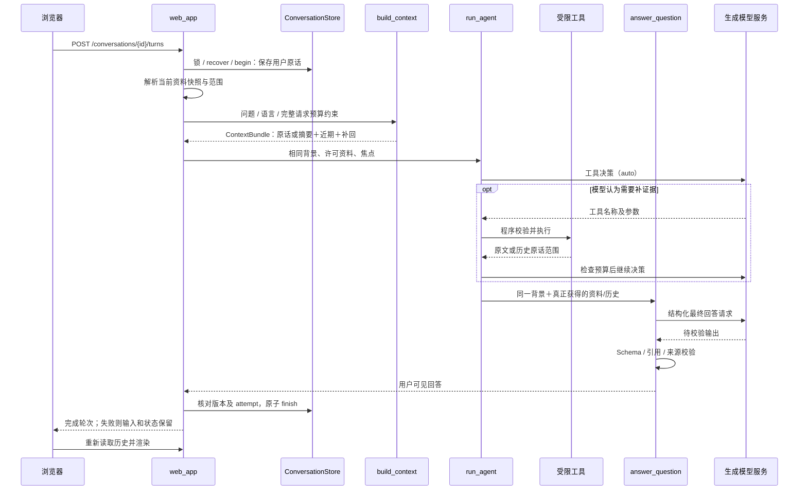

# 第一课：一次网页提问怎样完成

核对日期：2026-10-11。先读 [学习手册](project-learning-handbook.md) 第 1–4 节，建立产品、架构、技术和数据身份的地图。本课追踪持久聊天入口；`/api/ask` 是仍保留的直接问答接口，不等同于持久轮次链路。

## 1. 用具体问题建立预期

合成讨论：第一轮“SEQ=100，LEN=20，ACK=120”，随后问“长度改成30呢？”。目标是理解它如何携带前文，允许模型无需文档检索直接回答，以及如何保存为同一聊天的下一轮。

在有连续、纯数据、无 SYN/FIN 或缺口等教学假设下，应讨论 ACK=130。这里的 TCP 数字例子只用于观察数据流；受控接口中固定 ACK=130 不能证明真实模型理解了协议。



两个模型阶段共用聊天背景，但系统任务、工具定义、最终 Schema 以及本轮新增证据不同。工具阶段可多次调用；兼容输出也可能重发，所以不是每条消息固定两次 HTTP。

## 2. 入口：浏览器究竟提交什么

打开 [app.js](../web/static/app.js)，读 `askQuestion()` 和 `sendChatSubmission()`，再读 [web_app.py](../web_app.py) 的 `TurnRequest` / `AskRequest`、`submit_turn()`。

| 字段 | 从哪里来 | 为什么传它 |
| --- | --- | --- |
| conversation_id | 当前选中的聊天，放在 URL | 确定存档和历史隔离 |
| request_id | 新提交 UUID；未确认重发复用 | 一个用户提交和一次网络请求不同，防止重复创建原话 |
| question | 用户输入 | 完整保存；预算不足不能静默截掉 |
| document_ids | 当前文档加额外勾选资料 | 程序解析许可范围，不接受任意文件路径 |
| focus_document_id / focus_source_id | 当前文档身份与版本 | 防止用页面旧版本提问 |
| line_start / line_end | 可选选段；无选段时省略 | 限定焦点，不能把一项缺失当成有效范围 |
| strict / response_language | 当前资料模式及中文/英语选项 | 本轮选择优先于历史偏好 |

当前网页仍要求打开一份文档才能发送，即使模型最后没有查阅它；这是入口约束，不意味着每轮强制 RAG。额外选择的资料和集合也不是自动混为全知识库权限。

浏览器 localStorage 保留待确认请求与选项。聊天事实在 SQLite；浏览器刷新不能替代服务端幂等或事务。

## 3. 原话先保存，网络请求随后进行

在 `execute_turn()` 按顺序读：`generation_lock` → `recover` → `begin`。对应存储见 [conversation_store.py](../conversation_store.py)。

- 同聊天 OS 锁防止并发生成错序；其他聊天可以独立执行。
- `begin()` 用短写事务分配 seq、创建用户 message、设置 running 和新 attempt。
- 同一 request_id 携带相同输入且已完成时返回原轮次；输入改变则拒绝复用。
- 失败轮次重试复用原用户消息；存在未完成输入时先重试或跳过，不插入后续生成。
- `recover()` 必须在取得锁后处理遗留 running，不能因页面读取就把仍活跃的任务重置。

这里锁覆盖模型期间，但 SQLite 写事务没有覆盖模型网络等待。操作锁保证一条聊天的顺序；短数据库事务保证持久事实一致，是两个不同职责。

为什么原话先存？模型失败或服务中断时用户不必重新粘贴，重试能指向同一次提交。失败时可能只有用户消息，没有成功助手消息；不能保存一段假成功回答。

## 4. 数据已在程序中，不代表模型已看见

读 `resolve_scope()` / `_source_for()`：后端读取当前 Source 快照并校验 ID、版本及选段。导入正文替换通过数据库当前覆盖构造 Source；`source_id` 对路径和实际正文做哈希，不只依据文件名。

然后读 [conversation_context.py](../conversation_context.py) 的 `ContextBundle` / `build_context()`：

| 项目 | 程序手中有什么 | 最初发给模型什么 |
| --- | --- | --- |
| 文档 | 许可资料的当前全文快照 | 文件名、source_id、行数等目录元数据；有选段时另附真实焦点原文 |
| 短聊天 | 已完成历史 | 预算允许时完整历史 |
| 长聊天 | 完整原话与有效摘要 | 摘要、近期完整轮次和相关早期原话 |
| 当前问题与偏好 | 本轮提交 | 完整问题、当前语言及模式 |

历史和资料作为任务数据放入上下文，不提升成新的系统指令。ContextBundle 是 Python 中传递背景与可见范围的对象，不是新增的模型服务。

## 5. Agent 决策：模型选工具，程序执行工具

读 [agent_loop.py](../agent_loop.py) 的 `run_agent()`，重点寻找 `tool_choice="auto"`、`calls`、`tools.execute` 和 `visible`。

1. 任务说明、共用背景、许可目录、可选焦点、当前偏好和工具定义组成请求；调用前校验来源与完整预算。
2. 模型可以返回工具调用，也可以直接结束资料收集。结束时不偷偷搜索一次。
3. 程序解析工具名称/JSON 参数，校验范围并执行。模型不会直接执行 Python，也不能任意读取磁盘。
4. 真正返回的原文记入 visible；工具结果进入后续决策请求，必要时按预算缩减并同步缩小权限。
5. 错误回传模型或终止；成功与失败都受工具额度限制，不能无限补查。

| 工具 | 用途 | 额外代价 / 权限 |
| --- | --- | --- |
| `search_notes` | 在本轮许可文档里找相关片段 | 实际调用才加载 E5、准备/复用向量；相似度不是可信度 |
| `read_source` | 直接读已许可 source_id 的指定行 | 不运行 embedding；单次读取有行数上限，原文行号不重编 |
| `search_conversations` | 按需找合格旧讨论 | 全部合格历史有资格，归档不排除；关键词＋语义融合，历史不能扩大文档权限 |
| `read_conversation` | 读原话字符范围及相关上下文 | 来源版本/实际字符范围检查；不同于文档行引用 |

读 [knowledge_tools.py](../knowledge_tools.py) 的 `__init__`、`embedder`、`search_notes` 和 `read_source`。初始化可以结构分块，但不会加载 embedding 或计算向量；“没有 embedding”不代表完全没有资料解析成本。

## 6. 最终回答：保留同一聊天背景，换成回答任务

读 `run_agent()` 尾部调用，再读 [model_client.py](../model_client.py) 的 `answer_question()`。Agent 调用显式传 `chunks`，包括可能为空的列表。

重要区别：`chunks=None` 在该通用函数里代表全文模式；`chunks=[]` 代表没有实际获得文档原文。网页 Agent 零调用且没有焦点时传空列表，不能因为空列表而转成全文，也不能恢复强制检索。

最终阶段拿到相同问题、语言、聊天背景，另外接入实际工具资料/历史。它重新检查包含输出 Schema 的完整预算，减少可选内容，缩减后的实际范围才有引用资格。

| 回答类别 | 含义与校验 |
| --- | --- |
| grounded | 声称来自资料，必须有合法文档引用 |
| inference | 基于资料的推导，同样需要文档引用；推导语义仍待核对 |
| supplement | 模型背景补充，不能声称文档引用；严格模式禁止 |
| history reference | 证明某聊天当时说了什么，单独校验；不能把 supplement 变成文档依据 |

无历史工具结果时用 NoteAnswer / SourceOnlyAnswer；存在可见历史时用 MemoryAnswer / SourceMemoryAnswer 扩展独立历史引用。SourceMemoryAnswer 继承原严格文档契约，没有放松文档引用要求。纯历史解释可以在普通模式回答，在严格文档模式不能冒充资料充分。

## 7. Schema、兼容协议和引用为什么都要检查

读 [structured_output.py](../structured_output.py) 的 `request_structured` / `request_tool_result`，再读 [answers.py](../answers.py) 的 `validate_answer` 及 [context.py](../context.py) 的 `validate_chunks` / `citation_is_visible`。

输出字段和枚举在 Pydantic Schema，由 API 参数提供。优先原生结构化输出；明确的能力不支持错误才进入结果函数提交协议。`submit_result` 只装载结果，程序不执行它作为业务工具。每次兼容请求仍须检查预算与来源，并本地解析/校验；截断结果不能当成完整答案。

校验层次：输出形状 → source_id 属于本轮版本 → 行范围合法 → 每一行都属于实际发送范围 → 类别与引用规则一致。未发送的间隙不能通过“起止都在文件内”混过去。

例如程序发送 L10–L12 和 L20–L22：引用 L10–L12 可通过，引用 L10–L22 必须拒绝，因为中间有未发送原文。即使结构通过，也不能证明 L10–L12 在语义上支持模型结论。

## 8. 请求预算不是“全文字数限制”

读 [generation_budget.py](../generation_budget.py)：

```text
输入上限 = 配置上下文容量 - 输出预留 - 安全余量
请求估计 = messages + 工具/调用/结果 + 输出 Schema/协议参数 + 消息协议开销
```

生成端采用 UTF-8 字节保守估计及额外开销，不用 E5 tokenizer；不能把默认 fallback 容量当成已验证的服务容量。Agent 每次决策、工具结果追加、最终结构化请求和兼容回退都要复查。

可选文档片段按原文整行缩减，可选历史按字符范围缩减，引用权限同步收缩。当前问题、必要选段与完整存档不静默截断。最小安全请求仍容纳不了就失败，保留输入。

## 9. 成功、失败和迟到结果分别怎样保存

`generate_answer()` 给前端构造 coverage、blocks、原文摘录、程序工具步骤、停止原因和独立历史引用。工具步骤是执行记录，不是模型隐藏思维链。

`finish()` 的短事务先检查文档 revision/移出资格与记忆依赖，再确认当前 running 和 attempt；满足后保存助手消息、结果及上下文诊断和依赖。`fail()` 只更新匹配当前 attempt 的轮次错误，原用户输入保持。

| 情况 | 应看到的状态 |
| --- | --- |
| 成功 | completed，有用户消息和一条可见助手回复 |
| 模型/预算失败 | failed，原话保留，可按原 request_id 重试 |
| 同聊天并发 | 明确忙碌/未完成提示，不制造乱序后续轮次 |
| 重复发送已完成请求 | 返回原回复，不再创建消息或学习记录 |
| 资料替换/聊天删除后旧请求返回 | 版本或 attempt 检查阻止发布，不能复活撤销来源 |

成功回复保存后，首次聊天标题可由独立后台任务生成；标题失败不撤销成功回复，手动标题优先。浏览器重新读取历史来展示结果，浏览器的聊天切换 epoch 防止旧读取覆盖当前页面。

为什么还要数据库内复查？调用前检查与保存之间用户可能替换或删除来源；仅检查一次存在时间差。

## 10. 四个可以运行的实验

这些是已有受控测试：用临时业务数据库、合成资料和 mock 响应，不请求真实模型或下载 embedding。代码入口都已给出，可在调试器里观察合成变量，不输出真实配置。

```powershell
Set-Location 'E:\agentic project\knowledge-review'
```

### 实验 A：零检索也能把背景送到两个阶段

```powershell
.\.venv\Scripts\python.exe -m unittest test_conversations.ConversationTests.test_both_model_phases_receive_same_chat_background_without_search -v
```

读测试中 `respond()`、`requests` 和 `backgrounds`：两个请求都包含 SEQ=100、上一轮解释、当前追问及语言；工具 auto；原背景一致；没有工具步骤；embedding 若加载会立即使测试失败。可以在该合成回调处设置断点看 request body，不需要请求真实服务。

预期：该用例通过。它证明程序传递正确；ACK=130 是回调固定答案，不证明真实模型的协议理解。

### 实验 B：直接读取原文无需向量搜索

```powershell
.\.venv\Scripts\python.exe -m unittest test_agent_loop.AgentLoopTests.test_model_can_read_missing_evidence_without_semantic_search -v
```

读回调如何提出 `read_source`，观察第 3 行进入结果、严格回答引用第 3 行、embed_query / embed_chunks 未调用。比较它与实验 A：都不用 embedding，但 B 有真正原文，所以严格引用可以成立。

### 实验 C：失败重试和重复发送只保存一轮

```powershell
.\.venv\Scripts\python.exe -m unittest test_conversations.ConversationTests.test_failure_duplicate_retry_and_completed_replay_save_once_without_learning -v
```

第一次强制生成失败后只有用户消息；重试完成后有两条消息；重放返回原消息；新输入在前一失败未解决时被拒绝；学习计划保持。找到 begin 的旧 request_id 分支和 finish 的 attempt 条件，解释是哪条规则保证结果。

### 实验 D：文件存在的行也可能不能引用

```powershell
.\.venv\Scripts\python.exe -m unittest test_model_client.ModelClientTests.test_rag_http_request_excludes_hidden_lines_and_enforces_citations -v
.\.venv\Scripts\python.exe -m unittest test_conversations.RequestBudgetTests.test_agent_each_iteration_and_final_budget_shrink_citation_permissions -v
```

一个用例构造未发送行的引用并确认拒绝，另一个改变预算观察可选原文减少和权限同步。重点是查看最终请求及 visible_chunks，而不是只看原始磁盘文件。不能把预算裁剪后的文本重新编号再引用。

作为对照还可运行：

```powershell
.\.venv\Scripts\python.exe -m unittest test_agent_loop.AgentLoopTests.test_general_answer_does_not_load_embedding_model_or_search -v
.\.venv\Scripts\python.exe -m unittest test_agent_loop.AgentLoopTests.test_no_tool_call_allows_strict_insufficient_answer -v
```

前者检验没有暗中检索；后者检验严格无资料时可以明确资料不足。测试数量不是学习目标，能解释观察与断言才算完成本课。

真实模型样例另看 [评测说明](quality-evaluation.md)；显式 live 会发送合成数据到当前服务并产生调用，成功/失败须另记，不把这些 mock 实验说成真实语义效果。

2026-10-11 教学验证：上面七个不同用例实际运行通过（1.607 秒），日志 `.data/evaluations/learning-handbook-tests-20261011.txt`；实验 C 中的 RuntimeError 日志来自故意注入的失败，随后恢复断言通过。本次未重跑 315 项全量，也没有调用真实生成模型。手册链接、命令中的测试类/方法及代码围栏检查通过；固定评测资料的离线校验通过。后续代码变化时需要重新核对，不将本日期结果当成永久保证。

## 11. 用自己的话复述这条链路

完成本课后，应能说明：当前文档的全文在哪一步进入 Python、哪一步真正进入模型；一次零调用的聊天为什么仍有两个模型阶段；最终阶段怎样收到前文；为什么 request_id、attempt 和 revision 都要存在；引用校验与事实正确性的区别；生成失败后如何恢复。

可以围绕本课回答面试追问：“Agent 工具是怎么接入的？”“你如何避免强制 RAG？”“为什么采用两阶段？”“如何处理重复提交与过期引用？”每个回答都指出一个函数、一个具体例子和一个验证证据。下一课按 [手册路线](project-learning-handbook.md#5-学习路线一次追一条完整操作) 进入长聊天摘要与跨会话召回。
