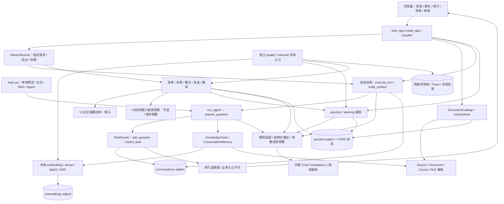

# Knowledge Review 项目架构地图

> 更新日期：2026-10-26（Asia/Shanghai）。源码基线：`4f06786`，分支 `codex/outline-extraction-v2`；父阶段 `e947e6b` 为任务识别与持久澄清。原2026-10-21地图已按当前源码修订。前一实现阶段266项相关受控回归通过；本次文档更新只做静态核对，不重复声称运行测试、真实模型质量或部署验收。
>
> Git 仓库根目录在本应用的上一级；下文代码路径统一相对应用根目录 `knowledge-review/`，在 Git 根目录定位时加此前缀。源码链接从本文目录出发。三份文档属于同一基线，后续改动应更新受影响章节和基线说明。

**摘要**：这是一个本地优先的个人资料学习应用。FastAPI 和无构建步骤的浏览器脚本组成界面；Python 服务协调资料问答、会话记忆、练习、学习目标及 FSRS；Markdown/PDF 快照、SQLite 和本地模型承担证据及状态管理；云端兼容 Chat Completions 服务承担生成和语义判断。它是模块化单体，另有独立评测入口；SSE、共享工作池及取消是执行适配层，不是另一个 Agent 服务。

## 目录

- [1. 系统定位与边界](#system-boundary)
- [2. 总体架构与依赖方向](#system-map)
- [3. 模块职责与依赖地图](#module-map)
- [4. 核心实体与状态归属](#data-model)
- [5. 存储与基础设施](#infrastructure)
- [6. 配置与运行边界](#runtime)
- [7. 测试证据与历史文档差异](#evidence)
- [8. 架构导航与维护](#navigation)

## 1. 系统定位与边界

### 主要能力

| 能力 | 当前实现及边界 | 关键证据 |
| --- | --- | --- |
| 资料管理 | 导入 Markdown/PDF，阅读选段、嵌套集合、移动、替换、移出、PDF 重解析和页面/区域显示 | [web_app.py](../../web_app.py)：`DocumentCatalog`、`_source_for`、`create_app`；[library_store.py](../../library_store.py)：`LibraryStore` |
| 资料问答 | 全文、固定 RAG、按需工具 Agent；资料依据/推导/模型补充分段，严格模式禁止补充 | [main.py](../../main.py)：`main`；[agent_loop.py](../../agent_loop.py)：`run_agent`；[answers.py](../../answers.py)：`validate_answer` |
| 连续聊天 | 原话和轮次持久化、失败重试/跳过、预算压力摘要、跨聊天搜索、独立历史引用、标题与归档/删除 | [conversation_store.py](../../conversation_store.py)、[conversation_context.py](../../conversation_context.py)、[conversation_memory.py](../../conversation_memory.py) |
| 任务识别与澄清 | 持久聊天Agent可选择已注册任务或调用ask_question；waiting_user卡片支持选择、自由文本、取消和恢复。业务任务返回原界面的入口卡片，不等于自动创建清单/练习 | [task_routing.py](../../task_routing.py)、`ConversationStore.wait_for_user/answer_clarification`、[任务实现](../task-routing-implementation.md) |
| 练习与复习 | 文档/选段/集合/讨论出题，保存真实答案后评分，可选追问、主动加入、固定目标变式、评分修订和 FSRS | [practice_service.py](../../practice_service.py)、[learning_service.py](../../learning_service.py)、[learning_state.py](../../learning_state.py) |
| 学习组织 | V1全文/分层概述为默认，概述归并通过稳定证据 ID 选择引用、程序还原坐标；V2结构化原文直接提取为显式实验选项；候选审核、跨章归组、有限复查、学习顺序与下一目标建议 | `outline_*.py`、[证据ID](../outline-evidence-ids.md)、[V2实现](../outline-v2-implementation.md)、[route_recommendation.py](../../route_recommendation.py) |
| 执行与观测 | 指定 JSON 请求、SSE、8 个后台提交/继续入口和自动标题共享有界工作池；协作取消与进程级计数 | [agent_stream.py](../../agent_stream.py)：`StreamRunner`；[agent_cancel.py](../../agent_cancel.py)；[agent_work.py](../../agent_work.py) |
| 工程/质量评测 | 受控业务流程、显式 live 生成评测、A/B/C 检索实验、标签审核/冻结、BEIR 指标与失败清单 | `quality_*.py`、`evaluation_*.py`、`retrieval_benchmark_*.py`、`evals/` |

### 系统外部

- 生成服务由 `LLM_*` 配置；使用 OpenAI Python SDK 的兼容接口，不限定供应商。视觉按字段使用 `VLM_*` 非空值，否则继承 `LLM_*`。没有在线网页搜索工具。
- 本地 SentenceTransformer 默认 CPU、离线加载；首次下载是显式命令。PDF 默认 PyMuPDF；Docling/OCR 是额外配置的本地解析选项。模型可用性及部署容量不能由源码保证。
- C++ Gateway、Redis 限流、Gateway 部署/鉴权/指标代理位于独立项目，**不在此代码树**。本应用只提供 HTTP 适配端点；相关说明见 [gateway-sse.md](../gateway-sse.md)。未检查独立项目的当前源码或证据。
- 本地资料、私人聊天、作答和配置存于`.data/`、`.env`等忽略目录，不属于版本化架构资料。应用内未见账户/租户认证系统，文档scope是单用户应用的资料范围约束，不等于多租户安全边界。
- 清单、归组和路线仍是可审核建议；普通问答不自动出题、加入计划或推进调度。已实现最终模型正文增量delta，预览在校验/保存后才成为正式结果。尚未实现通用整份资料总结工作流、全局用户画像、历史纠正关系自动建模或分布式任务队列。

## 2. 总体架构与依赖方向

图表示逻辑职责和主要调用方向，不是严格的 Python import DAG。源文件平铺在应用根目录；模块间存在延迟导入以复用服务与避免导入环，例如 `model_client` ↔ 会话上下文、`outline_service` ↔ `outline_context`。没有 ORM、依赖注入容器或独立领域服务进程。

主要控制流有三类：

1. 请求式：界面/CLI → 解析当前范围或历史快照 → 业务服务 → 本地工具/外部模型 → 程序校验 → 状态发布 → 响应。CLI 问答和 `/api/ask` 不保存聊天轮次。
2. 持久作业式：预留执行槽 → 保存任务身份/范围/计划 → 返回 202 → 工作线程分步生成 → 保存步骤/候选 → 用户审核 → 可选加入。HTTP 已返回不代表工作完成；进程重启后依赖原状态恢复入口和显式继续。
3. 人类等待式：Agent发布结构化澄清 → 短事务保存waiting_user与卡片revision → 结束执行、实际Future完成释放槽/锁 → 用户答复另存 → 重新准入并校验原资料版本。它不保留模型连接，不把等待标记为回答完成。

完整顺序及恢复分支见 [调用链地图](CALL_CHAINS.md#flow-index)，横切机制见 [架构决策](ARCHITECTURE_DECISIONS.md#adr-index)。

## 3. 模块职责与依赖地图

稳定模块名 M01–M13 同时用于调用链和 ADR。这里按业务边界分组，不按每个文件建模块。

### 目录导航

| 位置 | 内容与读取方式 |
| --- | --- |
| 应用根目录 `*.py` / `test_*.py` | 生产模块和测试平铺；先按下表找到服务，再按第7节找契约测试，没有单独的 `src/` 或 `tests/` 包 |
| `web/templates/`、`web/static/` | 两个页面及原生 JS/CSS；主页面和独立检索审核页面使用各自脚本 |
| `examples/` | 随仓库提供的示例资料，也是 `DocumentCatalog` 的默认示例来源；不是私人上传目录 |
| `evals/` | 版本化合成场景、原文、参考标注、检索初审及实验记录；不是正式用户状态 |
| `docs/` | 设计/实施/历史验证记录；存在时间差异，遇到冲突以当前实现为准 |
| `requirements*.txt`、`.env.example`、`.gitignore` | 依赖分组、配置键样例与私人/生成数据排除规则；本次未读取实际 `.env` |
| `.data/`、`.models/`、`.venv/` | 忽略的运行数据、模型和本地环境；不作为版本化项目源码，资源归属见第5节 |

### 职责与依赖

| 模块 | 入口、职责和对外能力 | 依赖 / 使用方 | 状态或资源归属 |
| --- | --- | --- | --- |
| **M01 界面与 HTTP/CLI 编排** | [web_app.py](../../web_app.py)：`create_app` 内路由与协调函数；[main.py](../../main.py)：`main`；模板和原生JS | 依赖M02–M12；浏览器聊天使用POST SSE，管理使用JSON | 浏览器state、偏好、待确认request/澄清回答localStorage；不是服务端业务事实 |
| **M02 资料目录与集合** | `web_app.DocumentCatalog`、`_source_for`、`resolve_scope`、`guard_documents`；`library_store.LibraryStore`：集合树、成员、版本/移出资格 | 依赖 M03、M07 的 SQLite 连接；供问答、练习、清单使用 | 稳定 `document_id`、当前 revision、正文/结构覆盖、集合直接归属；原文件在 `.data/notes/` |
| **M03 文档结构与证据** | [sources.py](../../sources.py)：`Source`、`load_sources`；[document_model.py](../../document_model.py)：`Document/ContentBlock/Asset/Location`；`chunking.py`；`pdf_parser.py`；`table_reading.py` | M02/M04/M05/M07/M09–M11 使用；可选视觉依赖 M06 | 不可变文本/解析快照、来源版本、真实行范围、PDF 页/区域、表格依赖；不拥有学习状态 |
| **M04 检索与知识工具** | [knowledge_tools.py](../../knowledge_tools.py)：`KnowledgeTools.search_notes/read_source/execute`；`embedding_config.py`、`embeddings.py`、`retrieval.py`、`hybrid_retrieval.py`、`vector_index.py` | 依赖 M03；供 M05、部分练习和 M13 使用 | 工具实例绑定本次 Source；prepared chunks、内存向量/BM25、检索诊断；持久文档向量是缓存 |
| **M05 有界问答 Agent** | [agent_loop.py](../../agent_loop.py)：`run_agent`、`document_focus`、`focus_on_lines`；[model_client.py](../../model_client.py)：`answer_question`；[answers.py](../../answers.py)、[context.py](../../context.py) 校验 | 依赖 M03/M04/M06/M08；供 M01 的一次/持久/SSE 问答 | 本轮 `AgentStep`、实际可见原文、视觉观察、history references、预算轨迹；不直接修改学习表 |
| **M06 生成协议与预算** | [model_client.py](../../model_client.py)：`model_settings`；[structured_output.py](../../structured_output.py)：`request_structured/structured_protocols`；`generation_budget.py`、`response_preferences.py`、`pdf_vision.py` | 所有生成服务复用；取消范围由 M12 注入 | 进程内结构化协议能力缓存、视觉能力缓存；请求预算、语言偏好；非精确服务 tokenizer |
| **M07 练习与学习记录** | [practice_service.py](../../practice_service.py)、[practice_model.py](../../practice_model.py)、[practice_store.py](../../practice_store.py)；`learning_types.py`、`learning_service.py`、`learning_store.py`、`learning_state.py`、`review_scheduler.py` | 依赖 M03/M06、M02；M01/M09/M11/M13 使用 | session、题目/作答、知识/固定目标、评分修订、ReviewItem/Event、FSRS 参数及时间；LearningStore 继承 PracticeStore |
| **M08 会话与记忆** | [conversation_store.py](../../conversation_store.py)：轮次/原话/摘要/管理；`conversation_context.build_context`；`conversation_memory.ConversationMemory`；`conversation_title.auto_title` | 依赖 M04 的 embedding、M06；供 M05/M11；标题由 M12 调度 | conversations 库、memory_revision、依赖图、历史向量、摘要、原话范围；摘要不替换原话 |
| **M09 学习清单与背景整理** | [outline_service.py](../../outline_service.py)：`run_outline/enroll_candidate`；`outline_context.plan_outline/run_adaptive`为V1；[outline_v2.py](../../outline_v2.py)：`plan_direct/run_direct`；`OutlineStore` | 依赖M02/M03/M06/M07，供M10；M12后台执行 | 原文快照、计划版本、逐任务预算/模型身份、主辅范围、批次父子关系、usage尝试历史、候选与审核 |
| **M10 候选整合、复查与路线** | `outline_grouping.py`、`outline_group_plan.py`、`outline_group_steps.py`、`outline_integration.py`、`outline_group_store.py`；`outline_review*.py`；`outline_routes.py`、`outline_route_model.py`、`outline_route_store.py`；`route_recommendation.py` | 依赖 M09/M06；读取 M07 证据；M12 后台执行 | 分步回执、预算额度、模型建议/用户决定、组成员版本、补读、路线页/边/顺序；不拥有 FSRS |
| **M11 讨论练习与可撤销来源** | [chat_practice.py](../../chat_practice.py)：`start/grade_discussion/variant/live_basis`；[practice_provenance.py](../../practice_provenance.py)：`check_session/revoke` | 依赖 M08/M06/M07；聊天删除反向撤销练习资格 | `chat_practice_jobs` 与 `practice_basis` 在 practice 库；依赖聊天 revision 和真实字符范围 |
| **M12 执行治理与传输** | [agent_stream.py](../../agent_stream.py)：`StreamRunner`、`EventBridge`、`EventResponse`；[agent_cancel.py](../../agent_cancel.py)；[agent_work.py](../../agent_work.py) | 包装 M01 指定入口及 M09/M10、标题；调用 M06 传输 | 每进程线程池/槽位/取消 Token/任务 key/计数；不是持久队列，业务状态仍归各 Store |
| **M13 评测与标签审核** | [quality_eval.py](../../quality_eval.py)、`evaluation_cases.py`、`evaluation_report.py`；`quality_memory.py`、`quality_route.py`、`quality_source_review.py`、`quality_chat_practice.py`、`quality_production_retrieval.py`；`quality_retrieval.py`、`retrieval_benchmark_data.py`、`retrieval_benchmark_metrics.py`、`retrieval_fixture_audit.py`、`retrieval_comparison.py`、`retrieval_failure_report.py`、`rerank_model.py`、`rerank_retrieval.py`、`retrieval_review_app.py` | 复用 M03–M11，运行于隔离库；审核路由挂入 M01，也可独立建 app | `evals/` 固定合成输入/初审；独立 review/vectors 库；追加审核修订/冻结；生成报告及检索 Trace |

2026-10-28清单对照的新入口为`outline_benchmark_generation.py`：最新源码固定131072/12288/2048，仅生成和客观指标，不执行Judge；`outline_benchmark_export.py`导出完整匿名comparison_data.json和comparison_review.md。六份已审核精简资料/34Gold复用、12任务重新运行；109正式候选、66新生成HTTP、0新Judge，语义质量留待独立评价。方法/原ID映射只保存在内部审计目录。详见[生成与独立导出](../outline-generation-only.md)，旧评测记录保留，检索评测流程未因此改变。

### 前端组织

`index.html` 按顺序加载 `app.js`、`library.js`、`learning.js`、`outline-review.js`、`outline-route.js`、`outlines.js`，共享全局函数与 `state`，不是组件框架。`app.js` 负责资料选段、聊天、引用和练习；其余脚本分别扩展集合/讨论出题、计划/评分、清单/复查/路线。独立 `retrieval-review.html/js/css` 管理评测标签。CSS 只承担表现。

`sendChatSubmission`以JSON请求体发起POST SSE，`chat-stream.js`跨网络/UTF-8边界解码；delta为未完成预览，result为已校验保存的结果，clarification为持久waiting_user卡片。`loadChat`分页/轮询恢复，`showCitation`核对source_id。业务卡片打开原功能界面并提示范围差异，不直接派发后台任务。网页默认hybrid，兼容API/CLI/KnowledgeTools默认dense。

M05/M08还共同使用`task_routing.TaskRouter`：能力注册表限定控制动作，控制动作独占模型响应；`AgentRun.control`允许不产生答案。独立`/api/ask`和CLI没有自动获得持久澄清功能。M08在`turns.control_json`保存问题、卡片身份、revision及回答，原`request_json`不覆盖。

## 4. 核心实体与状态归属

| 概念 | 身份、关系及不变量 | 实现位置 |
| --- | --- | --- |
| 目录 Document 与结构 Document | `web_app.Document` 是 document_id/path/revision/override；`document_model.Document` 是格式无关解析对象。两个同名类型用途不同 | `web_app`、`document_model` |
| Source / Chunk | Markdown source_id = 路径与正文哈希；PDF = 路径与 parse_id 哈希。Chunk 引用同一版本的连续原文行，附结构/表头等依赖；不是摘要 | `sources`、`chunking`、`context` |
| 文档/历史/视觉引用 | 文档为 source_id + 1 起始闭区间；历史为 message_id/revision + 字符半开区间；视觉须另有成功观察对应 asset_id。三者不能互相授予证据权限 | `answers.Citation`、`conversation_memory.MemoryReference`、`pdf_vision.inspect_visual` |
| Conversation / Turn / Message | 一个聊天多个有序 Turn；每轮用户/助手角色最多一条。request_id 在聊天内唯一；失败输入保留；只有 completed 历史进入正常上下文 | `ConversationStore.begin/finish/history` |
| ContextBundle / Summary | 两阶段共用近期完整轮次、摘要及早期原话召回，绑定当前资料/焦点/历史依赖。Summary 有版本、覆盖前缀和指纹；不改变原话 | `conversation_context` |
| PracticeSession / Question attempt | session 保存来源快照与可见范围；`practice_questions` 的行代表实际题目位置和作答，`question_ref` 指向不可变题目。答案先保存，评分可恢复 | `PracticeStore` |
| KnowledgeUnit / LearningTarget | 一个知识点可有多个能力目标；目标有固定范围/标准；变式通过 criterion_indices 映射到标准，独立题目和作答不等于新目标 | `learning_types`、`LearningStore.enroll` |
| EvaluationRevision / ReviewItem / ReviewEvent | 评分追加修订；每个 target 最多一个 ReviewItem；每次主要作答最多一个 ReviewEvent，只有 eligible 事件驱动 FSRS | `learning_state`、`learning_store`、`review_scheduler` |
| Outline / Candidate / Group / Review / Route | 候选不是长期目标；接受归组不创建计划；显式加入才原子保存首题/目标/ReviewItem。路线/建议与真实学习记录分存 | `outline_*` |
| Provenance / revision / attempt | revision 检测被依赖内容变更；attempt 标识当前执行发布权；request_id 标识用户重复提交；锁限制并行执行，不能互相替代 | 各 Store；[ADR-009](ARCHITECTURE_DECISIONS.md#adr-009) |

### 状态概览

- Turn：`running → completed / failed`；failed 可同一轮次重试，或 skip 为 `cancelled` 后继续新问题。程序取消通常保存为 failed；不要与用户跳过的 cancelled 混淆。
- 澄清增加`running → waiting_user → running`；选择单独保存，未回答的同request重放返回同卡片。waiting_user阻止创建新轮次，可通过卡片自由输入或取消；恢复核对旧来源，最多三轮澄清。
- PracticeSession：`waiting_for_answer → grading → finished`；评分失败仍 grading；用户选择 follow-up 才回到 waiting_for_answer，最多三题。
- 清单/整合/复查/路线：各自持久化 `queued/running/completed/failed/paused` 等状态，细节不完全相同；不能用一个通用状态机替代各 Store 契约。候选另有 `proposed/enrolling/enrolled`，建议还可 `accepted/rejected/stale`。
- V2提取批次另有`superseded`：原批由完整子批替代，父输出不发布候选；原文内`omission_risk`、截断或请求预算不足可拆分，8项目标仅是提示值，不因数量拆分，资料外`missing_context`只记录与展示。criteria的4条也为软阈值，保留必要条件，下游出题仍须覆盖全部标准。有效叶批主范围的并集决定处理覆盖，辅助表头不重复计入，完成仍可能有覆盖风险。新旧策略/Schema不在同一任务内混用。
- 删除聊天会撤销派生记忆和讨论练习资格，但保存其他聊天可见记录及真实学习证据。移出文档保留旧练习的版本依据。详见 [F07](CALL_CHAINS.md#f07)、[F10](CALL_CHAINS.md#f10)。

## 5. 存储与基础设施

| 资源 | 内容及创建者 | 使用和一致性边界 |
| --- | --- | --- |
| `.data/notes/<uuid>/` | 原始上传 `.md/.pdf`；PDF 的 `document.json`，替换 PDF 的 `versions/<hash>.pdf` | `DocumentCatalog` 文件发布与数据库归属不是统一文件事务；不可宣称导入全流程原子。读取 PDF 不重跑解析 |
| `.data/practice.sqlite3` | 练习、不可变题目、真实答案、评分修订、知识/目标/FSRS、集合/资料状态与旧版本、清单/整合/复查/路线、讨论练习任务/basis | `LearningStore/PracticeStore` 及扩展 Store；短 `BEGIN IMMEDIATE`，可传同一连接组合首题与加入事务 |
| `.data/conversations.sqlite3` | 聊天、轮次、原话、结果/上下文、摘要、依赖图、tombstone、历史向量 | `ConversationStore`；与 practice 库互相 ATTACH，发布/删除可在短事务中核对依赖 |
| `.data/embeddings.sqlite3` | `profiles/vectors`，真实 embedding 输入哈希、校验和、向量与来源范围 | `vector_index.get_document_vectors`；只按当前 chunks 取向量，不从库枚举检索资格；旧缓存不是资料历史档案 |
| CLI PDF 相邻 `.parsed/` | 原文件哈希 + parser profile 对应的解析 JSON | `pdf_parser.load_pdf`，临时文件后替换；与网页固定 `document.json` 读取路径不同 |
| `.models/` | 本地 embedding / reranker 权重及 tokenizer | 普通调用只读本地，显式下载；reranker 固定权重 revision，生产工具不启用 rerank |
| `.data/retrieval-benchmark/{review,vectors}.sqlite3` | 冻结 manifest、审核修订/初审/冻结，实验向量 | 与正式聊天/学习隔离；审核路由懒初始化 review 库 |
| `.data/evaluations/` | 独立运行的合成业务库、请求/诊断、排名 Trace、JSON/Markdown 报告 | `quality_*` 写入新运行目录/身份；原始运行和后续评分分开 |

没有 Redis 客户端、消息中间件、专用向量数据库或跨进程全局模型池。dense 在当前候选内进行余弦排序；BM25 为本工具实例内索引。embedding 懒加载到实例，实例内复用，跨请求可能重复加载/计算模型指纹；磁盘缓存复用文档向量，不缓存生成答案。

默认磁盘SQLite使用标准连接/外键，未主动切换WAL；ATTACH原子联动依赖正常回滚日志等条件。Store构造时做建表/查列/ALTER，没有独立迁移框架。普通导入`web_app/create_app`已不初始化默认库；显式访问`web_app.app`时由模块`__getattr__`和锁惰性创建，保持`uvicorn web_app:app`兼容。显式create_app/Store构造仍有初始化副作用。

并发有三层：M12 每进程工作槽；聊天/清单/候选的 OS 文件锁；短事务内的唯一索引、revision、attempt 及来源复查。网络/embedding 工作与写事务分离。工作池不是全部模型入口的总并发上限，范围见 [F16](CALL_CHAINS.md#f16)。

## 6. 配置与运行边界

| 配置或入口 | 当前语义 | 证据 |
| --- | --- | --- |
| `requirements.txt` | FastAPI/Uvicorn/Jinja2/multipart、OpenAI SDK、Pydantic 2、markdown-it、dotenv、`fsrs==6.3.2`，并包含 PDF 依赖 | `requirements*.txt` |
| `requirements-local.txt` / `requirements-eval.txt` / `requirements-docling.txt` | 本地 SentenceTransformer；BEIR 2.2.0 + pytrec-eval-terrier；可选 Docling | 可选能力并非基础环境保证已装/模型已下载 |
| `LLM_API_KEY/MODEL/BASE_URL` | `.env` 或环境变量；模型连接默认请求超时 30s | `model_settings`；本次不读取 `.env` |
| `LLM_CONTEXT_TOKENS/OUTPUT_TOKENS/SAFETY_TOKENS` | 默认 131072/12288/2048，可用输入116736含协议估计；显式环境值优先，UTF-8 字节保守计数，服务容量未核实 | `GenerationBudget.from_env` |
| `OUTLINE_V2_CONTEXT_TOKENS` / 清单请求`context_tokens` | V2应用总预算默认131072，可单独覆盖；连同输出/余量保存到plan并传入实际SDK，新建任务默认12288输出，恢复不随全局环境变化 | `outline_v2.direct_budget/saved_budget`、`practice_model._request_structured` |
| `VLM_*` / `PDF_VLM_ENABLED` | 逐字段覆盖聊天配置；后者只控制导入异常页的转写兜底，最多 3 页，不是按需 inspect_visual 的总开关 | `pdf_vision.vision_settings/enabled`、`pdf_parser.parse_pdf` |
| `PDF_PARSER/DOCLING_ARTIFACTS_PATH/PDF_DO_OCR` | 默认 pymupdf；Docling 须显式配置本地 artifacts；失败保留标注清楚的基础解析候选 | `pdf_parser.profile/parse_pdf` |
| `KNOWLEDGE_REVIEW_MODEL_WORKERS` | 每 `StreamRunner` 1–32，默认 4；满即 503 + Retry-After，无等待队列 | `StreamRunner.__init__/_reserve`；在 create_app 时读取，不能假设稍后 dotenv 会改变已建池 |
| `python web_app.py` | 本地 `127.0.0.1:8765`；文档也有显式 uvicorn 8767/8000 的运行示例 | `web_app.__main__`；并非当前监听状态的证明 |
| `main.py` | 文件/分块预览、本地搜索、显式模型下载；全文/固定 RAG/Agent 问答 | CLI 问答无会话/学习持久化；PDF 解析或索引仍可写缓存 |
| `/healthz` / `/internal/metrics` | 无模型健康响应；进程级 request/background/title 聚合快照，无业务身份 | 不测试外部模型可用性；无内置鉴权，进程重启清零 |

本树未见容器/Compose/CI 部署定义。多 Uvicorn worker 会各建工作池，不能把单进程指标或上限相加前的值当全局保证；部署与 Gateway 接线必须到外部项目核实。

## 7. 测试证据与历史文档差异

### 按子系统检索测试

| 边界 | 首选测试文件/定位符 |
| --- | --- |
| 原文身份、结构、预算、引用 | `test_sources.py`、`test_chunking.py`、`test_context.py`、`test_answers.py`、`test_embeddings.py`、`test_vector_index.py` |
| 检索/工具/模型协议/网页 | `test_knowledge_tools.py`、`test_retrieval.py`、`test_hybrid_retrieval.py`、`test_production_retrieval.py`、`test_model_client.py`、`test_structured_output.py`、`test_agent_loop.py`、`test_cli.py`、`test_web_app.py` |
| 记忆/恢复/删除 | `test_conversations.py`、`test_conversation_memory.py`、`test_management_chat_practice.py` |
| 练习/集合/学习调度 | `test_practice.py`、`test_learning.py`、`test_library.py` |
| 清单及全套子流程 | `test_outlines.py`、`test_outline_context.py`、`test_outline_groups.py`、`test_outline_integration.py`、`test_outline_review.py`、`test_outline_routes.py` |
| 新任务/澄清/V2 | `test_task_routing.py`、`test_chat_stream.cjs`、`test_outline_v2.py`；V2为显式可选，真实模型对照待确认 |
| PDF/表格/视觉配置 | `test_pdf_documents.py`、`test_pdf_vision_settings.py`、`test_table_reading.py` |
| 执行治理 | `test_agent_sse.py`、`test_agent_admission.py`、`test_agent_cancellation.py`、`test_agent_governance.py` |
| 独立评测 | `test_evaluation.py`、`test_retrieval_benchmark.py`、`test_retrieval_expansion.py`、`test_rerank_retrieval.py` |

这些测试主要使用合成资料、隔离数据库、受控向量或 HTTP 响应。本文引用其契约和断言作为证据，不把测试存在等同于当前通过；本次仅执行文档/源码静态核验。历史实际运行记录可从 `docs/development-log.md`、专项文档和 `evals/retrieval/expanded-v1/results-20261013.md` 检索，不能作为本次全量回归或真实模型质量结论。

2026-10-26前一实现阶段：266项相关受控回归（含18项V2专项）通过，Node流式解码/脚本语法/pip check通过。不是全量discover、浏览器验收或真实模型效果证明。[V1/V2×32k/128k实验](../outline-v2-experiment-plan.md)尚待用户确认，没有新召回、费用或延迟数值。

### 已识别的时序差异

| 旧描述 | 当前源码事实 / 优先证据 |
| --- | --- |
| README/AGENTS 中早期“只有 Markdown、没有集合删除/跨会话记忆/路线” | PDF、集合管理、跨会话、讨论练习及路线均有实现；查 M02/M03/M08/M10/M11 |
| 旧手册/检索设计“B 仅离线、正式只有 A，C 未实现” | B 已接入正式工具，网页默认 hybrid，API/CLI 仍默认 dense；C 已实现离线实验，生产拒绝 rerank。查 `KnowledgeTools.__init__`、`app.js` |
| 早期“没有历史版本存档” | `document_versions` 保存管理操作前版本，练习/清单保存快照，PDF 替换保留版本原件；没有通用历史版本浏览/恢复界面 |
| gateway-sse 早段“后台/标题未治理、断连不取消” | 2026-10-20 末段及 `StreamRunner.detached/title`、`agent_cancel` 已实现指定后台/标题治理和模型 HTTP 取消 |
| 早期“SSE 终了前标题仍占请求槽” | 当前 `after_released` 在请求完成释放后尝试独立 title 槽；`test_sse_title_starts_after_request_releases_single_worker` |
| 2026-10-21地图“无增量正文/导入会初始化默认库/VLM不入池” | 正文delta、惰性app、Web端启用VLM的解析共享准入均已实现；见F01/F16和审计修复记录 |
| “清单只走分层算法、所有请求只有32k预算” | V1保留默认，V2直接提取显式选择，V2按任务配置/保存131072；预算估算不是精确tokenizer |

### 待核验与已知限制

- 未验证真实配置、正在运行的服务、本地模型下载状态、独立 Gateway 的源码/Redis/容器或供应商取消后的停算行为。
- 来源/结构校验只证明身份与范围合法；摘要忠实、引用语义支持、出题/评分和前置关系质量仍需独立 live 评测。
- 历史召回扫描全部合格原话，0.78 阈值未校准；清单比较/路线候选对最坏平方增长；预算和回执不保证语义无遗漏。
- PDF 通用跨页/超宽表格与精确整表计算、视觉向量召回、自动清理孤立文件/旧向量、通用历史版本恢复未见完整实现。

## 8. 架构导航与维护

| 技术问题 | 先读模块 / 源码定位符 | 流程 / 设计 |
| --- | --- | --- |
| 上传/替换后哪些数据变化？ | M02/M03：`_source_for`、`LibraryStore.change_document`、`source_from_document` | [F01–F02](CALL_CHAINS.md#f01)、[ADR-002](ARCHITECTURE_DECISIONS.md#adr-002) |
| 为什么没搜索，或搜到的内容不能引用？ | M04/M05：`run_agent`、`KnowledgeTools.execute`、`fit_chunks`、`citation_is_visible` | [F04–F05](CALL_CHAINS.md#f04)、[ADR-003](ARCHITECTURE_DECISIONS.md#adr-003) |
| 两次模型请求/服务兼容/预算在哪里处理？ | M05/M06：`answer_question`、`request_structured`、`GenerationBudget` | [F04](CALL_CHAINS.md#f04)、[ADR-005–007](ARCHITECTURE_DECISIONS.md#adr-005) |
| 聊天重复提交、摘要、删除后为什么不能继续？ | M08/M11：`begin/finish/delete`、`build_context`、`check_session` | [F06–F07](CALL_CHAINS.md#f06)、[F10](CALL_CHAINS.md#f10) |
| 评分失败是否丢答案，FSRS 是否重复累计？ | M07：`submit_answer/save_grade`、`record_evaluation/reschedule` | [F08–F09](CALL_CHAINS.md#f08)、[ADR-010](ARCHITECTURE_DECISIONS.md#adr-010) |
| 大清单如何断点恢复、归组合并为何受限？ | M09/M10：`run_adaptive`、`execute_integration`、`proposals_from_proofs` | [F11–F14](CALL_CHAINS.md#f11)、[ADR-012](ARCHITECTURE_DECISIONS.md#adr-012) |
| 学习顺序或下一项为什么这么建议？ | M10：`selection_view`、`ordered_nodes`、`recommend_next` | [F15](CALL_CHAINS.md#f15)、[ADR-011](ARCHITECTURE_DECISIONS.md#adr-011) |
| 202/断连/暂停后还占工作槽？ | M12：`_reserve/_submit/detached`、`CancellableTransport`、`job_boundary` | [F16](CALL_CHAINS.md#f16)、[ADR-014](ARCHITECTURE_DECISIONS.md#adr-014) |
| 如何复算检索结果而不重跑模型？ | M13：`score_run`、`compare_runs`、`ReviewStore.freeze` | [F17–F18](CALL_CHAINS.md#f17)、[ADR-015](ARCHITECTURE_DECISIONS.md#adr-015) |

维护时按“受影响模块 → 调用链 → ADR”更新，避免把调用细节复制到三处。新增功能应判断是否产生新边界/状态/外部依赖，再扩展地图；不为辅助函数新增长章节。修改证据契约或恢复机制时同时定位对应测试；运行过什么、仅阅读了什么必须分开记录。
