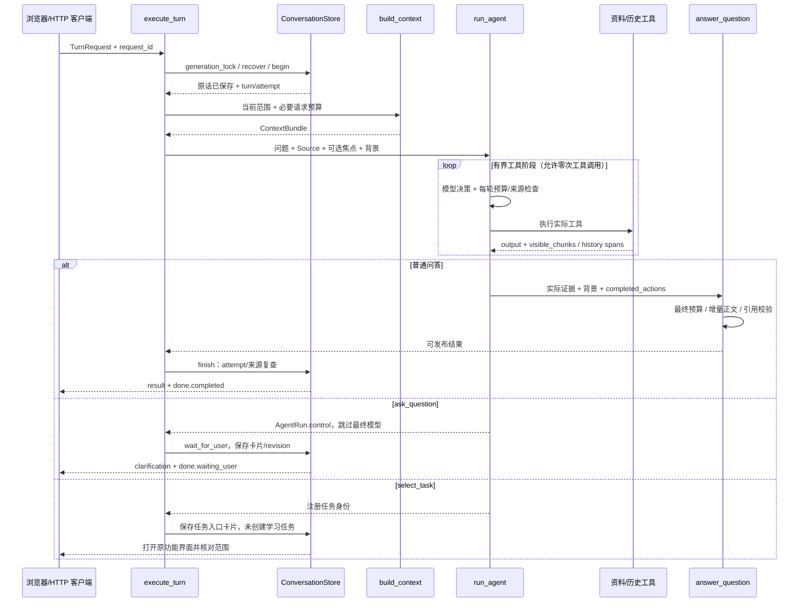

# Knowledge Review 跨模块调用链地图

> 更新日期：2026-10-26。源码基线`4f06786`，分支`codex/outline-extraction-v2`；任务识别阶段`e947e6b`。路径相对应用根目录knowledge-review。本次为文档静态核对；前一实现阶段266项相关受控检查通过，不代表真实模型质量/部署验证。

**摘要**：19条链路。F01–F05管理资料与问答证据，F06–F10管理会话/练习，F11–F15管理版本化清单/整合/路线，F16管理执行，F17–F18管理评测，F19管理任务识别与人类等待。模块见[架构](ARCHITECTURE.md#module-map)，取舍见[ADR](ARCHITECTURE_DECISIONS.md#adr-index)。

## 调用链总览与目录

| 流程 | 用途 | 真实入口及主要模块 |
| --- | --- | --- |
| [F01 资料导入与阅读](#f01) | 文件校验、PDF 解析、阅读选段、资源显示 | `import_documents/read_document/read_asset`；M01/M02/M03/M06 |
| [F02 资料与集合变更](#f02) | 移动、删除集合、替换/移出、重解析及失效 | `replace_document/remove_document/reparse_document`、`LibraryStore`；M02/M03/M07/M09 |
| [F03 CLI 多模式入口](#f03) | 预览、下载、搜索、全文/固定 RAG/Agent | `main.main`；M01/M03–M06 |
| [F04 持久问答与两阶段 Agent](#f04) | 请求保存、工具决策、最终回答、发布及重试 | `askQuestion/sendChatSubmission → submit_turn/execute_turn`；M01/M05/M06/M08/M12 |
| [F05 按需知识检索与阅读](#f05) | 当前 scope 搜索、缓存、表格/视觉证据 | `KnowledgeTools.execute/search_notes/read_source`；M03/M04/M06 |
| [F06 会话背景与标题](#f06) | 长聊天摘要、早期原话、自动标题和恢复 | `build_context/update_summary/StreamRunner.title`；M06/M08/M12 |
| [F07 跨聊天记忆与删除撤销](#f07) | 历史搜索/读取、范围引用、依赖传播 | `ConversationMemory.execute`、`delete_conversation`；M08/M11 |
| [F08 资料练习与作答评分](#f08) | 文档/集合出题、答案先存、评分重试和追问 | `create_practice/collection_practice/submit_practice_answer`；M02/M03/M06/M07 |
| [F09 主动加入、复习与评分修订](#f09) | 稳定目标、变式、FSRS、档位和更正 | `enroll/review/dimension/evaluation/rating`；M07 |
| [F10 根据讨论出题](#f10) | 幂等出题任务、讨论/文档依据、来源撤销 | `discussion_practice → chat_practice.start`；M06/M07/M08/M11 |
| [F11 清单提取与分层背景](#f11) | 预算路由、可恢复概述/提取、候选审核 | `create_outline/resume_outline → run_outline`；M09/M12 |
| [F12 跨章候选整合与归组审核](#f12) | 全候选对计划、卡片筛选、原文核验、组装 | `group_outline → run_grouping_with_reviews/run_grouping`；M09/M10/M12 |
| [F13 有限定向原文复查](#f13) | 针对 needs_review 补读、结论和显式采用 | `source_review/continue_review → run_source_review`；M09/M10/M12 |
| [F14 清单候选加入计划](#f14) | 生成固定目标首题并原子加入 | `enroll_outline_candidate → enroll_candidate`；M07/M09/M10 |
| [F15 路线生成与下一目标建议](#f15) | 关系判断、审核顺序、只读证据推荐 | `generate_route/retry_route/public_routes`；M07/M10/M12 |
| [F16 共享执行、SSE、取消与后台治理](#f16) | 准入、线程桥、暂停、断连、标题及指标 | `StreamRunner`、`agent_cancel`、`agent_work`；M12 |
| [F17 A/B/C 检索实验与冻结评分](#f17) | manifest、初审/冻结、排名/重排、BEIR/比较 | `quality_retrieval.main`、`review_router`；M04/M13 |
| [F18 学习与记忆质量评测](#f18) | 合成流程、受控 smoke、显式 live 和独立报告 | `quality_eval.main/run_suite` 及专项 `quality_*`；M07–M11/M13 |
| [F19 任务识别与持久澄清](#f19) | 能力目录、控制动作、waiting_user、回答保存与恢复 | `TaskRouter → wait_for_user/answer_clarification → retry`；M01/M05/M08/M12 |

阅读约定：箭头只展开影响业务边界、状态或外部请求的节点；“重试”默认指显式重新提交/继续，不代表程序无限自动重试。下文 HTTP 路由函数大多嵌套在 [web_app.create_app](../../web_app.py)，检索时使用函数名和路由字符串。

## F01 资料导入与阅读

**触发/入口**：`app.js.importFiles` → `POST /api/documents`；`openDocument` → `GET /api/documents/{document_id}`；PDF 图片另用 `/assets/{asset_id}?source_id=...`。

**主链**：`import_documents` → `DocumentCatalog.prepare_import` → PDF 时 `run_in_threadpool(parse_pdf)` → 全部文件准备完成 → `DocumentCatalog.import_note` → `LibraryStore.assign_documents` → 列表/阅读接口 → `_source_for` → `render_markdown` / 结构及资源响应。

- Markdown：UTF-8 解码/非空/2 MB 限制；PDF：签名/20 MB/密码/最多 200 页等检查。最多一次 20 个上传。名称清理后存 UUID 目录，浏览器不传任意本机路径。
- `parse_pdf` 先生成 PyMuPDF 文本/表格/图片区域；显式 Docling 配置可替换解析；导入 VLM 兜底受 `PDF_VLM_ENABLED` 控制，最多处理 3 个异常页。各失败保留 issues/attempts，得到 `ready` 或 `partial`，不是静默声称完整解析。
- Web导入/替换/重解析经`parse_document_pdf`：VLM启用时整次解析由`streams.run(parse, request)`共享准入；纯本地解析用普通线程池。忙时解析前503，不发布新资料；断连请求协作取消，Future真退出后释放。该范围不包括CLI解析。
- 新 PDF 保存原件和 `document.json`。`_source_for` 读取当前 source_override 或固定 JSON，不在网页阅读时重解析；`raw_path` 核对目录边界和原件哈希。
- `render_markdown` 给块附真实行范围且禁止原始 HTML；浏览器保存可选焦点。PDF 行号属于提取文本视图，响应另带物理页/区域。资源接口核对当前 source_id 后 `render_asset`，旧 URL 返回版本冲突。
- 上传在准备阶段任一无效文件会阻止本批文件发布；但后续逐文件落盘和集合归属写库跨两个资源，没有全流程事务/孤立文件自动回收保证。VLM 若在解析中调用，也不属于 F16 装饰入口的统一治理范围。

**证据**：[web_app.py](../../web_app.py)、[pdf_parser.py](../../pdf_parser.py)、[document_model.py](../../document_model.py)；`test_pdf_documents.test_bad_pdf_in_batch_publishes_no_documents`、`test_real_import_read_asset_and_stale_version_access`、`test_scan_is_partial_and_does_not_invent_searchable_text`；`test_web_app.py`。设计见 [ADR-002](ARCHITECTURE_DECISIONS.md#adr-002)、[ADR-008](ARCHITECTURE_DECISIONS.md#adr-008)。

## F02 资料与集合变更

**入口**：`library.js` 的管理操作 → `/api/collections/...`、`/api/documents/{identity}/collection`、文档 PUT/DELETE、`POST .../reparse`；计划归属通过 `/api/learning/{identity}/collection`。

**主链**：目录按 ID 解析当前资料 → 构造旧 Source 和 expected_source_id → 替换/重解析生成新正文或 Document → `LibraryStore.change_document` 的短事务 → 保存旧版本、revision 增加、当前 override/removed 更新 → 后续统一 `_source_for` 读取。

- Markdown 新正文写在 `document_states.text_override`，不覆盖上传原件。PDF 新原件先保存在 `versions/<raw_hash>.pdf`，解析快照通过 source_json 发布；模型/存储失败可能留未引用的文件。
- source_id 与服务端读取的 expected_revision 双重防并发覆盖。移出只撤销目录资格；旧练习快照与作答不删除。普通上传文档管理允许更换正文，示例替换/移出受限。
- 集合移动：`LibraryStore.move` 在事务内沿父链检查循环；删除集合：`remove_collection` 将直接文件、子集合、练习与 ReviewItem 归属迁到父级，清单保留但范围指纹加失效标记、活动提取暂停。文件与 ReviewItem 的归属独立。
- 聊天/文档出题在请求前复查目录版本，发布时还核对 revision/removed。清单及其派生流程通过 `scope_fingerprint(document_id, source_id)` 检查集合实际范围；资料/祖先范围变化使旧产物 stale。旧引文显示快照，不跳新版同一行。
- PDF 重解析读取经哈希校验的原件，调用 `parse_pdf`，通过同一 change_document 发布；不会改写既有练习依据。没有通用历史版本浏览或恢复入口。

**证据**：[library_store.py](../../library_store.py)：`move/remove_collection/change_document`；`web_app.replace_document/reparse_document/guard_documents`；`ConversationStore.finish`；`test_management_chat_practice.py` 中 `test_replace_has_stable_identity_new_version_and_restart_recovery`、`test_remove_revokes_catalog_scope_and_late_answer_publish`、`test_delete_doc_preserves_enrolled_source_snapshot_and_real_answer`。相关设计：[ADR-008](ARCHITECTURE_DECISIONS.md#adr-008)。

## F03 CLI 多模式入口

**入口**：[main.py](../../main.py)：`main()`，参数互斥及合法性先检查，再 `load_sources` 取得不可变 Source。

| 模式 | 调用顺序与输出 | 状态边界 |
| --- | --- | --- |
| 默认/`--chunks` | `format_sources` / `chunk_source → format_chunks` | 无生成调用；加载 PDF 的解析路径可写相邻缓存 |
| `--download-model` | `LocalEmbedder(allow_download=True) → embed_query` 自检 | 显式访问模型仓库，写 `.models/`；不读资料 |
| `--search` | `KnowledgeTools.search_notes → format_hits` | 本地 embedding/向量缓存，无生成答案 |
| `--question` | `answer_question(chunks=None) → validate_answer → render_answer` | 发送全文，仍受生成预算约束 |
| `--question --rag` | 搜索一次 → `with_table_context` → `answer_question(chunks=hits)` | 固定一次检索，与 Agent 分支互斥 |
| `--question --agent` | 可选 `focus_on_lines` → `run_agent` → 展示工具步骤和最终答案 | 动态检索/阅读；与 F04 共享引擎，没有会话 Store |

失败通过 CLI 错误退出；不自动建立会话、练习或计划。`--no-cache/--rebuild-index` 只影响检索索引；工具仍默认 dense。CLI `focus_on_lines` 受工具 200 行范围约束；网页 `document_focus` 不受此单次工具限制，但受生成预算约束。

**证据**：`test_cli.py`、`test_agent_loop.py`、`test_context.test_empty_retrieval_never_means_full_text`。底层检索见 [F05](#f05)，两阶段生成见 [F04](#f04)。

## F04 持久问答与两阶段 Agent

**入口**：网页`askQuestion → sendChatSubmission`以JSON请求体调用`POST /api/conversations/{identity}/turns/stream`，重试使用`retry/stream`，复用`execute_turn`。原JSON`submit_turn/retry_turn`仍保留并共享准入。一次性`/api/ask`跳过轮次/摘要，也不具备持久澄清；详见[F16](#f16)、[F19](#f19)。

**状态与数据**：

1. 持同聊天 OS 锁；`recover` 只处理被遗弃 running；`begin` 校验 request_id/原请求，保存用户原话并领取 attempt。completed 重放直接返回，failed 重试复用原轮次和用户消息。
2. `resolve_scope` 只按目录 ID 构造当前 Source，核对当前文档/版本/选段；`build_context` 见 F06。无选段时只给目录元数据及权限，不预先发送整篇正文。
3. `generate_answer` 创建 `KnowledgeTools` 和可选 `ConversationMemory`；`run_agent` 使用 `tool_choice=auto`，每轮来源/取消/预算检查。默认最多 4 次工具调用、允许设置 1–6；失败工具参数/执行错误回传模型且消耗调用预算。
4. 工具返回 output 供模型决策，visible_chunks 单独累计权限；超预算缩小可选材料。零工具调用不补搜索、不加载 E5。Agent 阶段直接输出文本不作为最终答复发布。
5. 普通问答进入`answer_question`独立生成并增量发送正文；使用同一背景和实际证据，裁剪同步缩小引用权限，`chunks=[]`不退回全文。持久聊天若产生控制结果则跳过该阶段，见F19。
6. `validate_answer`、历史引用验证完成后，封装引用摘录/版本、步骤和检索/预算诊断；`finish` 在事务内复查资料 revision/removed、记忆依赖、turn attempt，再保存助手消息和 completed。

**失败/恢复**：取消保存failed说明；预算/范围/服务/校验失败保留原输入。failed和waiting_user阻止新轮次；前者重试/跳过，后者先回答/取消，原request_json不重写。浏览器保留未确认请求/澄清回答身份。delta仅预览，最终校验或保存失败则清除；断流后读/messages确认实际状态。

**证据**：`web_app.execute_turn/generate_answer`、[agent_loop.py](../../agent_loop.py)、[model_client.py](../../model_client.py)、`ConversationStore.begin/finish/fail/skip`；`test_conversations.test_failure_duplicate_retry_and_completed_replay_save_once_without_learning`、`test_agent_loop.test_general_answer_does_not_load_embedding_model_or_search`、`test_production_retrieval.py`。设计：[ADR-003](ARCHITECTURE_DECISIONS.md#adr-003)、[ADR-005–007](ARCHITECTURE_DECISIONS.md#adr-005)、[ADR-009](ARCHITECTURE_DECISIONS.md#adr-009)。

## F05 按需知识检索与阅读

**入口**：Agent 工具调用或 CLI 固定搜索 → `KnowledgeTools.execute` / `search_notes`；实例构造时只绑定本次 Source、结构分块和配置。

| 子流程 | 跨模块顺序 | 证据与限制 |
| --- | --- | --- |
| 搜索 | `search_notes → LocalEmbedder.embed_query → prepare_chunks → get_document_vectors / embed_chunks → rank_chunks` | 默认 dense；首搜准备向量，实例内后续查询复用；持久缓存只读写当前 chunks，配置/原文损坏视为 cache miss |
| 融合 | dense50 + `BM25Index(当前 prepared chunks).search(50) → reciprocal_rank_fusion → top_k` | 两路等权 `1/(60+rank)`；融合最多50，工具返回≤10；无词命中不补零分；BM25 不跨 scope 复用 |
| 原文读取 | `read_source(精确 source_id, 闭区间) → protect_selection` | 不读浏览器路径，不接受 ID 前缀；最多200行；表头/表注以独立真实范围补回 |
| 表格分页 | `execute(read_table) → table_rows → read_source → protect_selection` | 行索引不含表头；返回抽取总行数/本次范围，最终按真实可见范围重算 coverage；提取完整不代表原 PDF 完整 |
| 视觉观察 | `execute(inspect_visual) → pdf_vision.inspect_visual → raw_path/render_asset → vision_request` | 页面及可选裁切图 → 结构化观察/限制 → 单独 observation 和对应块；只有成功观察才有 asset 引用资格 |

embedding 大块按 tokenizer 在原文行边界细分；超长单行/查询完整分字符窗编码并加权归一化，原文引用仍保持真实范围。缓存 profile 包括权重/tokenizer/运行库、前缀、token 上限、分块策略、来源和实际输入，不能只看维度或模型名。

**失败分支**：生产文档搜索失败记录 trace 并抛出，不把失败伪装成 dense 成功；工具参数/可恢复 ValueError 由 Agent 反馈再决策，传输/运行异常可终止问答。视觉明确不支持才缓存该连接能力；鉴权/限流/无效图片/结构化协议错误不能误判为不支持。历史检索的关键词降级属于 F07 的独立策略。

**权限出口**：`ToolExecution.output + visible_chunks (+ visual_observation)` → Agent 预算裁剪 → `answer_question` 最终裁剪 → `context.validate_chunks/citation_is_visible`。内部候选50条不自动成为可引用原文；表头/正文之间没有发送的行仍不能跨越引用。

**证据**：[knowledge_tools.py](../../knowledge_tools.py)、[embeddings.py](../../embeddings.py)、[vector_index.py](../../vector_index.py)、[hybrid_retrieval.py](../../hybrid_retrieval.py)、[pdf_vision.py](../../pdf_vision.py)；`test_vector_index.py`、`test_embeddings.py`、`test_hybrid_retrieval.py`、`test_table_reading.py`、`test_pdf_vision_settings.py`。设计：[ADR-002–004](ARCHITECTURE_DECISIONS.md#adr-002)。

## F06 会话背景与标题

**背景入口**：F04 的 `execute_turn` 及 F10 的 `chat_practice.start` → `build_context`。

**主链**：`ConversationStore.history` → 计算必要请求与历史 allowance → 短聊天直接使用完整 completed 原话 → 长聊天 `update_summary` → `generate_summary/request_structured` → 检查来源 message IDs/说话者 → `publish_summary` CAS → 最近至少两轮完整原话 + 摘要 + `recall_originals` → `ContextBundle`。

- 原话仍完整保存；摘要按完整轮次分批，只有预算压力才生成。早期原话用英文/数字词与中文双字的字面匹配补回，不是 E5 语义召回。
- 摘要发布检查 memory_revision、旧摘要 version、原话前缀指纹；网络请求不持写事务。失败可保留有效旧摘要，若旧摘要不存在/不匹配或剩余近期原话仍超限，则本次失败，不丢原输入。
- ContextBundle 在工具与最终生成阶段共享任务背景，材料权限由当前请求绑定；历史/摘要不能增大文档 scope。

**标题入口**：成功 submit/retry 的 BackgroundTasks、SSE 完成释放后的回调、读 messages 时发现待命名 → `streams.title → _reserve('title') → auto_title → claim_title → opening_messages → generate_title → publish_title`。

- 标题最多同时1个；多 worker 时标题只能在至少还空出一个槽位的条件下启动。忙时跳过、不排队；失败30秒冷却，后续读/成功请求可再次触发。
- 独立有界摘录，不依赖整聊天全文；publish 复查来源和 attempt。手动重命名使迟到自动标题失效。断连后的已取消请求不会继续启动标题；SSE 标题使用独立 title 槽。

**证据**：[conversation_context.py](../../conversation_context.py)、[conversation_title.py](../../conversation_title.py)、`ConversationStore.publish_summary/claim_title/publish_title`；`test_conversations.test_summary_requests_include_schema_budget_and_release_database_write_lock`、`test_library.test_auto_title_failure_retry_idempotency_and_manual_rename_wins`、`test_agent_governance.py`。设计：[ADR-005](ARCHITECTURE_DECISIONS.md#adr-005)、[ADR-009](ARCHITECTURE_DECISIONS.md#adr-009)、[ADR-014](ARCHITECTURE_DECISIONS.md#adr-014)。

## F07 跨聊天记忆与删除撤销

**读取入口**：Agent 的 `search_conversations/read_conversation → ConversationMemory.execute`；网页历史引用 → `GET /api/history/{message_id}`。普通聊天允许零次历史工具调用。

**检索链**：扫描 completed 且合法原话（包括归档，无年龄截止；失效派生助手回复排除）→ 800字符/640步长片段 → 字面分数 + E5 余弦≥0.78 的候选 → 名次 RRF → 最多5个命中消息 + 同轮邻居 → `fit_memory → remember` → ContextBundle → 最终再次 fit → `validate_references`。

- E5 仅实际搜索才加载，历史向量存 conversations 库，编码不持写事务，落库前复查 revision。模型不可用显式降级关键词并记录 warning；0.78 是未校准启发式。
- 直接读取每次最多1400字符。引用必须位于最终实际可见的 message/revision/字符范围；历史引用独立于文档 citations。历史解释无文档依据时仍属 supplement，严格模式文档要求不放松。

**管理/撤销链**：归档/恢复仅改列表状态；DELETE 聊天 → `ConversationStore.delete` 不等待生成锁 → BEGIN IMMEDIATE + ATTACH practice 库 → 依赖图传播 → 其他聊天相关 turns.memory_valid=0、清理上下文/历史摘录/助手向量/摘要、增加受影响聊天 revision → `practice_provenance.revoke` → 删除本聊天原话/轮次/向量 → tombstone。

- 其他聊天可见回复仍保留为记录，其用户原话仍可使用；依赖传播按聊天较保守。自动派生标题可重置，手动标题保留。
- 每次工具/模型请求及兼容回退、最终事务发布都复查来源。删除在途来源使迟到回答/摘要/标题/练习不能发布，不能复活缓存。讨论练习真实答案/FSRS 保留但使用资格撤销，见 F10。
- 删除是应用层记录清理与资格撤销，不承诺备份/磁盘空闲页擦除。当前没有原话编辑/删除恢复接口。

**证据**：[conversation_memory.py](../../conversation_memory.py)、`ConversationStore.delete/finish/check_dependencies`、[practice_provenance.py](../../practice_provenance.py)；`test_conversation_memory.py` 的删除/派生依赖/embedding竞态/最终裁剪测试；`test_management_chat_practice.test_deleted_source_blocks_all_saved_exercise_paths_preserves_fsrs`。设计：[ADR-013](ARCHITECTURE_DECISIONS.md#adr-013)。

## F08 资料练习与作答评分

**出题入口**：`app.js.startPractice → POST /api/practice`；集合模式 `/api/collections/{identity}/practice`。后者取得集合及后代当前 Source，不把此范围自动授予普通聊天。

**主链**：`resolve_scope/collection_snapshots` 等当前目录读取 → `start_practice` → 选择原文/预算 → `generate_question(LearningQuestionDraft) → validate_question` → `PracticeStore.create` 保存题目/来源快照/可见范围/语言/归属 → 返回待答题。

- 整篇/集合出题按结构块、文档交替和章节分散排列，可按目标字面匹配优先，给后续评分预留空间；不是语义全库覆盖。明确选段是必要证据，超预算不静默裁剪；多来源选段分支可能搜索补充资料。
- 出题校验真实引用、稳定目标标准及 criterion_indices 映射；PDF 图片导航标签不是文字依据。发布复查当前文档 dependencies；不自动加入计划。

**作答/评分链**：`submit_practice_answer → submit_answer` 在事务内保存真实文本/时间/assistance、置 grading → `grade_pending_answer` 读快照/可见范围/固定目标及近期证据 → `grade_answer(SemanticGradeDraft)` 或 F10 讨论评分 → `validate_grade` → `save_grade → record_evaluation → 可选 reschedule` 同事务保存 → finished。

- 评分检查每个 rubric point 恰好分类一次、answer_quotes 是真实答案子串、追问契约和范围；整体评价由模型语义判断，不按点数机械换算 FSRS 档位。
- 模型/校验失败时仍 grading；`POST .../grade` 重试同一保存答案，可换语言；save_grade 拒绝重复评分。已查看参考会保留 reference_seen，不可由提交表覆盖。
- 反馈中的追问只是 candidate_json；`continue_follow_up` 在用户选择后才落成下一题，最多3题。主要首题与教学追问不重复产生调度事件。

**证据**：[practice_service.py](../../practice_service.py)、[practice_model.py](../../practice_model.py)、[practice_store.py](../../practice_store.py)；`test_practice.py`、`test_library.test_whole_document_and_more_than_200_selected_lines_no_search`、`test_learning.test_follow_up_is_optional_and_does_not_count_as_second_scheduled_review`。设计：[ADR-010](ARCHITECTURE_DECISIONS.md#adr-010)。

## F09 主动加入、复习与评分修订

**入口**：`learning.js` 调用 enroll/review/dimensions、档位 PATCH、evaluation POST 和暂停/恢复 API。

| 操作 | 跨模块顺序 | 状态/分支 |
| --- | --- | --- |
| 加入 | `enroll_question → source_context/assert_basis → 必要时 EnrollmentDraft 提取 → validate_question → LearningStore.enroll` | KnowledgeUnit、固定 LearningTarget、唯一 ReviewItem；重试返回既有项，不改原题/旧答案；已答题加入不伪造历史复习事件 |
| 复习 | `start_review → item/source_context → 返回已有 pending session 或生成 variant/original → create` | 同一 target/标准映射；原题复用 question_ref，变式有新题目；active 与来源资格先检查 |
| 新能力维度 | `add_dimension → 生成所选 capability 的新目标题 → validate → create/enroll` | 同 unit 下新 target，独立 FSRS；不是原 target 的变式 |
| 评分驱动调度 | F08 `save_grade → record_evaluation → reschedule → review_scheduler.replay` | 首题且关联 ReviewItem 才有事件；有效需可判断、within_scope、none_recorded；唯一 attempt_id 防重复 |
| 用户改档 | `set_rating(expected_revision) → 保留 user 来源 → reschedule` | 不可将 ineligible 事件仅靠改档变成有效复习 |
| 内容更正 | `correct_grade → validate_grade → revise_grade → 追加 EvaluationRevision → 更新有效事件 → replay` | 原答案/原评分保留；按原时间、原参数重算后续卡片；用户手选档位继续保留 |

FSRS 适配固定 `fsrs-6.3.2`，参数和初始卡片保存在项内，关闭 fuzz；版本不匹配拒绝重算。暂停只改变 active/paused，不删除证据。`corrections` 文本备注入口与 evaluation 的有效评分修订不同，前者不会自行改变调度。

**证据**：[learning_service.py](../../learning_service.py)、[learning_store.py](../../learning_store.py)、[learning_state.py](../../learning_state.py)、[review_scheduler.py](../../review_scheduler.py)；`test_learning.test_correction_replays_later_reviews_using_original_times_and_parameters`、`test_opt_in_is_idempotent_and_does_not_invent_review_for_old_answer`、`test_uncertainty_invalid_scope_and_assistance_do_not_advance_schedule`。设计：[ADR-010](ARCHITECTURE_DECISIONS.md#adr-010)、[ADR-011](ARCHITECTURE_DECISIONS.md#adr-011)。

## F10 根据讨论出题

**入口**：`library.js.submitChatPractice → POST /api/conversations/{identity}/practice → discussion_practice → chat_practice.start`。这是同步业务入口，未加 `@streams.bounded`，不要因为持久 jobs 表就将它归入 F16 的202后台作业。

**主链**：同聊天 generation_lock → 按 (conversation_id, request_id) 保存/恢复 job 与 attempt → `build_context` → 为真实原话附字符范围 → 显式搜索相关跨聊天历史 → 裁剪可选历史及严格模式文档原文 → 保存依赖/预算诊断 → 模型 Proposal → 题目及 history reference 双重验证 → 来源 guard → 同一 practice 事务保存 session/basis + job completed。

- 默认 `DiscussionProposal → DiscussionQuestion/DiscussionKnowledge`：文档 citations 必须为空，模型拟定标准，历史只是出题角度。严格 `DocumentProposal → LearningQuestionDraft`：必须用当前许可文档实际可见原文，讨论不授予资料权限。
- 这是用户显式发起的讨论练习，因此服务主动检索历史；不能据此改写普通聊天的按需工具行为。至少一条引用关联当前聊天真实原话。
- completed/revoked job 重放不重新生成；failed 重试复用身份。输入变化须新 request_id；异常保存安全错误/诊断，不创建半套题目。
- 保存 `practice_basis` 的 dependencies/references/kind；后续评分、变式、新维度、查参考、加入等均 `assert_basis/check_session`，网络调用前及保存事务检查。删除来源聊天原子 revoke basis/job，拒绝在途结果并保留真实学习记录和原 FSRS 日期。
- 出题本身不创建 ReviewItem；复用 F08/F09 的主动加入和真实作答流程。

**证据**：[chat_practice.py](../../chat_practice.py)、[practice_provenance.py](../../practice_provenance.py)、`web_app.discussion_practice`；`test_management_chat_practice.py`。设计：[ADR-013](ARCHITECTURE_DECISIONS.md#adr-013)。

## F11 版本化清单提取：V1与V2

**入口**：`outlines.js` → `POST /api/collections/{identity}/outlines` 或 `/api/outlines/{identity}/resume` → `@streams.detached('outline')`。先留槽后创建记录，202 后线程继续；暂停和治理见 F16。

**规划链**：`collection_snapshots → archived_sources → outline_context.plan_outline → section_manifest` → 检查完整请求与预期输出 → full/hierarchical 文档计划、非重叠章节范围、提取批次 → `OutlineStore.create`（request_id/范围幂等）。

以上为V1默认。显式`algorithm=v2`改走`outline_v2.plan_direct`：ContentBlock原文单元→真实表头/脚注依赖→完整请求预算贪心打包→primary/support范围→plan.version=2。V2默认应用预算131072，context_tokens/环境可覆盖；配置、模型/端点身份随任务保存。同request不能改算法/预算。

**执行链**：`run_outline`经job_boundary/OS锁、require_current、start后按计划版本分发：无计划保留legacy，version=1走`run_adaptive`，version=2走`run_direct`，未知版本拒绝。V1为：

1. full：全文/章节导航 → `FullOutlineDraft`；仅当输入、预计目标数量和输出均可容纳。
2. hierarchical：结构窗口 → `execute_step(DocumentBrief)` → `reduce_steps` 逐层章节/文档概述：`merge_messages` 登记稳定证据 ID → `MergeDocumentBrief` 仅选择 evidence_ids → `resolve_merge` 原样恢复独立引用范围 → 持久化为原 `DocumentBrief` → `background_messages` 加共享背景，并按指针补回真实原文 → `OutlineDraft` 提取。归并预算使用新 Schema，保留可见性和版本检查；详见 [证据 ID](../outline-evidence-ids.md)。
3. `validate_learning` 只允许实际原文可见范围 → 复查当前范围 → `finish_batch` 保存候选/实际 visible/diagnostic → settle。

**V2直接链**：claim_batch→重建原文窗口/辅助范围→使用保存预算检查→登记调用机会并重查来源/模型身份→`_request_structured(...budget=保存值, telemetry=...)`→DirectOutlineDraft→validate_direct验证真实可见引用与主范围锚点→范围复查→finish_batch。没有DocumentBrief/reduce调用；预算贯通到SDK而非只用于规划。

2026-10-28：criteria四条/V2 proposals八条改为软阈值，提示合并等价标准或拆分独立能力，不得删必要条件；超过数量可完整保存，不单独触发窗口拆分。omission_risk、截断及请求预算不足仍受原深度/调用额度约束。新建默认预算为131072/12288/2048，旧计划不改写；新策略direct-structure-v3-soft-targets拒绝混用旧Schema。加入计划及变式题放宽评分标准数量，但validate_question继续要求全部criteria都有映射。

候选达到8项、omission_risk=true（已提供主要原文内可能漏提）或输出截断时，在结构/可验证表行边界有限拆分；missing_context仅记录资料外知识缺失，不触发拆分。split_direct_batch事务校验attempt，将父批标为superseded并保存完整子批，父输出不发布。深度默认4、任务调用额度200；触顶保留程序coverage_risk/失败。新策略与Schema摘要在调用前核对，旧策略任务需新建，不能静默换协议。超大单行和图片未处理显式记录，不伪造行级权限。usage/失败尝试与耗时保存，未知usage为null，不推算成真实成本。

**恢复/失败**：背景步骤按稳定输入键和结果哈希复用；分层合并不授予新的原文权限。背景占据预算导致提取缩小时 `split_batch` 在事务内保存完整尾段为 pending。失败停止当前推进并保留已完成步骤；resume 重置未完成项，旧 `plan=NULL` 清单保留原 `prepare_outline/run_outline` 协议。

`public_outline` 在拿得到操作锁时恢复遗弃状态（queued 有等待窗口），计算 stale 和章节分析进度；读操作因此可能更新恢复状态，不能视为全程纯读。coverage 记录分析行/候选/已加入数，不证明语义完整或掌握。`edit_candidate` 允许改目标文字但不扩大原引用，revision 增加并使归组建议失效。

V2恢复复用已完成叶批及保存预算；覆盖按完成主范围并集计算，不计辅助范围或superseded父批。调用额度跨重试累计，attempts保留旧usage。新旧算法尚无真实质量对照，网页/API不切默认；[实验方案](../outline-v2-experiment-plan.md)待确认。

**证据**：[outline_context.py](../../outline_context.py)、[outline_v2.py](../../outline_v2.py)、[outline_service.py](../../outline_service.py)、[outline_store.py](../../outline_store.py)；`test_outline_context.py`、`test_outline_v2.py`、`test_outlines.py`。设计：[ADR-007](ARCHITECTURE_DECISIONS.md#adr-007)、[ADR-012](ARCHITECTURE_DECISIONS.md#adr-012)、[ADR-017](ARCHITECTURE_DECISIONS.md#adr-017)。

## F12 跨章候选整合与归组审核

**入口**：`group_outline/retry_outline_grouping → detached('grouping') → run_grouping_with_reviews → run_grouping`；要求清单提取完成，默认选择未加入/未接受归组的候选。

**主链**：`start_grouping → inputs_for/create_run` 保存候选 revision 和 scope → `group_messages` 补固定原文证据 → `execute_integration`：`make_plan → work_scopes → select_page → claim_step → ComparisonPage 模型 → validate_page → finish_step` 循环 → `proposals_from_proofs → publish` → 用户 `review_group`。

- 新计划按完整输入、输出估计、Schema 容量选择 direct/hierarchical；候选对分配到叶子或最低共同祖先，包含远处节点/单例，不只比较相邻标题。
- 上层 route 卡片保留目标/条件/标准、去掉原文；关系假设必须 verify 补真实证据。回执的 checked/deferred 身份由程序检查；建议槽满时不能把未报告关系当作没有关系。
- 原文核验后的大组需组内每对同类型证明，不能把 A–B、B–C 的连通关系直接当 A–C 成立。needs_review 关系进入独立复查 F13。
- 每次默认24逻辑请求额度，范围1–200；额度耗尽暂停，继续增加额度；显式截断或待处理缩小比较页，其他错误保留失败，不自动冒充成功。完成步骤复用；候选/范围/归组变更或暂停撤销迟到结果。
- 全部计划完成才发布最终建议；model_json 和用户 proposal_json 分存。`review_group` 接受时查成员 revision/状态/冲突；needs_review 不能直接接受。接受不生成学习数据，统一 unit 等 F14 首次加入时绑定；duplicate_targets 只允许代表加入。
- `plan=NULL` 历史 run 保留单次 GroupDraft 路径，不强套新协议。

**证据**：[outline_grouping.py](../../outline_grouping.py)、[outline_group_plan.py](../../outline_group_plan.py)、[outline_integration.py](../../outline_integration.py)、[outline_group_steps.py](../../outline_group_steps.py)、[outline_group_store.py](../../outline_group_store.py)；`test_outline_integration.test_nontransitive_relations_do_not_union_into_one_group`、`test_full_suggestion_slots_revisit_unreported_comparisons`、`test_outline_groups.py`。设计：[ADR-011–012](ARCHITECTURE_DECISIONS.md#adr-011)。

## F13 有限定向原文复查

**入口**：新归组后的 `run_grouping_with_reviews` 自动考虑本次 needs_review；也可手动 `source_review/continue_review → detached('review')`。嵌套复查共享父工作槽和取消 Token。

**主链**：`start_source_review → review_inputs` 固定候选/组 revision → `run_source_review` 持父 run OS锁 → 原候选证据 + 已完成补读 → `prepare_review_request → action_schema → claim_review_step → 模型动作 → validate_action` → read 时 `execute_lookup` / conclude 时 `finish_review` → 显式 `apply_source_review`。

- 最多2轮读取，每轮最多2项 lookup，之后 Schema 只允许结论。locate 只返回许可快照的字面命中位置（至多6个），不授予原文引用；read 按完整 Markdown 块、200行及预算取得实际范围。
- requests、issue 和 provisional unresolved 是调查过程，不是最终归组结论。明确结论必须有已发送证据；候选需实质修订时输出非绑定建议，不能悄悄修复后宣布可合并。
- 调用额度计入父整合；失败/暂停/重启保留已完成补读。候选/组版本变化、范围改变或 attempt 失效拒绝迟到结果。
- apply 只接受 completed 且 same_knowledge/duplicate_targets/distinct；unresolved/revise_candidates 不能采用。原组被保留为 rejected，需要时新增 accepted 替代组，原模型建议及候选不覆盖；不创建学习记录。

**证据**：[outline_review.py](../../outline_review.py)、[outline_review_model.py](../../outline_review_model.py)、[outline_review_store.py](../../outline_review_store.py)；`test_outline_review.test_location_pointer_is_not_citable`、`test_two_read_rounds_cannot_execute_third_read`、`test_read_explanation_is_preserved_but_never_publishes_a_verdict`。设计：[ADR-012](ARCHITECTURE_DECISIONS.md#adr-012)。

## F14 清单候选加入计划

**入口**：`outlines.js.enrollOutlineSelection → POST /api/outline-candidates/{identity}/enroll → enroll_candidate`；批量选择在前端逐项调用，不能解释为整批跨目标原子事务。

**主链**：候选 OS锁 → completed 重放 → 检查当前 scope/目标 revision/归属集合 → `candidate_visible/validate_learning → begin_enrollment` 保存 attempt + group_token → 必要原文不裁剪、可选上下文预算裁剪 → `VariantDraft` 首题生成 → `validate_question/require_current` → `OutlineStore.commit_enrollment`。

提交事务同时复查候选状态/attempt/revision/归组 token → `resolve_unit` 延迟绑定组内知识点 → `PracticeStore.create(_connection=db)` → `LearningStore.enroll(_connection=db)` → 标记候选 enrolled。duplicate 非代表不能加入；不同能力目标仍各自 ReviewItem/FSRS。

生成/提交失败使候选回 proposed，首题/目标/计划/新组 unit 一起回滚；重试不生成重复计划；遗弃 enrolling 在拿到候选锁时恢复。已加入再请求返回既有 item/session；撤销归组不重写已保存学习项。

**证据**：`outline_service.enroll_candidate`、`OutlineStore.begin_enrollment/commit_enrollment`、`outline_group_store.enrollment_token/resolve_unit`；`test_outline_groups.test_database_failure_rolls_back_new_group_unit_and_seed_atomically`、`test_approval_changed_during_initial_question_rolls_back_every_record`。设计：[ADR-008–009](ARCHITECTURE_DECISIONS.md#adr-008)、[ADR-011](ARCHITECTURE_DECISIONS.md#adr-011)。

## F15 路线生成与下一目标建议

**入口**：`generate_route/retry_route → detached('route') → start_route/run_route`；关系审核、手动边、顺序/跳过修改以及 `public_routes` 查询。

**生成链**：完成清单 → `selection_view` 排除待核对/待确认重复、已接受重复非代表 → `input_stamp` 固定候选与归组决定 → `all_pairs → prepare_page` 按完整输入/输出估计分页 → `claim_page → RoutePage → validate_page → publish_page` 保存模型关系、原文证据、cursor → completed。

- 每个目标对必须有一次判断；依据区分 source/pedagogical，缺失外部话题只是待核实 topic，不自动创建目标。默认24调用额度，可暂停/继续，显式输出截断缩页，成功页保留；变更 scope/stamp/attempt 拒绝旧结果。
- `edit_edge` 保留 model_json；实质用户编辑标 basis=user 并清原引用，避免冒用原模型证据。接受边检查 DAG，不允许接受 uncertain；`save_order` 要求严格排列所有节点，可自由跳过并显示与关系的冲突，不锁学习入口、不改 FSRS。
- `public_routes → recommend_next` 只读同一数据库快照：固定 target 的最近已评分首题及 effective_evaluation_id、支持情况、范围、pending session、eligible FSRS 事件。优先 pending → 真正调度到期 → 当前定性缺口 → 接受的前置关系/探索；无 evidence 为未知，有提示/不确定为证据不足。
- 推荐不采用未审核边作为正式前置，不把教学追问或其他能力当当前达标，不计算掌握概率。页面预览可用 proposed 边排序，推荐只用 accepted 边或用户顺序。

**证据**：[outline_routes.py](../../outline_routes.py)、[outline_route_model.py](../../outline_route_model.py)、[outline_route_store.py](../../outline_route_store.py)、[route_recommendation.py](../../route_recommendation.py)；`test_outline_routes.py`，尤其评分修订改变推荐、DAG、order conflict、不重复调度相关测试。设计：[ADR-011](ARCHITECTURE_DECISIONS.md#adr-011)。

## F16 共享执行、SSE、取消与后台治理

**入口与覆盖范围**：

| 类型 | 当前接入 |
| --- | --- |
| 请求工作 | `@streams.bounded`共11个：collection_practice、enroll_outline_candidate、ask、submit_turn、retry_turn、discussion_practice、create_practice、submit_practice_answer、retry_practice_grade、review、dimension；另有新提问/重试SSE |
| 持久后台工作 | `@streams.detached`：create/resume_outline、group/retry_outline_grouping、source_review/continue_review、generate/retry_route，共8个入口 |
| 标题 | submit/retry、SSE完成后、messages读触发的 `streams.title` |
| PDF解析 | Web导入/替换/重解析启用VLM时整次parse_document_pdf经streams.run共享槽；纯本地解析走普通线程池 |
| 范围外 | CLI/独立评测和未显式接入的直接服务调用等；不能把本池称为跨进程全部模型流量上限。独立保存澄清API不调用模型；兼容retry保存路径仍短暂准入 |

**同步请求链**：FastAPI 参数解析 → `_reserve('request')` 非阻塞取槽 → `_submit` ThreadPoolExecutor → cancellation_scope + work_scope → 原同步业务 → Future 实际完成回调 `_release`。满返回503 + Retry-After，不留执行器等待队列；调用者用 asyncio.shield 等待，取消等待不释放仍运行工作。

**SSE链**：stream_turn/stream_retry_turn→streams.response→EventBridge→实际线程执行→meta解开响应头等待→progress/delta队列→异步events。最终模型正文经answer_stream增量发送，结构/引用/存储完成后才result+done.completed；澄清保存后clarification+done.waiting_user。失败用error/done，32条队列、8KiB单事件、256KiB累计进度、4MiB结果、15秒心跳，终态独立保留。delta有背压，属于未完成预览；无Last-Event-ID事件重放。

**后台链**：detached 先预留 background 槽 → 原入口准备/保存作业 → DetachedTask 收集一次后台调用 → 绑定 job key → `_submit` → 202立即返回但名额继续持有。已接受后台工作不因提交者断连而取消。嵌套自动复查 `job_boundary` 复用父 lease/Token，非另占槽。

**取消与恢复**：

- JSON断连、SSE发送/生成器结束、应用关闭请求取消 Token；`checkpoint` 及 `model_http_options → CancellableTransport` 在工作线程自有异步 HTTP 交换中检查并关闭 I/O，等待清理后线程退出。范围内禁用 SDK 自动重试。
- 业务 pause 先在 Store 撤销 attempt，再 `cancel_job` 请求 HTTP 取消；`job_boundary` 捕获独立 BaseException 类型 GenerationCancelled，沿原 Store 恢复/暂停边界落状态。只有 Future 真退出才释放槽。
- 已提交结果不回滚；CPU、文件、SQLite、DNS 阻塞不强杀，远端是否停算未知。SSE 结果过大可能“业务 completed、传输 done.failed”，要读记录确认，不能据传输失败认定回滚。
- 进程关闭停止接纳并取消已有Token；重启计数清零，持久作业经原恢复逻辑显式继续，不自动重放。`GET /internal/metrics` 是进程聚合，不是 Gateway 本地 `/metrics`。

**证据**：[agent_stream.py](../../agent_stream.py)、[agent_cancel.py](../../agent_cancel.py)、[agent_work.py](../../agent_work.py)；`test_agent_sse.py`、`test_agent_admission.py`、`test_agent_cancellation.py`、`test_agent_governance.test_full_pool_rejects_before_creating_background_records`、`test_pause_cancels_owned_worker_and_preserves_resumable_job`。设计：[ADR-014](ARCHITECTURE_DECISIONS.md#adr-014)。

## F17 A/B/C 检索实验与冻结评分

**入口**：`quality_retrieval.py` 子命令；审核页由主应用 include_router 或独立 `retrieval_review_app.create_review_app` 提供。全部使用版本化合成资料/隔离库，不读取正式私人聊天，不创建学习计划。

1. **prepare**：`load_suite → LocalEmbedder.prepare_chunks → make_manifest → ReviewStore.create`。manifest 绑定全文哈希、实际 prepared chunks、embedding profile、query scope/问题族/分区；匹配同目录完整 agent-review 时才初始化初审，已有编辑保留。
2. **审核/冻结**：`bind_section_audit` 只把显式章节语义等级绑定实际片段；`adopt_agent_audit` 校验全许可范围，追加 Agent 来源；UI `save` 强制 user 来源并CAS。`freeze` 检查全部最新 revisions、处理状态、完整初审，生成不可变冻结快照；null 不等于0，pending 不能冻结。显式修正只能追加符合条件的 Agent版本，不改用户决定/旧冻结。
3. **A/B**：`run_baseline` 复用 KnowledgeTools 的 dense 前十并另测候选；`run_hybrid` 使用同源 prepared chunks、dense50/BM25≤50/RRF≤50。记录实际原文、排名、各路得分/耗时；失败不伪装成功。普通实验离线加载模型，不隐式下载。
4. **C**：读取已保存的完整 B 运行 → `validate_hybrid_pool → LocalReranker → run_rerank/rerank_pool`。绑定 B digest、不重新召回；完整查询 + 连续原文窗，无截断；每片段 max logit，平分保留B序；超窗口/总对数失败。C是离线工具，生产API不接受 rerank。
5. **score/compare/export**：已有 Trace + 同版本 freeze → `score_run` 实际 BEIR/trec → Recall/nDCG/MRR/证据组/候选可救回/退化 → `compare_runs → failure_inventory` → 独立新报告。score/compare 不重跑生成或 embedding/rerank。

没有 freeze 时 quality=null，只比较执行/排名/耗时。缺失/失败保留在质量分母，dev/test、负例、excluded 分列，零分母为 null；不将负例返回片段等同于最终拒答错误。标签可混 Agent和user来源，合成自审不等同外部人工gold；C耗时是已存池纯重排，与B相加仅为端到端估计。

**证据**：[quality_retrieval.py](../../quality_retrieval.py)、[retrieval_benchmark_data.py](../../retrieval_benchmark_data.py)、[retrieval_benchmark_metrics.py](../../retrieval_benchmark_metrics.py)、[rerank_retrieval.py](../../rerank_retrieval.py)、[retrieval_comparison.py](../../retrieval_comparison.py)；`test_retrieval_benchmark.py`、`test_retrieval_expansion.py`、`test_rerank_retrieval.py`、`test_hybrid_retrieval.py`。设计：[ADR-015](ARCHITECTURE_DECISIONS.md#adr-015)。

## F18 学习与记忆质量评测

**综合入口**：`quality_eval.main` 默认/validate → `evaluation_cases.load_suite/validate_suite`，只校验固定合成资料与标注。run → `run_suite` 新建独立目录/每case数据库 → 服务级 extraction/grouping/grading → 保存 calls/report；review → `evaluation_report.review_run` 生成单独审核产物。

- smoke 用受控模型替身，但经过真实服务预算/校验/状态路径；live 显式调用当前配置服务且请求不含参考答案/关系标签。调用上限保留已完成内容，未完成不当成功；Schema返回仍需服务发布校验。
- 综合流程和专项分别存在，不能把固定候选归组测试当真实提取覆盖。质量审核使用版本和候选身份防复用旧审查，语义质量依赖审核，不由 smoke 产生真实质量率。

| 专项入口 | 实际复用与边界 |
| --- | --- |
| `quality_memory.py` | 合成聊天、归档/历史工具、问答双阶段；smoke 受控向量/客户端，live 才启用真实模型/本地 embedding |
| `quality_chat_practice.py` | 独立合成聊天、讨论出题/来源/评分；不自动加入计划，不以单样例合约成功宣称教学质量 |
| `quality_route.py` | 固定合成候选、路线/证据推荐；不把它当真实提取质量 |
| `quality_source_review.py` | 固定待核对候选、有限补读/结论；保留截断/语义分歧等失败类别 |
| `quality_production_retrieval.py` | 对照已存B的正式工具前十/分数，显式 `--live-agent` 才做生成检查；排名接线与最终回答质量分开 |

**证据**：[quality_eval.py](../../quality_eval.py)、[evaluation_cases.py](../../evaluation_cases.py)、[evaluation_report.py](../../evaluation_report.py) 及表中脚本；`test_evaluation.test_smoke_never_emits_semantic_quality_ratios`、`test_live_request_has_no_reference_answers_or_relation_labels`、`test_provider_failure_redacted_and_saved_answers_survive`。设计：[ADR-015](ARCHITECTURE_DECISIONS.md#adr-015)。

## F19 任务识别与持久澄清

**入口**：持久聊天的generate_answer向run_agent注入TaskRouter。能力注册表限定explain、清单、练习、评分入口、整合、顺序、复习、历史回顾和加入入口；专门整份资料总结不可执行。不增加每轮必经的独立分类请求。

1. 意图明确的普通问题继续问答；明确业务任务可select_task；重要歧义可ask_question，Schema限定2–4个不同任务选项。
2. 控制动作必须独占响应，否则整组工具不执行并有界纠错。成功控制结果写入AgentRun.control，不调用最终答案模型。
3. ask_question→wait_for_user短事务检查attempt→turns.control_json保存卡片id/revision和waiting_user→SSE终态→真实Future结束释放锁/槽。waiting_user不是failed或普通completed回答，不进入正常完成历史。
4. 前端兼容旧Gateway，调用原retry URL，携带clarification+save_only保存选择，再调用retry/stream；独立clarification API只供直连且无模型准入。save-only兼容入口仍短暂占槽，忙时localStorage保留同response_id。跨会话、旧卡片、冲突重答拒绝，重复同答幂等。
5. 恢复从原request及另存答复构造有效请求，重查资料版本并重新准入。explain/历史回顾继续问答；业务类型返回明确标为“尚未创建”的入口卡片。用户在原界面核对集合/对象后执行，不能把聊天文档范围静默扩大，也不自动加入计划。

同一逻辑轮次最多三张澄清卡；可取消并保留原话。当前仅提供任务选项，复杂对象/范围在原业务界面选择；没有通用多阶段工作流编排。证据：[task_routing.py](../../task_routing.py)、`ConversationStore.wait_for_user/answer_clarification`、`test_task_routing.py`、`test_chat_stream.cjs`；[ADR-016](ARCHITECTURE_DECISIONS.md#adr-016)。

## 清单对照：仅生成与独立评价导出（2026-10-28）

`outline_benchmark_generation.prepare`→复用已审核六份精简原文/Gold→当前plan_outline/plan_direct重新规划131072/12288/2048→冻结当前源码/依赖/适配器→GenerationRunner.generate→隔离OutlineStore/run_outline→强制submit_result+thinking disabled→当前Pydantic/引用/来源校验→每失败持久步骤最多两次重试→保存完整正式候选及HTTP台账→`outline_benchmark_export.export_comparison`→comparison_data.json/comparison_review.md。Judge入口在before_http拒绝，不是因为评分失败再停生成。

导出复查正式候选仅来自completed叶批、完整引用实际可见，superseded父输出不混入；原文/Gold/规则及PDF随匿名材料完整保留，算法/原ID映射独立存internal。运行/费用按唯一request_id统计，历史消费继承且未知不补0。没有自动语义质量分数，不自动更改默认算法。详见[新入口与边界](../outline-generation-only.md)。

## 使用与更新规则

从流程总览定位入口，按符号读当前源码，涉及证据/一致性/并发时同时检查对应 ADR 和测试。本文件不枚举所有 HTTP CRUD、辅助函数或提示词；新增重要流程时更新总览与独立锚点。基线后的源码改动可能使此地图过期，尤其是工作池覆盖范围、默认检索模式、发布事务和取消边界。
