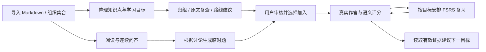
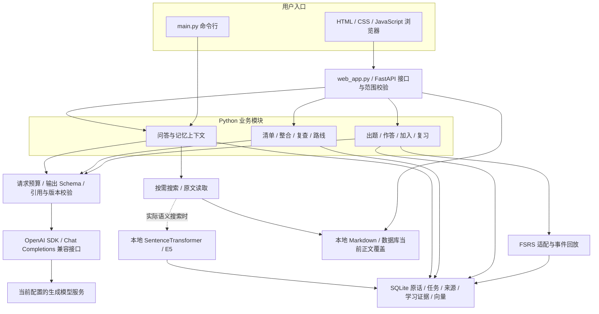

# Knowledge Review 项目学习与面试手册

核对日期：2026-10-11。以当前代码为准；旧设计文档中的路线图和早期“尚未实现”不直接代表当前状态。本手册串起已有说明，详细实现仍链接到原文，避免复制多份容易失同步的设计。

2026-10-13最新检索状态：20条已按用户授权冻结，独立评测已有A向量、B向量+BM25+RRF、C精确B池多语言Cross-Encoder重排，以及BEIR/Trace三组对比。阅读 [C数据流、代码职责与结果](retrieval-benchmark-design.md#rerank-c) 和核心导读第11节。学习时区分“分别编码后比向量”与“问题和候选一起编码”、召回池与候选排序、纯重排实测与端到端估计。当前可回答测试题只有12条，标签为16自动+4用户确认，包含单题退化，不能包装为百题专家gold或全面教学效果；正式问答仍原检索，约100扩样和生产接入后续。下面B交付时的C待实现是历史状态。

2026-10-12 检索学习补充：独立评测现已有A原向量和B向量+BM25+RRF，C重排尚未实现；正式问答仍原向量按需工具。阅读 [B的数据流、公式、代码职责及实验边界](retrieval-benchmark-design.md#hybrid-b)，配合核心导读第11节和18项Hybrid专项。可以解释“语义与字面互补、排名融合避免分数尺度问题、同权限与固定标签保证比较条件”；当前实际报告未冻结，不将其排名变化说成检索质量提升。

## 1. 先知道这个项目解决什么问题

项目面向使用个人技术 Markdown 笔记学习的本地单用户。阅读资料之后，用户需要讨论疑问、整理可观察的学习目标、实际作答，并在以后复习。项目把这些操作接成可恢复的流程，保留资料依据和学习证据。



当前是具备完整闭环的本地 MVP。已有恢复、幂等、版本和预算保护；模型质量、大库性能和学习效果尚未完成全面评估。不要给完成程度编造百分比。

### 当前功能地图

| 用户操作 | 已实现的行为 | 要记住的边界 | 主要代码 |
| --- | --- | --- | --- |
| 管理资料 | 多知识库/子集合、导入、移动、集合删除迁移、正文替换、移出资料库 | 当前仅 Markdown；移出保留原始文件和旧题依据，尚无物理清除/恢复、版本浏览 | `web_app.py`、`library_store.py` |
| 提问 | 整篇默认、选段可选、按需搜索/读取、结构化回答、引用跳转、中文/英语偏好 | 允许查阅整篇不代表把全文发送给模型；语言遵从是模型行为 | `agent_loop.py`、`model_client.py`、`context.py` |
| 连续聊天 | SQLite 原话存档、自动标题、切换/恢复、失败重试、摘要与近期原话 | 摘要有损但不替换原话；当前摘要同步准备，没有后台摘要队列 | `conversation_store.py`、`conversation_context.py`、`conversation_title.py` |
| 找旧讨论 | 按需跨会话搜索/读取、独立历史引用、归档/恢复、删除及派生撤销 | 归档继续有资格；历史助手解释不能证明技术事实；无年龄截止 | `conversation_memory.py`、`conversation_store.py` |
| 整理集合知识 | 按预算选择全文或分层、概述树/共享背景、章节分析进度、候选审核 | 已分析原文范围不等于知识完整性、召回率或掌握度 | `outline_service.py`、`outline_context.py`、`outline_store.py` |
| 整合与补证据 | 大候选集分层比较、同知识/重复目标/待核对建议、有限定向原文复查 | 筛选关联仍可能漏判；实际原文核验后才能形成可审核建议 | `outline_grouping.py`、`outline_integration.py`、`outline_review.py` |
| 拟定学习路线 | 前置关系、先学建议、理由、编辑/跳过/排序、下一目标建议 | 接受检查循环；顺序只提示，不锁关、不自动加入；限于一份清单 | `outline_routes.py`、`route_recommendation.py` |
| 做题与加入 | 文档/集合/讨论临时题、缘由和依据、选择集合加入、知识点下多个能力目标 | 用户选择才创建复习项；默认讨论题的参考标准是模型解释 | `practice_service.py`、`chat_practice.py`、`learning_service.py` |
| 作答和复习 | 原题/变式、真实答案、语义反馈、可选追问、参考披露、FSRS、评分/档位修订 | 使用提示、范围不符和不确定不会伪装成独立达标；追问不另算一次计划复习 | `practice_store.py`、`learning_state.py`、`review_scheduler.py` |

## 2. 架构：一个 Python 应用中的几条业务流程

网页和命令行共用部分业务能力。当前不是微服务部署：界面、接口与业务编排在一个本地 Python 应用中；本地 embedding 与外部生成接口承担不同任务。下图展示职责和可能调用，箭头不表示每个请求都必经所有节点。



### 三层职责

| 层 | 负责什么 | 为什么分开 |
| --- | --- | --- |
| 界面与接口 | 接收用户操作，解析身份/资料范围，展示保存的状态 | 浏览器不能用任意本地路径直接扩大资料权限；UI 状态不是数据库事实 |
| 业务编排与模型边界 | 组装上下文、选择工作单元、调用工具/模型、检查是否可发布 | 模型负责语义判断和建议，程序负责身份、权限、预算、格式和状态 |
| 持久化与调度 | 事务、幂等、来源版本、任务恢复、原话与证据、复习事件回放 | 网络调用可能失败或迟到，不能依赖模型“恰好只执行一次” |

这是理解代码的概念分层，不是所有模块都已完全解耦的严格分层架构。`web_app.py` 仍较大，多个 Store 共享学习库，后续可按真实维护问题继续整理。

FastAPI 的 `BackgroundTasks` 用于一些清单流程和自动标题，是进程内后台执行。任务恢复依靠 SQLite 状态、OS 锁、attempt 和用户继续操作；当前没有独立持久消息队列。

## 3. 技术栈：每项技术到底解决什么

| 技术 | 当前用途 | 不承担什么 / 选择理由 |
| --- | --- | --- |
| Python | 业务编排、校验、检索和状态处理 | 便于连接模型、SQLite 及现有学习库；核心难点仍是行为与数据一致性 |
| FastAPI + Uvicorn | HTTP 接口与 ASGI 服务运行 | API 接线和类型校验；不是 Agent 工作流引擎 |
| Jinja2 + 原生 HTML/CSS/JavaScript | 初始页面、阅读器、fetch 请求、状态展示和轮询 | 无 React/Vue 构建链；聊天事实保存在后端，localStorage 只保存选项/待确认请求等 |
| Pydantic v2 | 请求/输出对象、枚举、范围和严格字段契约；生成 JSON Schema | 符合结构不代表引用在语义上支持结论，更不代表评分正确 |
| OpenAI Python SDK | 调用当前配置的 Chat Completions 兼容生成接口 | SDK 名称不等于实际服务商；不训练模型，模型身份由本地配置决定 |
| 自有 `structured_output.py` | 原生结构化输出及结果函数提交兼容，随后本地校验 | `submit_result` 是结果交付格式，不是执行知识检索或写入学习状态的工具 |
| SentenceTransformer / multilingual-e5-small | 本地 CPU embedding；查询与资料编码，语义相似度排序 | 不生成答案；只在实际搜索时加载，不作为生成模型 tokenizer |
| 关键词匹配 + RRF | 历史召回结合英文/数字词、中文双字片段和语义排序 | 融合的是名次；不是概率，也没有证明召回阈值已校准 |
| SQLite / Python `sqlite3` | 原话、来源、任务、知识目标、学习证据和向量缓存 | 没有独立向量数据库服务；本地单用户的部署和事务管理较简单 |
| markdown-it-py | Markdown 解析、阅读渲染、结构/行范围识别 | Markdown 结构是导航与分块依据，不自动证明内容可信 |
| FSRS 6.3.2 | 根据合格复习事件计算日期；保存参数并回放更正后的事件 | 不直接判断答案、不测量通用掌握百分比；变式共享目标调度尚需效果评估 |
| python-dotenv / python-multipart | 本地配置加载 / Markdown 上传 | 配置不放进手册；不打印密钥或私人原话 |
| unittest / mock / FastAPI TestClient / HTTP 受控响应 | 可重复验证状态、SDK 请求、幂等和竞态 | mock 检验工程链路，真实模型另用显式 live 评测 |

依赖声明见 [requirements.txt](../requirements.txt) 和 [requirements-local.txt](../requirements-local.txt)。本表描述用途，不把版本范围写成当前已安装的精确版本。项目未引入 LangChain、LangGraph、多 Agent 或额外向量数据库。

自有编排的当前优势：业务流程有限，可以直接看见每次请求的上下文、引用授权、事务和恢复状态，也方便解释和测试。代价是这些接线及兼容代码需要自己维护。未来是否引入框架，应由流程复杂度和可验证收益决定，而不是仅凭文件大或流行程度。

## 4. 关键数据对象：避免把所有东西都叫“知识”

| 对象 | 含义 | 为什么独立 |
| --- | --- | --- |
| collection | 知识库/子集合；根 `root` 是总览 | 同一树模型表达顶层和子层，父集合包含后代 |
| document_id | 一个文件的稳定身份 | 用来管理归属；正文换版不重建文件身份 |
| source_id / Chunk | 路径与实际正文的版本哈希 / 该版本的一段连续原文 | 引用必须能回到具体版本及真实行，不用名字猜来源 |
| conversation / turn / message | 聊天 / 一次提交及状态 / 用户和可见助手原话 | request_id 管幂等，seq 管顺序，message 保留不可由摘要替代的记录 |
| summary / memory dependency | 有覆盖范围及证据指针的摘要 / 使用过的来源关系 | 摘要可更新，原话保留；删除来源可撤销派生记忆 |
| outline candidate | 待审核的知识与目标提案 | 模型提案和正式计划分开，不自动制造学习记录 |
| knowledge unit / learning target | 知识点 / 对它的一种能力及可观察标准 | “解释 ACK”和“计算 ACK”属于不同目标，各自调度 |
| practice session / question | 一次练习流程 / 具体考题与真实答案 | 一个目标可以有原题、变式和追问，不把每题都当新知识 |
| evaluation revision | 某次作答的评价版本及当前有效指针 | 更正不覆盖原答案或旧评价，推荐读当前版本 |
| review item / review event | 加入计划的目标调度 / 符合规则的真实复习事件 | 计划存在不代表已经复习；追问、提示和聊天疑惑不能制造事件 |
| practice basis | 讨论题的来源版本及经过验证的原话范围 | 删除讨论后保留学习记录，撤销继续送入模型的资格 |

### 本地存储地图

| 位置 | 保存什么 |
| --- | --- |
| `.data/notes/` | 原始导入 Markdown |
| `.data/conversations.sqlite3` | 聊天、轮次、消息、摘要、历史向量和记忆依赖 |
| `.data/practice.sqlite3` | 集合、当前正文覆盖/版本、练习、知识/目标、评分、计划/事件、清单/整合/复查/路线任务、讨论题依据 |
| `.data/embeddings.sqlite3` | 文档向量缓存，按正文及 embedding/分块配置隔离 |
| `.models/` | 本地 embedding 模型缓存 |
| `.data/evaluations/` | 独立合成评测报告与数据库 |

原始文件、当前正文、模型本轮真正看见的片段是三个不同概念。SQLite 中的正文替换覆盖是网页当前内容；旧练习快照仍描述当时版本。

## 5. 学习路线：一次追一条完整操作

每次依次回答：入口在哪里？输入读写了什么？模型真的看见什么？代码校验什么？成功保存什么？失败留下什么？为什么选这个实现？

| 顺序 | 具体例子与追踪路线 | 建议实验 / 判断自己是否理解 |
| --- | --- | --- |
| 1. 提问 | 问“ACK 是什么意思”；`askQuestion` → `submit_turn` / `execute_turn` → `run_agent` → `answer_question` → `finish` | 完整第一课见 [一次网页提问](learning-01-question-flow.md)。能解释零工具调用和未见行不能引用 |
| 2. 连续追问 | SEQ=100、LEN=20 后问长度改成30；`build_context` → `update_summary` → 历史工具 → `publish_summary` / `finish` | 运行 `test_conversations` / `test_conversation_memory`；观察共用背景、摘要范围及删除竞态，不把受控 ACK=130 当真实理解 |
| 3. 整理资料 | 从 TCP 集合提取目标；`plan_outline` → `run_outline` / `run_adaptive` → 分层概述 → 局部候选 → 分层整合 → 原文复查 | 看固定远处候选与预算压力用例；解释为什么概述有指针仍需补回原文、完成比较不等于发现所有关系 |
| 4. 加入并作答 | 选择“计算 ACK”加入 TCP；`enroll_candidate` / `enroll_question` → `submit_answer` → `grade_pending_answer` → `save_grade` | 观察加入前后和作答前后的记录不同；解释知识、目标、题目、真实证据和日期各自身份 |
| 5. 修改证据与来源 | 更正评价、移出文档或删除讨论；`correct_grade` → `record_evaluation` / `reschedule` → `replay`；`delete` → `revoke` | 解释为什么更正要回放事件，为什么旧文档题与删除聊天题处理不同 |
| 6. 路线与表达 | 核对前提链，再作答；`start_route` → 逐对比较 → 用户审核 → `recommend_next` | 解释未测试、提示、缺口和到期为何不同；未作答前置仍可自由学习 |

后续链路已有实质说明：[核心代码导读](core-code-walkthrough.md)、[集合清单与分层实现](collection-learning-outline.md)、[记忆实现](conversation-memory-phase2.md)、[学习闭环](learning-loop-implementation.md)、[资料与讨论练习](library-and-chat-practice.md)。第一课之后按本表顺序对照这些说明继续读，不需要一次读完所有模块。

## 6. 需要吃透的设计取舍

| 选择 | 要解决的问题 | 实现与收益 | 代价 / 限制 |
| --- | --- | --- | --- |
| 按需查资料 | 固定 RAG 会给闲聊/已有上下文增加检索和噪声 | 工具 auto 决策，零调用不补检索；embedding 延迟加载 | 模型可能没有选择必要工具，需要真实评测 |
| 工具决策和最终回答两阶段 | 工具交互与最终可验证输出的职责不同 | 共用 ContextBundle，最终再接入实际证据和专用 Schema | 增加请求成本；“两个阶段”不等于固定两次 HTTP |
| 混合聊天记忆 | 全历史常驻上下文会超过预算，永久截断会丢信息 | 完整原话存档，长聊天摘要＋近期原话＋相关补回，跨会话按需检索 | 摘要有损、召回可能漏、当前历史全扫描成本增长 |
| 用户审核后加入 | 模型提案并不一定值得长期复习 | 候选/路线和正式计划分开，显式加入后才建复习项 | 多一个审核步骤，批量体验仍可改进 |
| 完整请求预算 | 只算正文会忽略工具、Schema、协议和输出空间 | 每次检查实际请求，整行裁剪同步收缩引用权限 | UTF-8 字节是保守估计；默认容量不是服务商承诺 |
| 原话/版本/attempt | 网络会失败、重复、迟到，资料或任务可能已经改变 | 短事务保存、幂等身份、发布前复核、暂停/删除使旧结果失效 | 保存状态和依赖较多，传播有时较保守 |
| 语义评价和 FSRS 分开 | 语义正确性与何时复习是不同问题 | 模型读真实答案提出反馈；代码校验证据、记录有效事件，FSRS 调日期 | 评价质量和变式调度假设尚需校准 |

## 7. 怎么做小实验

在 PowerShell 进入应用目录，使用现有虚拟环境：

```powershell
Set-Location 'E:\agentic project\knowledge-review'
# 第一课：两阶段同背景、零检索，不请求真实模型
.\.venv\Scripts\python.exe -m unittest test_conversations.ConversationTests.test_both_model_phases_receive_same_chat_background_without_search -v
# 固定资料及标注的离线校验
.\.venv\Scripts\python.exe quality_eval.py validate
```

第一课给出另外三个实验和明确观察点。其他链路按模块运行相关测试，或按 [评测说明](quality-evaluation.md) 执行 smoke。测试使用合成/临时业务数据；不为了学习把私人聊天或笔记打印进提示词日志，不直接改正式数据库。

练习记录可以自己写在笔记中：

| 项目 | 写下具体内容 |
| --- | --- |
| 操作与预期 | 我做了什么，希望看到什么 |
| 请求与数据 | 哪个接口、哪些字段、模型实际可见什么 |
| 结果与证据 | 哪个测试断言、哪个状态或实际原话支持判断 |
| 取舍与异常 | 为什么这么实现，失败能否恢复 |
| 理解修正 | 实验和原来想象不同在哪里 |

先运行已有实验，再在临时副本改变一个条件，例如删除先前讨论、把引用改成未发送行或取消源资料。运行原测试只证明已有断言通过，自己预测变化并核对才是学习；修改学习用副本，不为迎合预期放松生产校验。

## 8. 面试怎样表达，怎样应对追问

下面是项目事实的表达素材。只有能追到代码并解释验证的部分，才写作个人掌握；Agent 生成过代码不自动代表自己能独立实现。

### 两分钟介绍的结构

“我做的是基于个人 Markdown 知识库的本地学习助手。用户既能按需查资料并连续讨论，也能把集合资料整理成可审核的知识点与能力目标，再自行加入学习计划。作答保存真实证据，经语义评价后用 FSRS 安排复习。

工程上，我关注模型建议进入持久状态的边界：引用只能对应实际可见原文，聊天用摘要与原话检索控制预算，长任务按完整请求预算分层并可恢复。来源版本、attempt 和短事务处理重复提交及迟到结果；评分更正会回放有效事件。

目前有程序回归和少量真实合成模型样例。语义质量、大库性能和学习效果还需要系统评估。”

这是可根据实际理解改写的说明，不是需要背诵的固定话术。用一个具体例子替换泛泛术语，再解释一次真实失败及方法，面试更容易继续追问。

### 常见追问的证据入口

| 追问 | 回答要点与代码 |
| --- | --- |
| 这算 Agent 吗，能自主到什么程度？ | `run_agent` 中模型按需选搜索、读原文、历史工具或结束；程序限制工具身份、范围和次数，不是无限开放式执行 |
| 为什么不用 LangChain / LangGraph？ | 当前有限流程由 Python 编排，边界清楚且易跟踪；自有维护成本是真实代价，不宣称框架没有价值 |
| 默认整篇怎么避免超窗口？ | 许可目录和实际可见正文分开；工具有界读，预算包括 Schema，必要内容不能容纳时报错 |
| 为什么不只保留最近十条？ | `build_context` 优先完整已完成历史；压力时摘要和近期完整轮次，旧原话存档并可补回 |
| 如何防止重复保存？ | `(conversation_id, request_id)`、当前 attempt、事务和锁；`begin` / `finish`，不靠页面按钮或模型自律 |
| 如何保证引用正确？ | `validate_chunks` / `citation_is_visible` 验版本、范围及真实原文；语义支持仍需审核，不能回答“彻底消除幻觉” |
| 如何证明用户掌握了？ | 固定能力目标的实际作答与有效评价提供局部证据；提示、不确定、未测试分开，不计算未经校准的概率 |
| 遇到过什么模型兼容问题？ | 原生结构化不可用时结果函数提交；讨论题嵌套字段混淆后改扁平 Schema，错误仍被校验拒绝；见开发日志 |
| 测试多意味着模型效果好吗？ | mock 验工程、live 验少量真实样例，人工标注/语义评估另计 |

## 9. 验证程度与待完成工作

最近保存的开发验证记录：315 项全量 unittest 通过，随后最新接口调整后的 72 项相关回归通过；两者不能相加为新测试总数。本次手册编写会另记所引用教学实验的运行结果，不把此前全量记录描述为本次重跑。

2026-10-11 本次教学验证：第一课七个不同用例通过；固定资料/标注离线校验通过；本地链接、命令中的测试对象及代码围栏检查通过。没有真实模型调用；详细观察点及日志见 [第一课](learning-01-question-flow.md#10-四个可以运行的实验)。

真实合成样例及失败分别保存；当前没有专家金标准、全面召回率、教学效果或大规模性能结论。详细证据见 [质量评测](quality-evaluation.md)，实际遇到的问题、方法、理由见 [开发记录](development-log.md)。

主要缺口：多题批量审核与题目编辑、原话/摘要纠正、全局画像、后台摘要队列、物理文件清除/恢复、版本浏览、跨清单去重与统一路线、真实大库性能和学习效果评估。当前输入以 Markdown 为主，多用户权限、云端部署等也不属于现有本地 MVP 的已交付范围。

### 第一轮学习完成标准

能够画出本手册的架构并说出每条箭头条件；能用自己的话追踪“提问→工具→最终回复→保存”；能解释检索、记忆、引用、评分、调度的区别；能复现一个失败保护实验并指出证据；能诚实区分已实现、已验证和仍未校准的部分。之后再进入第二条业务链路。
