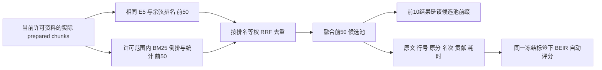

# 文档检索基线、混合检索与重排评测

2026-10-13 后续授权与上线：用户要求后续评审由Agent自行判定、无需请示。完整初审/争议理由/确定修正/明确排除仍留版本；CLI可显式复核Agent自己的pending并自主freeze，用户决定和旧冻结保护不变，不能宣称全人工gold。B作为可回退的网页默认查找已接入，A保留选择和旧API/CLI基线，C不接入。正式工具100条与保存B逐前十/分数一致，真实问答与隔离网页验证记录见 [实现说明](production-hybrid-search.md)；原冻结实验数字不因上线改变，也不根据已知test调参。下面用户逐条确认及正式仅A属于历史状态。

最新（2026-10-13）：100条标签获用户确认冻结，身份 `6c215fa76fc64742af175be84c9f8a06`（98自动+2用户）；复算已存A/B/C得到固定标签质量及失败清单。72可回答test上B的Recall10由A87.50%升至91.67%、nDCG5从.73702升至.80860；C Recall10同B，nDCG5降至.80037、完整证据3从B83.33%降至79.17%，8组合题完整证据3 B5/8/C0/8。详细表、分母、来源范围、失败原文及接入决定见 [扩展结果](../evals/retrieval/expanded-v1/audit.md#冻结后的质量结果与接入决定)。现阶段不默认升级生产：保留A，B优先作为下一步可选试用候选，C留在离线评测。后文待审/未冻结为当时状态，原20条实验保留。

2026-10-13 扩样实现：独立建立 [100条版本与初审](../evals/retrieval/expanded-v1/audit.md)，旧20条资料、标签及实验保留。`validate/prepare/baseline/hybrid --suite` 显式选版本；C继续只读保存的B池。100查询/40规则/10领域问题族，dev20/test80，12多证据、8无答案（含3权限负例），实际80片段。98条完整Agent初审自动采用，仅2条边界交用户核对；创建时未冻结，后续决定以数据库追加版本为准。新增失败清单自动附在冻结对照报告，未冻结不计算失败质量。该合成集扩大覆盖而非100独立样本或外部盲测；正式问答接入仍须质量及延迟依据。

2026-10-11，用户确认的方案。本文先记录设计；各批实际完成状态单独追加，不能把规划当成实现。

**最新审核规则已由用户调整为只审核不确定项，见文末。下文全量人工批准与20条全pending属于第一次交付快照。**

**当前能力（2026-10-12）**：A/B/C均已在独立评测实现，当前20条已由用户授权冻结；正式问答保持原向量检索和Agent按需工具。此前“C未实现/未冻结”是旧交付快照，最新C实现与结果见文末。

<a id="hybrid-b"></a>

## B：向量、BM25 与 RRF（2026-10-12 已实现）

本批完成独立可运行的 B 和 A/B 对照入口。没有修改生成模型、生产 KnowledgeTools、网页问答、聊天记忆或学习业务，没有新框架或依赖。用户处理四条争议只影响正式质量出分，不阻碍算法开发；当前没有自动批准这些争议或冻结真实标签。

### 数据流与核心代码



| 关键代码 | 为什么采用 | 改变了什么 |
| --- | --- | --- |
| `hybrid_retrieval.lexical_tokens` | 默认空格分词不足以处理中文；只保留整个代码词又会漏掉自然语言中的组成词 | NFKC/casefold匹配，中文Han单字及相邻双字，代码词完整形式与组成词；原文、行号和身份不改 |
| `hybrid_retrieval.BM25Index` | 小型本地试验可用标准库明确实现公式与范围，不需新数据库/服务 | Counter统计tf，倒排表保存词→片段序位/tf；当前许可片段内计算df/N/平均长度；同范围本轮复用 |
| `hybrid_retrieval.reciprocal_rank_fusion` | 余弦和BM25分数尺度不同，不能随意相加 | 按每路1起始排名计贡献，去重后取最多50；每条保留命中分支、原分、名次、贡献；拒绝越权/重复/原文不一致 |
| `quality_retrieval.run_hybrid`、`hybrid`命令 | 保留真正旧A，并复用现有实际预处理与向量缓存 | 通过原工具引导向量准备，逐题校验完整片段原文与范围；暖请求只编码一次，依次运行两路与融合，失败留记录 |
| `retrieval_comparison.compare_runs`、`compare`命令 | 比较与模型运行分开；冻结后不需要每次重跑编码或人工打分 | 校验同manifest/scope/原文，输出完整JSON及可读Markdown；未冻仅排名与耗时，冻结后同BEIR标签配对点差 |
| `retrieval_benchmark_metrics.py` | B已可评分但没有重排，不能误标重排成功率 | 保留原指标与失败分母，将无重排说明明确为A/B，来源仍分开记录 |
| `test_hybrid_retrieval.py` | 排名变化不等于算法接线正确，需要可解释的受控证据 | 18项新增测试验证已知BM25数字、中文/标识符、RRF数学、范围/原文、失败、不读标签、CLI与真实BEIR公式接线 |

### 公式、词策略与边界

BM25默认 `k1=1.2`、`b=0.75`；正IDF形式 `log(1+(N-df+0.5)/(df+0.5))`，避免高频词的负IDF和额外裁剪规则。TF饱和项为 `tf*(k1+1)/(tf+k1*(1-b+b*length/avg_length))`。N/df/长度只来自本题许可的实际片段，不能用整个知识库统计后才过滤结果。查询重复词不额外加权；零词命中返回空列表，不能用零分片段填满排名。空/纯标点片段可存，无法凭字面得到正分。

参数及IDF依据 [Lucene BM25Similarity说明](https://lucene.apache.org/core/9_12_1/core/org/apache/lucene/search/similarities/BM25Similarity.html)。这里是小型Python BM25实现，没有调用Lucene引擎，也不宣称与其分数逐值相同；词策略、特征长度及TF常数都明确记录。

`std::string_view`同时产生完整词和std/string/view，`user_id`产生完整词及user/id；C++/C#保留完整形式及c。`缓存过期`产生单字与缓存/存过/过期等邻接双字，不依赖语言词典、没有停用词/词干化。这是可复现的字面启发式，不是中文语言分词、同义词理解或条件校验；常见单字会产生噪声，效果需要固定标签验证。扩展后的全部特征计入BM25长度，策略版本保存在协议。文件名不做额外加权；原文绝不以这些匹配特征替换。

两路各最多50，按 `sum(1/(60+rank))` 等权融合，缺失一路贡献0，按固定manifest顺序打破同分，去重后最多50，前10为其前缀。[RRF原论文](https://plg.uwaterloo.ca/~gvcormac/cormacksigir09-rrf.pdf)提供排名融合公式。BM25无命中时保留向量顺序；分支执行失败则整个B查询失败，不静默退回A冒称成功。未来C必须复用此B池，不能扩池后把变化归因于重排。RRF分数和BM25分数都不是回答置信度。

默认值未按测试标签调优。命令允许显式 `--bm25-k1`、`--bm25-b`、`--rrf-k`，值写入Trace；调参应只使用开发集，然后固定参数测测试集。不能根据已看到的测试失败频繁改参数并仍称独立测试。

首次请求复用原工具Top10引导，会另跑候选排序并可能建BM25索引；此引导开销、向量计算/复用和BM25建索引单列，不混作暖查询。B暖时间含一次问题编码、向量50、BM25至多50、RRF至多50；A暖时间保持原工具Top10，额外50候选诊断另测。两者是各方案真实工作时间，不应把引导总时间说成严格同工作冷启动对比。当前BM25仅本轮按范围复用，无磁盘词索引；尚无稳定并发吞吐结论。

### 可运行命令

在应用目录使用现有venv，已有标注集不必重新准备：

```powershell
.venv\Scripts\python.exe quality_retrieval.py baseline --benchmark 55167722d52a4bcda09a25315f1f307d --repeats 3
.venv\Scripts\python.exe quality_retrieval.py hybrid --benchmark 55167722d52a4bcda09a25315f1f307d --repeats 3

# 将刚才输出的两个真实路径作为参数；compare不加载模型
.venv\Scripts\python.exe quality_retrieval.py compare --a-run <A运行JSON> --b-run <B运行JSON>

# 处理分歧并冻结后，沿用这两份Trace出分；不用再次编码
.venv\Scripts\python.exe quality_retrieval.py compare --a-run <A运行JSON> --b-run <B运行JSON> --freeze <冻结身份>
.venv\Scripts\python.exe quality_retrieval.py score --run <B运行JSON> --freeze <冻结身份>
.venv\Scripts\python.exe -m unittest test_hybrid_retrieval test_retrieval_benchmark test_knowledge_tools test_retrieval test_agent_loop test_web_app -q
```

尖括号是说明占位。每次创建新结果文件，保留此前运行和失败证据。compare同时写同名JSON/Markdown，JSON含逐查询排名/质量差、失败及标签来源，Markdown提供可读概览。尚未冻结时quality=null，不偷用当前可编辑标签打分；冻结后的差值仍是小样本配对点估计，暂没有配对区间或重排收益。无答案仍单列、缺失/失败继续留在固定质量分母。

### 本次实际验证

- 74项相关unittest通过，其中18项新增Hybrid专项；其余覆盖原检索、工具、Agent及网页。日志 `.data/evaluations/hybrid-final-targeted-tests.txt`。这是受控工程/数字测试；未重新跑全量，不用历史335项充作本次全量。
- 真实本地E5：同一8份资料/61片段/20查询、CPU8线程、各3次暖查询，A与B顺序运行，各20/20成功。A新运行 `retrieval-baseline-95bbdd9f6e6d4e548c800e66ad61b70f.json`；B `retrieval-hybrid-3ef6e9e5dd874ed69e03c6d0fcdfd2bb.json`。所有A排名与之前A一致；所有B向量分支与新A一致。BM25按两种许可范围分别建统计，未读标签。开发5/5、测试15/15的Top10排序变化只是结构观察，不代表20条都改善。
- 可读报告 `.data/evaluations/retrieval-comparison-c1d2b6166221458b9d048c3fccaada20.md`；JSON同名。本机测试集暖P50/P95为A15.87/17.55ms、B19.95/24.49ms，45个成功样本/组。仅这次观测且工作不同，不宣称稳定性能收益；未冻结质量仍null。更早与工程测试并行的A试跑保留，但交付比较采用测试结束后的顺序A/B。
- 正式学习/聊天数据库数量、完整性/外键、标注集/审核/冻结记录及三个根设计文档哈希不变；报告 `.data/evaluations/hybrid-preservation-final.json`。没有生成模型调用、模型下载、生产检索替换、提交/推送或委派。

接下来是C同池重排、扩展标注集、冻结后的正式三组对比和配对区间，再依据质量/延迟决定是否接入生产问答。检索提升不自动等于最终回答正确率提升。

交付最后HTTP核对：正式8767为200，当前16自动采用+4用户已确认，冻结0。四条争议已由用户处理；本轮前后审核数据库哈希一致，没有代替用户修改。之前4待处理是旧阶段状态。标签冻结后可直接用本节两份Trace计算质量，无须再调用E5。

## 目标与三组实验

以当前 KnowledgeTools.search_notes 的 E5 向量检索为 A 基线。B 为向量 + BM25 + RRF（Hybrid），C 为同一 Hybrid 候选池 + Rerank。只保留这三组，B–A 衡量混合检索收益，C–B 衡量重排收益，C–A 衡量整体变化。RRF 已是 Hybrid 的融合步骤，不再重复增加名为 Hybrid 的阶段。

冻结资料、实际 embedding 预处理后的片段、模型输入前缀/权重指纹、查询、资料权限和最终 K。先直接评测检索接口，不包含 Agent 是否搜索和如何改写查询；后续固定生成服务和输入预算验证端到端回答。网页仍按需要调用搜索，不增加固定检索 middleware。不读私人聊天或正式学习库，不自动加入计划、不自动提交或推送。

## 数据与人工审核

先完成约 20 条查询的标注试运行，再扩展约 100 条查询与 10–15 份可公开技术 Markdown。包含事实、同义/中英改写、代码/缩写/数字、同名及条件干扰、多证据、无答案和权限范围。开发/测试按问题族拆分，改写不跨分区；约 30/70 为后续目标，不是已完成规模。

Agent 负责资料、拟题、原文证据、初标与审核界面，并先审查。原始草案、初审发现、建议修正和用户决定分开保存：错误（证据不支持/范围错误/等级错误）、争议（有多种合理判断）、暂未发现问题（仍待用户审核）。展示原话邻近上下文、证据条件、相关程度与理由；不展示模型检索分数和系统身份以减少偏向。用户核对、修改或标待处理，争议记录原因；不只检查 A 的 Top-K，以免遗漏 B/C 找到的有效证据。

相关性 0=无关或条件错误，1=部分支持，2=充分支持。先标原文范围再映射实际检索片段，行号重叠只产生待审核建议，不能自动证明语义相关。多证据问题记录独立证据组及可替代的完整片段组合；重复片段不能冒充多个必要事实。

标注冻结包含资料/片段/问题/标签/审核版本及审核人。未审核或待处理样例不进入正式指标；正式测试子集的排除原因和数量公开，不允许悄悄挑选易题。改标签发布新冻结版本、注明原因，三组在新版本全部重跑，旧报告保留。冻结之后每次运行由固定标签自动评分，无须反复人工判断同一检索结果。新发现有效证据应修订标签而不是一律当作不相关。

## 指标约定

K=1/3/5/10，候选 M=20/50；实际不足 M 时报告候选数量，不填造条目。Recall@K 对所有相关片段（grade>0），Hit@K 表示至少一条有效片段，MRR@10 取第一条相关片段倒数，nDCG@5/@10 用固定分级相关性。标准指标交给 BEIR/pytrec_eval，记录其实际版本和公式约定，不能混入其他 nDCG 增益公式。

完整证据命中率@K 要求每个必要组至少一套完整替代组合在 Top-K 内。候选 Recall@M/Hit@M 观察重排可达上限。无答案查询单列，Recall/MRR/nDCG 不适用，检索器返回 Top-K 不意味着最终系统会拒答。

重排救回率@3：候选池有有效证据、重排前 Top-3 未命中的问题中，重排后命中的比例。退化率@3：重排前命中、重排后失去命中的比例。无从救回比例：候选池没有有效证据的可回答问题比例。以上为项目自定义诊断，保存分子/分母，分母为 0 为 null，不是 0。B/C 同池才能归因于排序。

性能保存 P50/P95 和分阶段耗时，区分冷启动、建索引、预热后查询；固定设备/线程、查询顺序和重复次数。索引缓存复用及模型指纹单列，不把估计 token 当实际账单。质量比较使用同查询配对差异，按问题族分组重采样计算区间；小试运行不宣称稳定统计结论。

## 自动计算与 Trace

BEIR 接收 qrels（审核相关性标签）与 results（实际模型分数），不会自己阅读资料决定真伪。复用其评测器，无须替换现有检索、引入新向量数据库或 Agent 框架。Windows/当前 Python 的依赖兼容先实际验证；不可用时明确报告，不能用自写实现冒称 BEIR。

实际实现保留原始余弦得分在 Trace；将已经保存的排序转换为严格递减的序位得分传给 BEIR。原因是 trec 的同分处理与生产 Python 稳定排序不同；该转换仅保证评测同一个真实排名，不重排候选、不制造命中。空结果/系统失败计零后保留在可回答查询分母中；报告记录实际 BEIR 与 pytrec_eval 版本。

每次运行保存代码/数据/模型/标签版本、允许范围、候选和实际原文、各阶段排名及分数、缓存命中、冷/热耗时、结果与错误。标签不进入查询、模型输入或召回决策。缺失查询按固定测试分母处理、系统失败单列，不能因为未返回结果从平均值中排除。标准指标与完整证据/救回/退化/延迟分别报告。

## 交付顺序和面试证据

1. 标注规则、试运行资料、初审与用户审核界面、冻结/版本、真实 A 基线和 BEIR 接线。未冻时只输出可检查的检索 Trace，不公布正式质量分数。
2. 同资料/片段基础上加 BM25 + RRF，评测 A/B；中文分词与代码词保留策略显式记录。
3. 本机试验并选定重排模型，保持 B 候选不变评测 C，记录截断/容量及延迟；不静默截掉证据。
4. 标注扩大、固定测试三组对比、配对区间、失败案例和受控端到端人工验证。检索提高不直接等于回答正确性提高。

简历优先采用冻结测试规模、Recall@10、nDCG@5、同硬件 P95 延迟，必要时补完整证据命中与重排救回/退化。用实际原值与百分点差，不预设提升目标，不把 smoke、未审核标签或单次成功作为质量保证。开发记录必须记实际问题、方法、理由和验证。

参考：[BEIR](https://github.com/beir-cellar/beir)、[评测接口](https://github.com/beir-cellar/beir/blob/main/beir/retrieval/evaluation.py)。

## 第一阶段已实现（2026-10-11）

已实现可运行的标注、审核、冻结、A 基线与 BEIR 接线；B/C 和三组正式对比仍未实现。这里的 BEIR 用作评测器，并未使用 BEIR 的现成公开数据集作为本项目的答案标签。

试运行集 `evals/retrieval/suite.json` 为 20 条查询、8 份公开合成 Markdown，按当前本地 E5 预处理得到 61 个检索片段；开发集 5 条、测试集 15 条。包含三条无答案/权限不足查询。初审记录见 [audit.md](../evals/retrieval/audit.md)：发现 cosine 的草案等级错误，以及 TTL 全局条件、视图的部分证据、索引限定、未指定负缓存 TTL 四处争议。草案、建议修正与用户审核记录分别保存，初审“未发现问题”不等于人工批准。

审核从主页面“检索标注审核”或 `/retrieval-review` 进入。选择 `retrieval-pilot-v2-audited`；v1 是准备过程中留下的旧草案快照，当前基线绑定 v2，不能把旧版本标签套到新基线。只展示许可原文与标签，不展示系统名及相似度。批准前必须核对全部许可片段；可以显式将其余未判断标为 0，但操作本身不证明已经阅读。多证据组可编辑：组之间全部必要，组内多组合可替代，同组合多个片段要一起出现。有争议/错误必须记录处理理由，排除必须给原因；批准/排除全部样例后，填审核人和版本说明冻结。

程序不会代替你给真实样例确认，也不会自动冻结初标。版本号防止多页面覆盖，审核记录追加保存，冻结快照不会随后续编辑变化。题目文字/许可范围/资料/分块变更需创建新的标注集；标签修正发布新的冻结版本，全部方案重评。

### 数据和核心代码：为什么这样划分

| 代码 / 数据 | 作用与行为变化 | 为什么采用 |
| --- | --- | --- |
| `retrieval_benchmark_data.py`、独立 review.sqlite3 | 保存不可变资料/模型/片段清单、逐查询追加修订、冻结快照；初标未知用 null | 标注与私人聊天、学习记录分离；未知不能自动当无关；指纹绑定真实检索单位 |
| `retrieval_review_app.py`、retrieval-review 页面与脚本 | 原文、草案、初审和用户决定可同时核对；版本冲突拒绝覆盖 | 人工审核是标签质量来源，检索分数隐藏，避免只看 A 排名前列造成偏差 |
| `quality_retrieval.py` | 本地真实 E5，沿用 KnowledgeTools.search_notes；同向量另取前 50 并核对前 10 | 留住真实旧实现作为 A，不为评测更改工具权限或生产上限 |
| `retrieval_benchmark_metrics.py` | BEIR 标准指标；自定义完整证据/候选指标；无答案分开、失败计零 | 将公式与标签审核解耦，冻结后自动复评；失败不消失，同分不改变生产排名 |
| manifest + labels + run Trace | 资料原文、版本、行号、实际片段、模型指纹、代码哈希、排名、缓存和冷/暖时间 | 能追溯差异来自数据、预处理、召回还是排序，不把单次演示当质量改善 |

默认评测数据：`.data/retrieval-benchmark/review.sqlite3`、独立 `vectors.sqlite3`；结果 `.data/evaluations/retrieval-baseline-*.json`。代码保存整批实际模型调用的结果，不利用相关性标签选择候选。加载、模型指纹计算、第一请求（含索引/复用）、暖查询编码和排序/开销分别记录；前 50 的额外排名时间单列，不混入原工具延迟。

### 运行

在应用目录，使用现有虚拟环境。首次安装可选评测依赖；实际验证 Python 3.13/Windows 下 BEIR 2.2.0 + pytrec-eval-terrier 0.5.10 可用，该包提供 pytrec_eval 模块。仅本地 E5，没有生成模型调用或隐式下载模型。

```powershell
.venv\Scripts\python.exe -m pip install -r requirements-eval.txt
.venv\Scripts\python.exe quality_retrieval.py validate
.venv\Scripts\python.exe quality_retrieval.py prepare
.venv\Scripts\python.exe -m uvicorn web_app:app --host 127.0.0.1 --port 8767
```

prepare 输出标注集身份与审核地址；同资料/模型/分块重复执行复用同一集。使用该身份运行基线：

```powershell
.venv\Scripts\python.exe quality_retrieval.py baseline --benchmark <prepare输出的身份> --repeats 3
```

未冻结输出质量为 null，只保存实际检索 Trace。用户审核、冻结之后：

```powershell
# 不重新加载模型，给已经保存的真实运行自动评分
.venv\Scripts\python.exe quality_retrieval.py score --run <基线JSON路径> --freeze <冻结身份>
# 或重新跑查询，绑定同一冻结版本
.venv\Scripts\python.exe quality_retrieval.py baseline --benchmark <标注集身份> --freeze <冻结身份>
# 备份原文、标签，并导出标准 corpus.jsonl / queries.jsonl / qrels/*.tsv
.venv\Scripts\python.exe quality_retrieval.py export --freeze <冻结身份>
.venv\Scripts\python.exe -m unittest test_retrieval_benchmark -q
```

尖括号是占位说明，实际执行时替换成输出的值。每次导出/评分使用新文件名，不覆盖原证据。标准 BEIR 导出只含已批准的可回答查询；无答案、排除原因、证据组及完整许可范围保留在 labels/manifest。外部 BEIR 检索器必须按查询的 scope 限制 corpus，不能用通用全库搜索的结果冒充本项目同权限实验。独立审核服务可用 `retrieval_review_app:app` 在空闲端口运行，不必初始化正式学习库。

### 当前验证与边界

本机真实 E5 已完成 20 条查询、每条 3 次暖查询，检索失败 0，前十全部与生产工具一致；这是“检索可运行”的证据，尚未形成用户审核后的质量指标。真实 BEIR 数字例验证与其他工程测试使用可控合成标签，不是用户批准的 gold。独立合成库的页面批准/冻结/刷新验证不影响真实试运行集，真实集 20 条均待审核、冻结数 0。

当前可自动计算 Recall/Hit@1/3/5/10、MRR@10、nDCG@5/10、完整证据命中、候选 Recall/Hit 与无从救回@20/50、P50/P95，分开发/测试及测试类别。救回/退化的事件定义已有受控检查，A 报告为不适用；真实 B/C 未实现，不能声称已有重排成功率或性能提升。扩展到约 100 条、中文 BM25 词策略、真实重排模型、配对区间与端到端生成拒答/引用评测属于接下来步骤。本页面没有对标注人身份做账号认证，只适合当前本机服务；不能作为多用户托管审核产品。
收尾验证：335 项全量 unittest 通过（378.555 秒）；新增导出/缺失查询均值检查和保存回执修正后，30 项检索及网页专项再次通过，其中22项检索专项。85 个应用根目录 Python 文件语法解析、新脚本语法及依赖检查通过。全量日志 `.data/evaluations/retrieval-full-tests.txt`，专项日志 `retrieval-final-targeted-tests.txt`。正式 8767 已加载最新应用，重启后审核资料/初审恢复；本轮独立8770验收进程已关闭。正式学习/聊天表数量不变、完整性 ok、外键错误0，根目录三个设计文档哈希不变，元数据 `retrieval-preservation-final.json`；未提交或推送。

## 只审核 Agent 不确定的样例（2026-10-11 用户调整）

用户认为逐条、逐片段确认负担过大，明确授权：只有 Agent 不确定时才标出来交给用户。当前改为 **完整 Agent 初审 → 确定项自动采用 / 不确定项留给用户 → 冻结混合来源标注 → BEIR自动评分**。不使用数字“置信度阈值”，也不把“有checked标志”当作完整初审。

本轮再次逐份阅读8份原文，逐题检查全部许可范围、证据条件和实际分块，记录完整逐片段等级到 `evals/retrieval/agent-review.json`。其中16条可以确定，自动采用；4条存在合理分歧（ttl-global、view、index、missing-negative-ttl），留给用户。cosine草案的缓存命中错误已确定，直接修正为0，无须再请用户确认确定错误。还修正实际合并片段包含原子性/隔离性两事实的等级、允许同一完整片段覆盖多个独立事实、补充正常TTL/token/缺口的部分证据。原草案不覆盖，这次完整初审另存。

页面默认仅显示待决定项，并展示涉及分歧的原文与建议理由。完整资料、全部样例和证据编辑是可选展开；无需逐一勾选其余片段。点击“采用建议”即可记录用户决定与采用理由并进入下一项；修改可回答性/等级/证据组合要说明变化理由；排除仍需原因。冻结只需确认剩余分歧已处理，无需给16条自动项补做人类批准。

数据增加 `auto_accepted` 状态、`origin=agent/user` 和 `audit_id`；初审需提供每个许可片段的明确等级、完整资料哈希和版本，null仍不能当0。初审短事务仅初始化没有任何审核修订的查询，重复导入不会重复插入，用户草稿/决定/冻结一律保留。用户接口不接受auto状态，保存来源由代码改为user，初审指针继承真实旧记录，不能由客户端伪造。初审全文按哈希存储，冻结一并携带，后续评分核对自动采用标签与该完整初审一致。

BEIR和标准导出纳入同一冻结版本的自动采用与用户确认项；报告增加 `label_provenance`，分别计数自动、用户、排除。**这属于Agent初审、用户处理分歧的标签集，不能在简历上写成20条均经人工审核或专家gold。** 模型来源与评测来源可追溯；无答案仍单列，未解决分歧仍阻止冻结，不会为降低审核工作量默默排掉难题。

```powershell
# 已有v2集可导入完整初审；当前集已执行，重复不会覆盖已有决定
.venv\Scripts\python.exe quality_retrieval.py adopt-audit --benchmark 55167722d52a4bcda09a25315f1f307d --audit evals/retrieval/agent-review.json
```

prepare会在完整初审指纹与当前manifest完全一致时复用这份初审；变化时保留未判断，不凭旧标签自动通过，需要Agent重新检查资料。资料/分块/模型/问题版本未变，所以此前真实A检索Trace仍可在新冻结后评分，无须再次编码。B/C尚未实现，本次只降低标注流程的人类负担。

### 2026-10-12 收尾验证

- 38项相关 unittest 通过（30项检索、8项网页），日志 `.data/evaluations/retrieval-exceptions-targeted-tests.txt`。新增 prepare 回归检查：仅指纹匹配才自动复用初审；重复 prepare 保留用户已确认记录；版本不符仍为未判断。导出/旧Trace评分测试采用混合来源标签，检查 BEIR qrels 和来源计数。此处使用受控嵌入/标签测试，不代表真实模型语义改善；此前335项全量是历史运行，本次未重跑全量。
- 独立合成验收库 `.data/evaluations/retrieval-exceptions-qa-8092cced/` 初始2待处理+1自动，点击采用后自动转下一条，两条处理完可冻结，刷新恢复1自动+2用户确认及冻结记录，浏览器脚本错误0。截图 `retrieval-exceptions-qa.png`；没有替用户批准真实四条争议。
- 正式8767原本无监听，已用项目现有虚拟环境恢复；实际页面为16自动+4待处理、冻结0，截图 `retrieval-exceptions-main.png`。启动前后正式学习/聊天表数量一致、两个库完整性ok/外键错误0，三个根设计文档哈希不变，元数据 `retrieval-exceptions-preservation.json`。
- JavaScript语法与Git空白检查通过。独立8770验收服务只按核对的本轮进程身份停止，正式8767保留。没有提交、推送、切换模型或委派；B/C及正式质量对比仍待后续。

<a id="rerank-c"></a>

## C：固定 B 池重排及20条冻结（2026-10-12）

用户明确要求“这二十条就冻结，后续再扩张到差不多一百条，继续实现rerank”。已将当前20条追加为不可变冻结 `7283e52f0de54e80897be850bd37bb01`，指纹 `496834d8023f835c9ac9d2c4c3ebced8cb55da6d2e06222b32c9a3b343b8c558`。16条自动初审与4条用户确认分别保留；旧审核修订/原文/运行均不覆盖。冻结是用户此次授权，非开发者自行批准20条，不能称为全部人工gold。

### 为什么选这个模型与运行方式

采用 [cross-encoder/mmarco-mMiniLMv2-L12-H384-v1](https://huggingface.co/cross-encoder/mmarco-mMiniLMv2-L12-H384-v1)，固定commit `1427fd652930e4ba29e8149678df786c240d8825`。模型卡说明它是基于多语言MiniLMv2、在翻译的mMARCO数据上训练的Cross-Encoder。当前目标是验证中文/英文技术资料的本地同池重排，选择一个现有Transformers可加载的较小基线，没有逐个模型看测试结果后择优宣称独立测试。领域效果仍依赖本项目标签，不能由模型卡直接推导。

Bi-Encoder先分别编码问题/文档再比向量，文档向量可缓存；Cross-Encoder将每个问题与一个候选原文一起编码，输出排序logit。因此只对B已召回的有限候选执行，不扩展候选、不生成答案，也不请求生成模型。使用现有Transformers/PyTorch，未新增依赖、服务、框架或向量数据库。

只在显式 `download-reranker` 命令下载固定权重和配置，保存在 `.models/rerank--cross-encoder--mmarco-mMiniLMv2-L12-H384-v1/<commit>/`。普通rerank只本地加载；safetensors、trust_remote_code=False、无认证token，CPU/float32/eval/inference_mode。加载实际权重和tokenizer后计算指纹并记录运行库/参数，不只记模型名称。首次Hub缓存路径在Windows受限临时目录中失败，改local_dir普通继承权限目录，不修改系统权限或现有E5缓存。

### 一条请求如何重排

1. 读取B完整Trace和其绑定的manifest，校验同资料/实际分块/E5/问题版本、逐查询scope、身份、顺序及原文行范围。B读取过的候选就是本次全部输入；与冻结标签校验版本，但标签不进入模型。
2. 从已保存的B前50取原池，将完整当前问题与每个原文配对。B失败/缺失时保留C失败，不新检索补池。
3. 使用该重排模型的实际tokenizer计算整个pair，包含特殊token；按请求上限/tokenizer容量/模型位置容量取最小值。实际模型tokenizer512、位置容量514扣除RoBERTa保留位置后512。批张量也再次检查，明确 `truncation=False`。
4. 超过pair容量的原文按连续字符窗口覆盖全部内容，每窗重复完整问题。保存0起始左闭右开字符范围、真实原文、包含两端的行范围、token数及原始logit；每片段取最大窗口logit，同分保持B原顺序。最大窗口聚合是排序启发式，不能保证跨窗条件理解完整。
5. 原问题不能安全容纳、单片段超过16窗或本题超过1024对时明确失败，保存B原池和失败原因，不剪问题/尾文、不删候选。即使过长分窗，C最终排序对象仍是原B片段，不能把窗口冒充新候选。
6. 原池快照及其digest存入C，最终同池校验确保每个候选恰好出现一次、原文不改、窗口连续完整、聚合得分一致。冻结后BEIR按C排序计算指标；后续修改当前标签不会改变此冻结。

### 核心代码、为什么修改与行为变化

| 代码 | 为什么 | 完成的行为 |
| --- | --- | --- |
| `rerank_model.py` | 重排需要自己的tokenizer、容量与真实模型身份，不能复用E5 tokenizer或生成模型容量 | 固定下载/离线加载、权重与tokenizer指纹、实际pair计数、无截断批推理、raw logits |
| `rerank_retrieval.py` | C与B不同候选池就无法把收益归因于重排 | 校验B全文Trace、完整问题/原文窗口、同池排序、失败保留、稳定同分、禁止新搜索 |
| `quality_retrieval.py` | 用户需要可重复运行与单独评分，C不需再加载E5 | download-reranker/rerank命令、--c-run对照、模型与窗口/分阶段时间/父B版本记录 |
| `retrieval_benchmark_metrics.py` | C升排名不能变成“召回更多”，救回率不能把无分母写成0 | C候选@20/@50按重排前B池走BEIR；救回/退化事件及分子分母；失败仍在分母 |
| `retrieval_comparison.py` | 三组须同冻结、同原文、C绑定精确B运行；纯重排时间不等于整体响应时间 | A/B/C同标签表、B−A/C−B/C−A配对点差、同池诊断、纯C耗时与明确估计的B+C |
| `test_rerank_retrieval.py` | 真实一遍成功不能证明长输入、损坏池、失败及数学分母正确 | 20项新增受控工程/真实BEIR数字测试，包含候选第25名升首位仍不改变B候选@20的检查 |

### 运行与复用

```powershell
# 只有首次明确下载；普通rerank不会联网取模型
.venv\Scripts\python.exe quality_retrieval.py download-reranker

# C复用已有B池，不运行新的E5召回
.venv\Scripts\python.exe quality_retrieval.py rerank --b-run .data/evaluations/retrieval-hybrid-3ef6e9e5dd874ed69e03c6d0fcdfd2bb.json --freeze 7283e52f0de54e80897be850bd37bb01 --repeats 3

# 将C输出身份作为--c-run参数；可无需模型重新评分/对照
.venv\Scripts\python.exe quality_retrieval.py compare --a-run .data/evaluations/retrieval-baseline-95bbdd9f6e6d4e548c800e66ad61b70f.json --b-run .data/evaluations/retrieval-hybrid-3ef6e9e5dd874ed69e03c6d0fcdfd2bb.json --c-run <C运行JSON> --freeze 7283e52f0de54e80897be850bd37bb01
.venv\Scripts\python.exe quality_retrieval.py score --run <C运行JSON> --freeze 7283e52f0de54e80897be850bd37bb01
.venv\Scripts\python.exe quality_retrieval.py export --freeze 7283e52f0de54e80897be850bd37bb01
```

参数可显式设max-tokens、batch-size、max-windows、max-pairs，记录值及实际有效容量；调参/模型选择不能根据最终测试标签反复优化。报告给候选数量和无答案单列。C测量的是已有B池上的纯重排时间（包含分窗/计数与推理），B旧暖时间+C暖时间之和仅为估计，不能称为实测端到端。没有将调用失败当零耗时降低P95。

### 后续约100条扩样（计划，尚未实施）

保留当前20条冻结与三组结果，扩样创建新suite/manifest、重新初审/争议处理并冻结新版本。问题族不跨开发/测试；覆盖语义改写、精确代码词、参数/条件、同名不同义、多证据、权限不足、无答案及候选确实缺失的难例。保持只请求用户处理初审不确定项；扩大样本数本身不等于标签可靠或覆盖完整。

当前B的Top3已命中全部12条可回答测试题，救回eligible=0，率应为null；不能用0/0宣传100%救回。约100条应覆盖真实不同难度的任务，而非仅复制这批容易题。以后在新固定测试版本上三组重跑，报告配对区间/失败案例，再决定生产接入；不以小试运行的满分推断完整知识库能力。

### 本次实际结果与限制

94项相关测试通过，新增20项C专项；日志 `.data/evaluations/rerank-final-targeted-tests.txt`。涵盖已知分数与BEIR分母、完整问题、全部原文分窗及字符/行范围、最大窗口/总pair限制、稳定同分、越权/损坏/变化池、非有限分数、B失败继承、缺失项、标签不入模型、离线安全加载、真实容量/张量无截断、raw logits及CLI不加载E5。长原文分窗是受控工程验证，不能称为真实长文语义评测。未重跑全部历史测试，不以此前335项全量作为本次数量。

真实本地C固定版本CPU8线程/float32、每查询3次暖重复，20/20成功、958候选/958窗口、分窗候选0。实际tokenizer/位置容量均512，不存在隐式截断。早期成功试跑 `retrieval-rerank-68046aa3a1884195a8912046418f3141.json` 保留；最终检查完容量、适配器及工程测试后重跑 `retrieval-rerank-c5054326d82e462191809e6856fa79b6.json`，没有根据测试语义成绩修改模型或参数。对应完整三组报告为 `.data/evaluations/retrieval-comparison-03b5f69630424104b63e6d36531ad512.json/.md`；输入A/B沿用本节固定运行，父B完整快照/digest在C中，导出qrels和原标签保留。

全部20查询包含开发5条、测试15条，测试中3条无答案单列；以下是同一冻结标签下**12条可回答测试查询**的均值，均为BEIR/trec约定：

| 指标 | A原向量 | B混合 | C同池重排 |
| --- | ---: | ---: | ---: |
| Recall@10 | 0.94445 | 0.97222 | 1.00000 |
| nDCG@5 | 0.90004 | 0.95383 | 0.96064 |
| MRR@10 | 0.91667 | 1.00000 | 1.00000 |
| 完整证据命中@3 | 1.00000 | 1.00000 | 1.00000 |
| 候选召回@50 | 1.00000 | 1.00000 | 1.00000 |

C相对B的Recall@10增加2.78个百分点、nDCG@5增加约0.00681；相对A分别增加5.56个百分点和约0.06061。并不是所有指标都提升：MRR/完整证据@3已达试运行上限，单题view的nDCG@5下降0.04182。具体B将cpp.md L9–11（grade1）放第二，C把cache-read.md L33–35（grade0）插入第二，原grade1降第三。该观察定位到排序/条件相关性误差，但不能凭模型分数推断内部成因；没有为了结果好看改gold或换模型。

救回@3：0/0，率=null；退化@3：0/12，率=0；无从救回：0/12。这里是“至少一条相关证据命中”的特定事件，不表示所有问题/指标无退化，view例子明确证明其区别。冻结来源为16 Agent自动初审+4用户确认，没有全部专家人工gold，不作稳定统计结论或最终生成答案正确率声明。

本次测试分区45个成功暖样本：A P50/P95=15.87/17.55ms，B=19.95/24.49ms，C**纯重排**=1116.72/1250.84ms。B旧时间与C相加的整体估计P50/P95=1134.78/1272.07ms，非实测端到端；初始加载/指纹和首请求分开。三组环境元数据相同，但A/B旧运行与C不同时间点，故仅描述此次质量/成本，不声称严格稳定延迟收益或吞吐优势。

正式HTTP接口已能读取冻结身份；`rerank-preservation-final.json` 核对学习/聊天表与根三个设计文档保持、相关标签/初审表哈希未变，仅新增用户授权冻结，两个正式库完整性ok/外键0。正式生成服务、问答按需工具、引用权限、练习与FSRS均未修改；没有提交、推送、委派或新任务。
